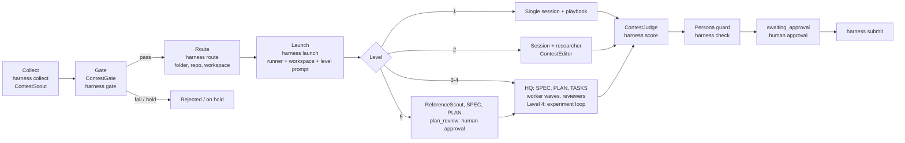
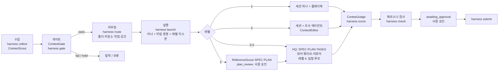

**English** · [한국어](#한국어)

# Autocontest-Harness

Autocontest-Harness finds open contests, checks whether you are eligible, and runs a coding agent on each one until the entry is ready for you to submit.

It is a single Rust binary (`harness`) plus a set of agent prompts. The binary keeps a local registry of contests, moves each one through a fixed set of states, and starts agent sessions. The agents read the official announcements, plan the work, and produce the deliverables. Sessions can run on five agent harnesses (omp, pi, Claude Code, Codex, dsh) inside four kinds of workspace (Orca, tmux, a background process, the current terminal). The harness never submits an entry for you.

[](Cargo.toml)
[](LICENSE)

Repository: https://github.com/FMsongX2/Autocontest-Harness. The interface contract (commands, states, file formats, backends) lives in [docs/CONTRACT.md](docs/CONTRACT.md).

## Why

Korean contest listings are spread across many aggregator sites, and each one formats things differently. The same contest often shows up on several of them. Before any real work starts, you have to read the official notice, check eligibility (student-only, region, team rules, AI policy, fees), and decide how much effort the contest is worth. A short-form video and a month-long product hackathon need very different setups.

The harness automates these steps: collecting, deduplicating, gating, sizing, scheduling, and launching. People still make the decisions that matter: which creative concept to pursue, whether a production-scale plan is sound, and whether to submit.

## Features

- Collectors for 11 listing sites, with dedupe across sites. The first run on 2026-10-15 saw 375 listings, merged 75 cross-site duplicates automatically, and added 246 new contests.
- A web-search agent (`ContestScout`) that looks for contests the aggregators do not list: government and public-agency sites, academic societies, corporate contests, and overseas organizations.
- An agent gate (`ContestGate`) that reads the official notice. It records the eligibility, deliverables, scoring criteria, submission method, type, level, and priority in a structured `gate.json`.
- Five execution levels. Each level sets the agent team for a contest, from a single session up to a reviewed, production-grade build.
- Admission control. New sessions start only when the global limit, the per-level limit, and the memory budget all allow it, and when the token-usage pace of your model provider leaves room.
- Pluggable backends. Pick the agent harness (`runner`) and where sessions run (`workspace`) in the config.
- A main interface session (`harness chat`) from which you watch and direct every contest, with an optional persona that never reaches contest sessions.
- A persona guard that blocks the move to submission approval while a contest folder or its commit messages contain persona traces.
- Human-in-the-loop gates for creative concepts, Level 5 plans, and final submission.
- A score loop from Level 2 up: the contest's scoring criteria become a rubric, `ContestJudge` scores the plan before anything is built and the deliverable afterward, and every score is recorded with `harness score`. Submission approval waits until the final score reaches the target.
- A submission ledger (`harness submitted`) that remembers every contest you have already entered, including ones entered outside the harness, so the same contest is never gated, routed, or submitted twice.
- A local user profile you write yourself (`data/profile.md`, read with `harness profile`) with your eligibility facts and the personal details forms ask for. The gate sees only the eligibility section; personal details are read only at an approved submission step.
- A board (`BOARD.md`) that lists every contest by state.

## How it works



Registry states: `discovered → gate_pass | rejected | hold → routed → running → (plan_review →) running → awaiting_approval → submitted → closed`. Most states can also move to `skipped` or `duplicate`. [docs/CONTRACT.md](docs/CONTRACT.md) section 4 has the full transition table. Only the CLI writes to the registry. Agents change state by calling `harness`.

### Architecture

- **Rust core** (`src/`). One binary handles the registry, collectors, dedupe, gate records, routing, capacity, the board, the persona guard, and session launch. It has no runtime dependencies beyond the tools it calls (`git`, `gh`, the runner and workspace CLIs).
- **Runners** (`src/runners/`): `omp`, `pi`, `claude`, `codex`, `dsh`. Each runner knows its interactive command, its one-shot command, whether it has subagents, how to append a system prompt, and how to install the harness agents and skill.
- **Workspaces** (`src/workspaces/`): `orca`, `tmux`, `headless`, `terminal`. Each workspace knows how to create a per-contest workspace, open a session in it, and read the tail of its screen or log.
- **Extension package** for omp and pi (`package.json`, `extensions/contest-harness.ts`, `commands/`, `skills/`, `agents/`). It adds `/contest` commands to either agent, and a `contest_agent` subagent tool to pi.
- **Install-time conversion** for the other runners. `harness install` rewrites the omp agent files as Claude Code subagents or Codex custom agents and links the skill where those tools look for it.

## Quickstart

Prerequisites:

- macOS. Memory checks use `vm_stat` and the macOS memory-pressure level, and scheduled runs use launchd.
- Rust 1.89 or later (`cargo`). There are no prebuilt binaries.
- `git` and the GitHub CLI `gh`, signed in to an account that can create private repositories in your `github_org` (by default, your own account).
- At least one runner CLI on `PATH`: [omp](https://github.com/can1357/oh-my-pi) (the default), pi, Claude Code (`claude`), Codex (`codex`), or dsh.
- A workspace backend for contest sessions: [Orca](https://github.com/stablyai/orca) with its `orca` CLI (the default), or `tmux`. `headless` needs nothing extra.

Clone the harness and build it. Any location works; the examples use `~/contests/Contest-Harness`. The binary records the checkout it was built from and reads `data/`, prompts, agents, and the skill from there. Set `HARNESS_HOME` to use a different checkout.

```bash
mkdir -p ~/contests
git clone https://github.com/FMsongX2/Autocontest-Harness.git ~/contests/Contest-Harness
cd ~/contests/Contest-Harness
cargo install --path . --root ~/.local     # installs ~/.local/bin/harness; ~/.local/bin must be on PATH
```

Create your settings from the committed example and edit them:

```bash
cp data/config.example.json data/config.json   # personal settings; git-ignored
$EDITOR data/config.json                        # contests_root, github_org, runner, workspace; see Configuration
```

Then write your user profile (eligibility facts and the details submission forms ask for). It is a Markdown file you fill in yourself:

```bash
cp data/profile.example.md data/profile.md   # git-ignored; fill it in by hand
chmod 600 data/profile.md
harness profile path                         # path and whether it exists
```

Optionally copy `data/local-rules.example.md` to `data/local-rules.md` and write rules for your own environment there (see [Local rules](#local-rules)).

With the default `orca` workspace, contest workspaces are created as worktrees of `orca_repo_path` (default: `contests_root`, which defaults to `~/contests`). That directory must be a git repository added to Orca. Set `"workspace": "tmux"` or `"headless"` to run without Orca.

Install the agents, skill, and extension for your runner, collect listings, and open the main session:

```bash
harness install            # the configured runner; or --runner pi --runner claude, or --all
harness collect            # all sources; or: harness collect --source dacon --pages 1
harness chat               # main interface session at the repository root, in this terminal
```

The main session summarizes the board and capacity and asks you what to do. You can also drive each step yourself:

```bash
harness list --state discovered
# Gate: ask the main session (or any session of your runner) to run ContestGate on an id,
# or use the /contest-gate <id> prompt template in omp or pi. The agent writes gate.json
# and records it with: harness gate <id> --file gate.json
harness show wevity-111674
harness route wevity-111674            # folder <contests_root>/<Folder>, private repo, workspace, CONTEST.md
harness capacity                       # free slots per level, memory budget, recommended workers
harness launch wevity-111674 --dry-run # print the command and prompt without starting it
harness launch wevity-111674
harness peek wevity-111674             # tail of the session's screen or log
```

Use `--no-repo` or `--no-workspace` on `route` to skip the GitHub repository or the workspace. To launch everything the limits allow, use `harness tick --auto-launch`. It routes and launches `gate_pass` and `routed` contests in priority order. Contests that do not fit are reported as `waiting`.

## Runners and workspaces

`runner` picks the agent harness for contest sessions, scheduled runs, and the main session. `workspace` picks where contest sessions run. Interactive workspaces use the runner's interactive command. `headless` has no TTY, so it uses the runner's one-shot command.

<p>Table 1. Runners</p>

| Runner | Subagents | System prompt (main session) | One-shot command | Model selection | `harness install` |
|---|---|---|---|---|---|
| `omp` | Yes (`task` tool) | `--append-system-prompt` | `omp -p` | `preset_by_level` (per-run `--config` overlay) or `model_by_level` | `omp plugin link <repo>`; removes symlinks left by the old per-file install |
| `pi` | No. The extension's `contest_agent` tool runs one agent in a separate `pi` process | `--append-system-prompt` | `pi -p` | `model_by_level` | `pi install <repo>` |
| `claude` | Yes (converted subagents) | `--append-system-prompt-file` | `claude -p` | `model_by_level` | Agents converted to `~/.claude/agents/contest-harness/`, skill linked to `~/.claude/skills/contest-harness` |
| `codex` | Yes (converted custom agents) | `-c developer_instructions=...` | `codex exec` | `model_by_level` | Agents converted to `~/.codex/agents/contest-<Name>.toml`, skill linked to `~/.agents/skills/contest-harness` |
| `dsh` | No | No flag; prepended to the first message | `dsh --profile headless` | Not supported | Skill linked to `~/.agents/skills/contest-harness` |

On runners without subagents, `harness launch` appends a section to the launch prompt telling the session to run subagent steps one after another in the same session. Contest sessions never get an appended system prompt, so they never get the persona. `runner_args` adds fixed arguments per runner; the defaults are `--permission-mode acceptEdits` for `claude` and `--sandbox workspace-write` for `codex`.

<p>Table 2. Workspaces</p>

| Workspace | Interactive | What `route` creates | How `launch` starts the session | `peek` |
|---|---|---|---|---|
| `orca` | Yes | A worktree of `orca_repo_path` named after the contest | `orca terminal create` in that worktree, running `cd <folder> && <command>` | `orca terminal read` |
| `tmux` | Yes | Nothing | A window per contest in the tmux session `contest-harness`, running `cd <folder> && <command>` | `tmux capture-pane` |
| `headless` | No | Nothing | A detached background process running the one-shot command, logging to `<folder>/.harness/session.log` | Tail of the log |
| `terminal` | Yes | Nothing | Replaces the current process. Default for `harness chat`; `launch` refuses it | Not available |

The registry records where each session runs in the entry's `session` field: `{workspace, workspace_id, runner, handle}`.

## omp and pi extension

The repository is an extension package for both omp and pi. `harness install --runner omp` runs `omp plugin link <repo>`, and `harness install --runner pi` runs `pi install <repo>`. Both load the same extension file and the repository's skill, agents, and prompt templates.

<p>Table 3. Commands and tools registered by the extension</p>

| Name | Kind | What it does |
|---|---|---|
| `/contest` | Command | Board summary: counts by state, contests awaiting submission approval or plan review, hold questions, in-progress deadlines within 7 days, and capacity |
| `/contest <id>` | Command | Summary of one contest |
| `/contest-chat` | Command | How to open the main interface session, and the binary version |
| `/contest-gate <id>` | Prompt template (`commands/contest-gate.md`) | Runs `ContestGate` on one registry entry and summarizes the result |
| `contest_agent` | Tool, pi only | Runs `agents/<agent>.md` as a one-shot `pi` subprocess and returns its output. Not registered inside that subprocess, so agents cannot recurse |

The extension gets all data from `harness ... --json`. It looks for the binary at `HARNESS_BIN`, then `target/release/harness` and `target/debug/harness` in the checkout, then `harness` on `PATH`. It does not add the persona.

## Main interface and persona

`harness chat [--runner R] [--workspace terminal|orca|tmux]` opens the main session at the repository root. It writes `data/main-system.md` from the persona (when enabled) and [harness/prompts/main.md](harness/prompts/main.md), passes it to the runner as an appended system prompt, and starts with `data/main-start.md`: summarize the board and capacity, then ask you any pending questions in one batch. From there you ask in plain language and the session runs `harness` commands and agents for you. The main session does not write or edit contest deliverables; contest sessions started by `harness launch` do that.

The operator persona is an optional feature, off by default. It sets the conversational tone of the main session only. To use one, write it in `data/persona.md` (git-ignored; start from the committed `data/persona.example.md`), point `persona.file` at it if you keep it elsewhere, set `persona.call_user` to how it should address you, and turn it on:

```json
"persona": {"enabled": true, "call_user": "<form of address>", "guard_terms": ["<persona name>"]}
```

The persona goes only into the main session (`harness chat`). It is never added to contest sessions, subagents, scheduled runs, or the extension, and no setting turns it on there.

## Persona guard

Contest deliverables (code, comments, reports, slides, forms) and commit messages must not contain the persona: its name, the form of address, casual speech, or laughter notation. List those markers in `persona.guard_terms`. The harness enforces this:

- `harness check <id>` scans every UTF-8 text file in the contest folder and every commit message for `persona.guard_terms` plus `persona.call_user`, and exits with code 4 if it finds any. Korean syllable terms count only at the start of a word, so a term `도담` matches in `도담이` but not inside `새도담길`.
- It skips `.git`, `.harness`, `node_modules`, `target`, virtualenvs and caches, `dist`, `build`, `data`, `dataset(s)`, `raw`, `cache`, files over 4 MB, and binary files.
- `harness transition <id> awaiting_approval` refuses while the scan finds anything. If a match is intentional, such as a character's line in a story, pass `--persona-ok "<reason>"`; the reason and the match count are written to the history note.
- Agents, skills, templates, and launch prompts refer to you as "the user" (사용자), because these texts are copied into contest sessions.

The guard checks `guard_terms` and `call_user` whether or not the persona is enabled.

## Levels

`ContestGate` assigns each contest one level. If a contest falls between two levels, it gets the higher one.

<p>Table 4. Execution levels</p>

| Level | Size | Example contests | Execution |
|---|---|---|---|
| 1 | One deliverable within a day | Short-form video, poster, image, slogan, short essay, simple application form | Single agent: one session follows the type playbook. `ContestJudge` runs once at the end as the submission gate |
| 2 | One document that needs research | Idea proposal, short plan | Main session plus one researcher (`DomainResearcher`, or `ArticleResearcher` for academic sources). If the notice has scoring criteria (`gate.criteria`), `ContestEditor` checks and edits style, tone, and sentences against them. Then `ContestJudge` |
| 3 | A deliverable that takes several sessions | Policy-idea paper, paper backed by a simple experiment, simple policy-related service, a project the size of an illegal-ad detection service | HQ (the session follows the `ContestHQ` procedure to write SPEC, PLAN, TASKS) + `DomainResearcher` (plus `ArticleResearcher` when needed) + subagent worker waves + reviewers (`ContestJudge` at every checkpoint, `ContestEditor` for writing, omp's built-in `reviewer` for code) |
| 4 | Large project with an experiment or feedback loop | Multi-day server-experiment research competitions, or DACON-style submit → score → analyze → improve loops | Level 3 setup + experiment loop (every experiment and submission is logged in `LEDGER.md`), remote compute (a GPU server or a cloud GPU that is deleted as soon as the job ends), and Orca orchestration workers for long tasks |
| 5 | A month or more, real production quality | Products that need real-world quality, such as the Meta AI hackathon | 1) `ReferenceScout` finds and analyzes existing production references on the web. 2) SPEC and PLAN are written after reviewing them. 3) The session moves the contest to `plan_review`, asks for human review, and stops. 4) After approval: HQ + `DomainResearcher` + worker waves + `UxReviewer` + omp's built-in `security-reviewer` + optimization (only as much as UX needs) + `ContestJudge` |

Signals the gate applies:

- A multi-day server or GPU experiment, or a repeated-submission feedback loop, means at least Level 4.
- Real production quality, or a timeline of a month or more, means Level 5.
- Implementing an experiment or a service means at least Level 3.
- A document that needs research evidence means at least Level 2.

The gate records its reasoning in `reasons`.

Priority includes a schedule-slack score that uses a minimum number of days left before the deadline: 2 days for Level 1, 5 for Level 2, 10 for Level 3, 14 for Level 4, and 30 for Level 5. A contest gets 20 points at twice the minimum or more, 10 points at the minimum or more, and 0 below it.

Contest types are `video, image, music, idea, paper, report, model, data, software, essay, design, research, other`. `model` covers leaderboard contests with repeated submissions. `research` covers contests where you run experiments and report the results with few or no leaderboard submissions. Each type maps to a playbook under `skills/contest-harness/playbooks/`.

## Score loop

From Level 2 up, work is driven by a score. The contest's scoring criteria are turned into a rubric, `ContestJudge` scores against it, and the session works to raise that score. Scoring starts at the planning stage, not after the deliverable is finished: it is cheaper to fix a plan than a finished entry.

1. **Rubric** (`RUBRIC.md`, from [harness/templates/RUBRIC.md](harness/templates/RUBRIC.md)). Each criterion in `.harness/gate.json` (stage, name, weight) is written out: what earns full marks, what loses points, the evidence needed, what a winning entry would have had, and where the notice says so. If the notice gives no weights, they are split evenly and marked as an assumption. The target total comes from SPEC (default 90/100).
2. **Plan scoring** (stage `plan`). `ContestJudge` predicts the score of two or three concept candidates (or the SPEC and PLAN drafts) as if they were completed. The best candidate is picked, its weakest criteria are fixed in the plan, and it is scored again, until the predicted total reaches the target or three rounds have run. Only then does building start.
3. **Draft scoring** (stage `draft`). When a draft exists, it is scored and the largest deductions on the heaviest criteria are fixed first.
4. **Final scoring** (stage `final`), right before submission. At Level 2 with scoring criteria, this comes after `ContestEditor`.
5. Every score is recorded with `harness score`, so the per-criterion scores and the trend of the total show what raised the score.

Level 1 does not require the loop; `ContestJudge` still runs once before submission.

`ContestJudge` output is saved in the contest folder as `.harness/judge/<stage>-<n>.json`. `harness score <id> --stage plan|draft|final --file <judge.json> [--note N]` validates it (fields `total`, `target`, `verdict`, `scores[{name, weight, score, ...}]`; `target` defaults to 90) and appends it to the entry's `scores` array as `{at, stage, total, target, verdict, criteria, note, file}`, with `total` on a 100-point scale. `harness score <id>` without `--stage` prints the history: time, stage, total/target, verdict, and the three criteria that lost the most points. `harness show --json` includes `scores`.

Transition gates (Level 2 and up):

- **`→ awaiting_approval`** needs at least one `plan` score, and the latest `final` score must have `verdict` `ready` and `total >= target`. Otherwise the CLI refuses. If you must submit below the target, for example because the deadline is near, pass `--score-ok "<reason>"`; the reason and the score are written to the history note.
- **Level 5 `→ plan_review`** needs a `plan` score, so the review request carries the predicted score.

The board shows the latest score as `total/target` next to the type and level of in-progress and awaiting-approval rows, for example `idea / L2 · 88/90`.

## Sources

Each source is one module under `src/sources/`.

<p>Table 5. Built-in sources</p>

| Name | Site | Method | Notes |
|---|---|---|---|
| `linkareer` | Linkareer (링커리어) | HTML | Reads the Next.js `__NEXT_DATA__` on the list page, including deadline times. First page only |
| `wevity` | Wevity (위비티) | HTML | The list has no deadline, so only new items open the detail page |
| `thinkcontest` | Thinkgood (씽굿) | API | Internal JSON list API. Reads "open" and "upcoming" separately |
| `allcon` | Allcon (올콘) | API + HTML | Internal JSON list, HTML detail for new items |
| `contestkorea` | Contest Korea (콘테스트코리아) | HTML | List and detail pages. Filters out closed rows |
| `detizen` | Detizen (대티즌) | API | Supabase REST with the site's public publishable key |
| `campuspick` | Campuspick (캠퍼스픽) | API + HTML | Internal list API, detail `__INITIAL_STATE__` for new items |
| `allforyoung` | Allforyoung (요즘것들) | API | Public JSON API. Deadline comes from the detail API |
| `dacon` | DACON (데이콘) | HTML + API | Nuxt data on the list page, detail API for registration and submission deadlines |
| `devpost` | Devpost | API + HTML | Public JSON API, online hackathons only. Detail pages are often blocked by Cloudflare and are not bypassed |
| `kaggle` | Kaggle | API | Internal list API with prize and UTC deadline. Excludes Getting Started and Community competitions |

Two sources were left out on purpose. Campusmon's robots.txt has `Disallow: /`, and AIConnect shut down on 2026-07-31. All deadlines are stored in KST (`+09:00`). When a source only gives a date, the deadline is set to 23:59 KST that day, and the gate checks the exact time against the official notice.

## Configuration

Settings are read from `data/config.json` on top of the defaults in [`src/config.rs`](src/config.rs). Any key you leave out keeps its default. For map-valued keys (`preset_by_level`, `model_by_level`, `max_running_by_level`, `ram_gb_by_level`, `runner_args`, `persona`), only the entries you list are overridden; `{"max_running_by_level": {"5": 0}}` changes Level 5 alone. Level keys are the strings `"1"` to `"5"`.

<p>Table 6. Configuration keys</p>

| Key | Default | Description |
|---|---|---|
| `github_org` | `""` | GitHub organization or user where `harness route` creates a private repository per contest via `gh`. Empty means the account `gh` is logged in as |
| `contests_root` | `"~/contests"` | Directory that holds one folder per contest. `dedupe-check` also reads `<contests_root>/*/README.md` and `<contests_root>/.shared/existing_contests.md` |
| `orca_repo_path` | `null` (= `contests_root`) | Git repository registered in Orca. Contest workspaces are created as its worktrees |
| `runner` | `"omp"` | Agent harness: `omp`, `pi`, `claude`, `codex`, or `dsh` |
| `workspace` | `"orca"` | Where contest sessions run: `orca`, `tmux`, or `headless` |
| `preset_by_level` | `{"1": null, "2": null, "3": null, "4": null, "5": null}` | omp only. Model preset per level, for example `{"3": "ResearchPreset"}`, taken from `modelPresets` in `~/.omp/agent/config.yml` and passed as a per-launch `--config` overlay, so your global omp config is not modified. `null` uses omp's default roles. A named preset must exist in your omp config, otherwise an omp `launch` fails |
| `model_by_level` | `{}` | Model id per level for runners other than omp (and for omp when no preset applies). `dsh` ignores it |
| `runner_args` | `{"omp": [], "pi": [], "claude": ["--permission-mode", "acceptEdits"], "codex": ["--sandbox", "workspace-write"], "dsh": []}` | Extra arguments added to every command of that runner |
| `max_running` | `6` | Maximum number of contests in progress at once, across all levels |
| `max_running_by_level` | `{"1": 3, "2": 2, "3": 2, "4": 1, "5": 1}` | Maximum contests in progress per level. `0` means contests at that level stay in `gate_pass` and are never launched |
| `ram_reserve_gb` | `8` | Memory held back for your own apps. The budget is available memory (`vm_stat` free + inactive + speculative) minus this value |
| `ram_gb_by_level` | `{"1": 2, "2": 3, "3": 4, "4": 6, "5": 8}` | Memory one session at each level is assumed to use. These are estimates, not measurements |
| `ram_gb_per_worker` | `1.5` | Memory per worker inside a session. It caps the recommended worker count |
| `max_workers` | `6` | Upper bound on recommended parallel workers per session |
| `primary_provider` | `"anthropic"` | Model provider whose usage windows drive the token pace calculation |
| `collect_pages` | `3` | Default number of list pages per source for `collect` and `tick` |
| `collect_skip` | `[]` | Source names to turn off, for example `["devpost", "kaggle"]` |
| `auto_launch` | `false` | When `true`, `harness tick` routes and launches passed contests as capacity allows. Leave it off until you trust the gate's decisions |
| `gate_batch` | `16` | Maximum number of `discovered` contests one scheduled run gates in parallel. The actual number depends on the token pace of `primary_provider`: all of it when the mode is maxing, half when steady, 4 when conserve, 0 when throttle |
| `persona.enabled` | `false` | Add the operator persona to the main session. Contest sessions never get it |
| `persona.file` | `"data/persona.md"` | Persona text file (git-ignored). Example: `data/persona.example.md` |
| `persona.call_user` | `""` | How the persona addresses you. Also scanned by the persona guard |
| `persona.guard_terms` | `[]` | Terms that must not appear in deliverables or commit messages: the persona's name, form of address, and speech markers |

How capacity is computed (`harness capacity`):

- **Token pace.** For each usage window reported by `omp usage --json`, the harness computes pace = share of quota remaining ÷ share of time remaining. In the tightest window, a pace of 1.5 or more allows `max_workers` (maxing), 1 to 1.5 allows half of that (steady), and below 1 scales down (conserve). If 10% or less of the quota remains, the harness allows one worker and starts no new sessions (throttle). Without omp, only the memory and count limits apply.
- **Memory.** New sessions start only if their `ram_gb_by_level` fits within the memory budget. If macOS memory pressure is `warning` or higher, no new sessions start.
- **Count limits.** `max_running` and `max_running_by_level` apply on top of the token and memory limits. `running` and `plan_review` contests count as in progress.

## CLI reference

Every command accepts `--json`. Exit codes: `0` success, `1` error (the reason goes to stderr), `3` possible duplicate (`dedupe-check`, and `add` without `--force`), `4` persona traces found (`check`).

<p>Table 7. Commands</p>

| Command | What it does |
|---|---|
| `harness collect [--source <name>\|all] [--pages N]` | Collects new listings, merges cross-site duplicates, and adds new contests as `discovered` |
| `harness add --title T --url U [--org O] [--deadline D] [--source scout\|manual] [--note N] [--force]` | Adds one contest. If it looks like a duplicate, prints the candidates instead |
| `harness dedupe-check "<title>" [--url U] [--id ID] [--org O] [--deadline D]` | Looks for the same contest in the submission ledger, the registry, and the contest folders. Ledger matches come first as `kind: submitted` |
| `harness list [--state S] [--type T]` | Lists contests by deadline |
| `harness show <id>` | Prints one registry entry |
| `harness gate <id> --file gate.json` | Records a gate result and moves the contest to `gate_pass`, `rejected`, or `hold` |
| `harness route <id> [--folder NAME] [--no-repo] [--no-workspace]` | Creates the folder, repository, workspace, and `CONTEST.md`, then moves the contest to `routed`. Refuses a contest already in the submission ledger |
| `harness launch <id> [--preset NAME] [--dry-run] [--force]` | Starts the configured runner in the configured workspace with the level prompt and moves the contest to `running`. Refuses if the level has no free slot or memory (`--force` overrides). `--preset` is omp only |
| `harness peek <id> [--lines N]` | Prints the last N lines (default 40) of a session's screen or log |
| `harness check <id>` | Scans a contest folder and its commit messages for persona traces |
| `harness transition <id> <state> [--note N] [--by WHO] [--persona-ok REASON] [--score-ok REASON]` | Changes state, enforcing the transition rules, the Level 5 approval rule, the score gates, and the persona guard |
| `harness submit <id> --method M --receipt R [--files F...] [--note N] [--by WHO]` | Records a submission you made, moves the contest to `submitted`, and adds it to the submission ledger. Put your approval in `--note` |
| `harness score <id> --stage plan\|draft\|final --file <judge.json> [--note N]` | Records a `ContestJudge` score. Without `--stage`, prints the score history |
| `harness submitted` | Lists the submission ledger: date, title, method, receipt |
| `harness submitted add --title T [--url U] [--org O] [--date D] [--method M] [--receipt R] [--folder F] [--note N]` | Records a contest you entered outside the harness |
| `harness submitted import` | One-time import of submitted entries from the registry into the ledger. Existing keys are skipped |
| `harness clean <id> [--dry-run] [--purge] [--force]` | After submission, closes the contest's session and workspace and moves its local folder to the trash (`--purge` deletes it). Refuses unless every cleanup condition holds (`--force` skips the checks) |
| `harness clean --all [--dry-run]` | Runs `clean` over every `submitted` or `closed` contest that still has its folder |
| `harness profile path` | Prints the profile file path (`data/profile.md`) and whether it exists |
| `harness profile eligibility [--json]` | Prints only the `## 참가 자격` section, the eligibility facts the gate needs, without identifying values. JSON is `{path, eligibility}` |
| `harness profile show [--json]` | Prints the whole profile, personal details included, for an approved submission step only. JSON is `{path, text}` |
| `harness budget` | Shows per-provider remaining quota, pace, and the recommended worker count |
| `harness capacity` | Shows how many sessions can start now. JSON fields: `slots`, `slots_by_level`, `recommended_workers`, `running`, `running_by_level`, `ram` (`available_gb`, `reserve_gb`, `budget_gb`, `pressure`), `limits`, `providers` |
| `harness board` | Writes `BOARD.md` |
| `harness tick [--no-collect] [--auto-launch]` | Runs one control loop: collect, list contests waiting for the gate, optionally route and launch within capacity, then update `BOARD.md` |
| `harness install [--runner R ...] [--all]` | Installs agents, the skill, and the extension for the configured runner, the given runners, or every runner on `PATH` |
| `harness chat [--runner R] [--workspace W]` | Opens the main interface session at the repository root |
| `harness autorun` | Runs the scheduled automation once with the configured runner's one-shot command |
| `harness schedule install [--every-hours N]` | Installs a launchd job that runs `harness autorun` every N hours (default 6) |
| `harness schedule remove` | Unloads and deletes the launchd job |
| `harness schedule status` | Shows whether the job is installed and loaded, its interval, the last exit code, and the last log |

## Scheduled runs

Each scheduled run follows [harness/prompts/automation.md](harness/prompts/automation.md):

1. `harness tick` collects listings and updates the board.
2. A first-pass filter moves clear misses among `discovered` posts to `skipped`. Anything ambiguous is left for the gate. The filter catches three kinds of post:
   - Posts that are not contests, such as supporter programs, reporter programs, courses, product-testing groups, recruiting, event notices, and comment events.
   - Posts whose title or note alone shows you are not eligible, judged against your profile's eligibility facts (`harness profile eligibility --json`). Examples are contests only for school students or for residents, employees, or members of a specific group, contests that require on-site attendance, filming, or an entry fee, and overseas contests that exclude participants from Korea.
   - Posts whose deadline has passed.
3. The run decides how many contests to gate. It reads the `mode` of the `limits.basis` provider in `harness capacity --json` and gates `gate_batch` contests when the mode is maxing, half of that when steady, 4 when conserve, and none when throttle. It picks the remaining `discovered` contests nearest the deadline and runs one `ContestGate` agent per contest in parallel.
4. Between 00:00 and 05:00 only, `ContestScout` runs a web search.
5. `harness tick --no-collect` runs again. If `auto_launch` is `true`, contests that passed are routed and launched within the global limit, the per-level limits, and the memory budget. The rest are reported as `waiting`.
6. `harness clean --all` cleans up submitted contests whose work is safely pushed (see [Cleanup after submission](#cleanup-after-submission)).
7. The session reports in five lines or fewer: newly passed contests (deadline, level, priority), contests on hold with their questions, contests waiting for plan review (`plan_review`), what was launched, what was cleaned up or blocked, and errors.

There are two ways to schedule it.

**launchd.** `harness autorun` runs the prompt once with the configured runner's one-shot command from the repository root and writes the output to `data/logs/autorun-<timestamp>.log`. `harness schedule install` registers it as a launchd job:

```bash
harness schedule install --every-hours 6
harness schedule status
harness schedule remove
```

The job pins `HARNESS_HOME` to the checkout and `PATH` to the value at install time, so run `schedule install` again after moving tools.

**Orca automation.** Orca can start an omp session on a cron schedule:

```bash
orca automations create --name "Contest harness" --trigger "0 */6 * * *" --timezone Asia/Seoul \
  --provider omp --repo "path:$HOME/contests" \
  --prompt "Read $HOME/contests/Contest-Harness/harness/prompts/automation.md and follow it exactly."
```

Manage it with `orca automations run <id>` (run now), `orca automations edit <id> --trigger "<cron>"`, and `orca automations edit <id> --disabled` or `--enabled`.

## Human-in-the-loop gates

- **Concept cards.** For creative work (video, image, music), the agent presents two or three concept cards and you pick one before production starts.
- **Level 5 plan review.** After the reference research, SPEC, and PLAN are done, the session runs `harness transition <id> plan_review --note "<summary>"` and stops. It continues only after you approve, with `harness transition <id> running --note "Approved: <your message and time>"`. That note is required. Without this approval record, the CLI refuses to move a Level 5 contest to `awaiting_approval`.
- **Submission approval.** Every contest stops at `awaiting_approval`, which the persona guard and, from Level 2 up, the score gate must pass first. Personal details (name, contact information, signatures, enrollment certificates) are used only at this step, after you approve, read with `harness profile show --json`. The approval is recorded in `SUBMISSION.md` and in `harness submit --note`.
- **Gate questions.** The gate asks at most three questions per contest, and they are batched so you answer them all at once.

The main session collects these approvals and questions and relays your answers to contest sessions as quotations.

## Submission ledger

`data/submissions.json` (git-ignored) records every contest you have already entered, so the harness never assigns or submits the same contest again. Each entry keeps the registry id (or a `manual-<slug>` key), title, organizer, URL and alternative URLs, folder, submission time in KST, method, receipt, files, a note, and its source (`harness`, `manual`, or `import`).

- `harness submit` appends to the ledger after updating the registry (or updates the entry with the same key).
- `harness submitted add --title T ...` records a contest you entered outside the harness.
- `harness submitted import` copies past submissions from the registry once: entries with submissions or in state `submitted`, and `closed` entries whose title or history note mentions a submission (제출).
- `harness dedupe-check` matches the ledger by URL key, alternative URLs, or a similar title, and lists those matches first as `{"kind": "submitted", ...}`. `ContestGate`, `ContestScout`, and the main session mark such a contest `duplicate` (note "already submitted: <title, date>") instead of gating it.
- `harness route` refuses a contest that is already in the ledger.

## Cleanup after submission

Once a contest is submitted and nothing is left to do in its folder, the contest session runs `harness clean <id>` right after `harness submit`, and each scheduled run ends with `harness clean --all`. If work remains in the same folder, such as a final round or a presentation, the session moves the contest back with `harness transition <id> running` instead of cleaning up. The main session tells you what was removed and what was blocked.

`clean` removes nothing unless all four conditions hold; otherwise it lists the problems. `--force` skips these checks.

1. The state is `submitted` or `closed`.
2. The contest is in the submission ledger.
3. The folder is a git repository with an upstream, a clean working tree (no changes and no untracked files that are not ignored), and no unpushed commits (checked after `git fetch`).
4. Every file listed in the registry's `submissions[].files` that lies inside the folder is tracked by git, so a git-ignored submission file is never lost.

Then it:

1. Closes the session (Orca terminal, tmux window, or headless process) and removes the Orca workspace if there is one. A failure here is reported as a warning and cleanup continues.
2. Moves the folder to the trash (`~/.Trash/<name>-<time>`, or `data/trash/` when there is no trash). `--purge` deletes it instead.
3. Sets `session` to null and records `folder_removed_at` in the registry, with a history note in the same state. The state does not change.
4. Records the remote `repo` URL and `folder_removed_at` in the ledger entry, so the folder can be restored with `git clone`.
5. Keeps the line in `<contests_root>/.shared/existing_contests.md`, which dedupe still uses.

`--dry-run` prints the checks and the planned actions only. JSON output is `{id, ok, problems, actions, trash}` (an array with `--all`).

## User profile

`data/profile.md` (git-ignored) is a Markdown file you write yourself. Copy the committed `data/profile.example.md`, which has empty fields only, and fill it in. The harness only reads it and never changes it. Keep it at 0600 permissions. It has two sections:

- `## 참가 자격` (or `## Eligibility`): the facts the gate checks, such as participation (individual or team), student status, school, department, level, year, birth year (for age limits, instead of a birth date), region of residence, nationality, whether you have proof of enrollment, strengths, and conditions you avoid. No identifying values go here.
- `## 제출용 개인정보` (or `## Submission details`): the details submission forms ask for: name (Korean, English, hanja), birth date, phone, email, the official name of your school and department, paths to signature, seal, and enrollment certificate files (for example under `data/profile/`, git-ignored), and your Hancom Docs account. It is read only after you approve a submission.

- `ContestGate` reads only `harness profile eligibility --json`, the `## 참가 자격` section.
- Identifying values are read only at an approved submission step, with `harness profile show --json`.
- If the file or its `## 참가 자격` section is missing, the commands fail with a message that points to `data/profile.example.md`.

## Local rules

Rules that only make sense on your machine, such as your own helper scripts, compute servers, document tools, or folder conventions, go in `data/local-rules.md`. It is git-ignored, so it never reaches the public repository. Start from the committed example `data/local-rules.example.md`. When the file exists, agents and the skill read it first and follow it.

## Privacy

Personal state stays on your machine. `.gitignore` excludes `data/config.json`, `data/registry.json`, `data/*.lock`, `data/profile.md`, `data/profile/`, `data/submissions.json`, `data/local-rules.md`, `data/persona.md`, `data/main-system.md`, `data/main-start.md`, `data/logs/`, `BOARD.md`, and the reference clones under `references/`. Contest repositories are created as private. The committed examples `data/config.example.json`, `data/profile.example.md`, `data/local-rules.example.md`, and `data/persona.example.md` contain no personal values. The gate never copies personal values into `gate.json`.

## Extending: adding a source

1. Create `src/sources/<name>.rs` that implements the module contract in the header comment of [`src/sources/mod.rs`](src/sources/mod.rs):
   - `NAME`: the source name and registry id prefix, lowercase ASCII with no hyphens.
   - `collect(pages, known_ids) -> Result<Vec<Item>>`: every contest on the first `pages` list pages. Ids already in `known_ids` are returned from list data only, without opening detail pages. An empty result is treated as a sign that the site structure changed or nothing is open.
   - `url_key(url) -> Option<String>`: `Some("<NAME>:<unique id>")` for this source's detail URLs and `None` for any other URL. Dedupe uses it.
   - Each `Item` has `entry_id` (`"<NAME>-<unique id>"`), `title`, `url`, `organizer`, `deadline` (KST `YYYY-MM-DDTHH:MM+09:00` or `None`), and `categories`, plus optional `note` and `alt_url` (the official site).
2. Declare the module in `src/sources/mod.rs` and add it to `SOURCES`. `--source` picks it up automatically.
3. Keep parsing separate from fetching. Shared HTTP, text, and date helpers are in `src/sources/common.rs` and `src/http.rs`. Requests to the same site are at least one second apart.
4. Add `tests/source_<name>.rs`. The tests parse real responses saved under `tests/fixtures/<name>_*.html|json` and never touch the network. Cover the list parser, the deadline conversion to KST, and `url_key`.
5. Respect `robots.txt` and the site's terms. Do not bypass blocks. The Devpost module, for example, falls back to list data when Cloudflare blocks a detail page.

Run the tests with `cargo test`.

## Project layout

```text
Contest-Harness/
├── Cargo.toml                  Rust crate (binary `harness`)
├── src/
│   ├── main.rs                 CLI entry point
│   ├── config.rs, paths.rs     settings and file locations
│   ├── registry.rs, board.rs   registry, state machine, BOARD.md
│   ├── collect.rs, dedupe.rs   collection and duplicate matching
│   ├── route.rs, launch.rs     folders, repositories, sessions, main interface
│   ├── budget.rs               token pace, memory, capacity
│   ├── guard.rs                persona guard
│   ├── install.rs, schedule.rs runner installs, autorun and launchd
│   ├── runners/                omp, pi, claude, codex, dsh
│   ├── workspaces/             orca, tmux, headless, terminal
│   └── sources/                one module per listing site
├── package.json                omp and pi extension package manifest
├── extensions/contest-harness.ts  /contest commands and the pi contest_agent tool
├── commands/contest-gate.md    /contest-gate prompt template
├── agents/                     agents (ContestScout, ContestGate, ContestHQ, DomainResearcher,
│                               ContestJudge, ContestEditor, ReferenceScout, UxReviewer)
├── skills/contest-harness/     lifecycle skill and per-type playbooks
├── harness/
│   ├── prompts/                launch.md, level_1.md … level_5.md, automation.md, main.md
│   └── templates/              SPEC, PLAN, TASKS, JUDGE, RUBRIC, SUBMISSION, LEDGER
├── data/
│   ├── config.example.json     settings example (copy to config.json)
│   ├── config.json             your settings (git-ignored)
│   ├── profile.example.md      user profile example (copy to profile.md)
│   ├── profile.md              your profile (git-ignored)
│   ├── profile/                signature, seal, and proof files (git-ignored)
│   ├── local-rules.example.md  local rules example
│   ├── local-rules.md          your local rules (git-ignored)
│   ├── persona.example.md      optional operator persona example
│   ├── persona.md              your persona (git-ignored)
│   ├── submissions.json        submission ledger (git-ignored)
│   └── registry.json           contest registry (git-ignored)
├── docs/CONTRACT.md            commands, states, file formats, backends
├── references/REFERENCES.md    reference projects (clones are git-ignored)
├── tests/                      integration tests and saved source fixtures
└── BOARD.md                    generated board (git-ignored)
```

## Limitations

- **Written in Korean for Korean contests.** The agent prompts, skill, playbooks, templates, persona, and contract are in Korean and target Korean contests. They assume macOS and a tool that can edit HWP files, such as Hancom Docs. Operator-specific rules (helper scripts, compute servers, folder conventions) are not in the repository; put yours in `data/local-rules.md`, which agents read first when it exists.
- **omp is the reference runner.** Agents are written for omp, and model roles (`@task`, `@slow`, …) and `preset_by_level` work only there. Converted Claude Code subagents use `model: inherit`. The omp-to-Claude tool-name mapping in converted agents has not been verified in a live Claude Code session. `pi` and `dsh` have no subagents, so steps written for subagents run one after another in a single session (pi can hand single tasks to `contest_agent`). `dsh` has no model or system-prompt flag.
- **Token pace comes from omp.** `budget` and `capacity` read `omp usage --json`. Without omp, only the memory and count limits apply.
- **Headless sessions cannot be answered.** `headless` runs the runner's one-shot command with no TTY. Use `orca` or `tmux` for contests that need concept or plan approval in the session.
- **The persona guard reads text only.** It does not look inside HWP, PDF, or other binary formats, and it skips data and build directories and files over 4 MB. `ContestJudge` checks the text of the final deliverables separately.
- **External agents.** `ArticleResearcher` is referenced but not included.
- **macOS only.** Memory checks depend on `vm_stat` and the macOS memory-pressure level, and `schedule` uses launchd.
- **Build from source.** There are no prebuilt binaries. The binary reads files from the checkout it was built from unless `HARNESS_HOME` is set.
- **Scrapers break.** Collectors read live site structures and internal APIs. When a site changes, its collector returns zero items, which is reported as an error while the other sources keep going.
- **Approximate deadlines.** Date-only deadlines are set to 23:59 KST, and blocked Devpost detail pages are marked as having an unconfirmed time zone. The gate re-checks deadlines against the official notice.
- **Heuristic dedupe.** Duplicates are matched on title, URL, organizer, and deadline. A folder whose README title is the name of your work rather than the contest name can be missed.
- **Coverage gaps.** Linkareer reads only the first list page. Devpost covers online hackathons only. Kaggle Community competitions are not listed.
- **Estimated memory figures.** `ram_gb_by_level` values are estimates. Tune them for your machine.
- **Gate decisions need checking.** Gate decisions come from a model reading the notice. Review a few rounds of decisions before you turn on `auto_launch`.

## Acknowledgments

The design borrows structure and output formats from these projects, not their code. Snapshots were cloned on 2026-10-15. See [references/REFERENCES.md](references/REFERENCES.md).

<p>Table 8. Reference projects</p>

| Project | License | What it informed |
|---|---|---|
| [BMAD-METHOD](https://github.com/bmad-code-org/BMAD-METHOD) | MIT | Matching planning depth to the size of the work, task DAGs |
| [Spec Kit](https://github.com/github/spec-kit) | MIT | The spec → plan → tasks sequence, numbered requirements, `[P]` parallel markers, coverage checks |
| [GPT Researcher](https://github.com/assafelovic/gpt-researcher) | Apache-2.0 | Research planning, source reading, and citation |
| [STORM](https://github.com/stanford-oval/storm) | MIT | Questions from multiple perspectives, cited long-form writing |
| [open_deep_research](https://github.com/langchain-ai/open_deep_research) | MIT | Research briefs, parallel sub-research, stopping criteria |
| [RD-Agent](https://github.com/microsoft/RD-Agent) | MIT | Hypothesis → implement → run → feedback loops for model contests |
| [kaggle-competition-harness](https://github.com/chenxi-bot21/kaggle-competition-harness) | MIT | An auditable submission ledger, with final submission left to a human |

## License

[MIT](LICENSE). Copyright (c) 2026 FMsongX2.

---

## 한국어

[English](#autocontest-harness) · **한국어**

Autocontest-Harness는 접수 중인 공모전을 찾고 참가 자격을 확인한 뒤, 공모전마다 코딩 에이전트를 띄워 사용자가 제출만 하면 되는 단계까지 작업을 진행한다.

Rust 바이너리 하나(`harness`)와 에이전트 지시문 묶음으로 이루어진다. 바이너리는 공모전 레지스트리를 로컬에 두고, 공모전 하나하나를 정해진 상태 순서대로 옮기고, 에이전트 세션을 띄운다. 에이전트는 공식 공고를 읽고 작업을 계획해 결과물을 만든다. 세션은 에이전트 하네스 다섯 가지(omp, pi, Claude Code, Codex, dsh) 가운데 하나로, 작업 환경 네 가지(Orca, tmux, 백그라운드 프로세스, 현재 터미널) 가운데 하나에서 돌린다. 제출은 하네스가 대신 하지 않는다.

저장소: https://github.com/FMsongX2/Autocontest-Harness. 명령·상태·파일 형식·백엔드 같은 인터페이스 계약은 [docs/CONTRACT.md](docs/CONTRACT.md)에 있다.

### 왜 만들었나

국내 공모전 공고는 여러 모음 사이트에 흩어져 있고, 사이트마다 형식이 다르다. 같은 공모전이 여러 사이트에 함께 올라오는 일도 많다. 실제 작업에 들어가기 전에 공식 공고를 읽고, 참가 자격(학생 한정, 지역, 팀 규정, AI 사용 정책, 참가비)을 확인하고, 그 공모전에 얼마나 공을 들일지 정해야 한다. 숏폼 영상과 한 달짜리 제품 해커톤은 필요한 작업 구성이 전혀 다르다.

하네스는 이 과정, 곧 수집·중복 제거·게이트·크기 판정·일정 관리·실행을 자동으로 처리한다. 중요한 결정은 여전히 사람이 한다. 어떤 창작 콘셉트로 갈지, 프로덕션 규모의 계획이 타당한지, 제출할지는 사용자가 정한다.

### 기능

- 모음 사이트 11곳의 수집기와 사이트 간 중복 제거. 2026-10-15 첫 수집에서 공고 375건을 읽어 사이트 간 중복 75건을 자동 병합하고 새 공모전 246건을 넣었다.
- 모음 사이트에 없는 공모전을 웹 검색으로 찾는 에이전트(`ContestScout`). 정부·공공기관 누리집, 학회, 기업 자체 공모, 해외 기관의 공고가 대상이다.
- 공식 공고를 읽는 게이트 에이전트(`ContestGate`). 참가 자격, 제출물, 심사기준, 제출 방법, 유형, 레벨, 우선순위를 구조화한 `gate.json`으로 기록한다.
- 실행 레벨 5단계. 레벨마다 공모전을 맡을 에이전트 구성이 정해져 있고, 세션 하나부터 검수를 거치는 프로덕션 수준 구현까지 있다.
- 실행 수 조절. 전체 상한, 레벨별 상한, 메모리 예산이 모두 허용하고 모델 공급자의 토큰 사용 속도에 여유가 있을 때만 새 세션을 띄운다.
- 바꿔 끼우는 백엔드. 에이전트 하네스(`runner`)와 세션을 돌릴 곳(`workspace`)을 설정에서 고른다.
- 모든 공모전을 보고 지휘하는 메인 인터페이스 세션(`harness chat`). 선택 사항인 페르소나를 붙일 수 있고, 페르소나는 공모전 세션에 들어가지 않는다.
- 페르소나 차단 검사. 공모전 폴더나 커밋 메시지에 페르소나 흔적이 있으면 제출 승인 단계로 넘어가지 않는다.
- 사람이 판단하는 관문: 창작 콘셉트, 레벨 5 계획, 최종 제출.
- 레벨 2 이상의 점수 루프. 공모전 평가기준을 점수표로 바꾸고, 만들기 전에 기획을, 만든 뒤에 결과물을 `ContestJudge`가 채점해 `harness score`로 남긴다. 최종 점수가 목표에 닿아야 제출 승인 단계로 넘어간다.
- 제출 기록부(`harness submitted`). 하네스 밖에서 낸 것까지 이미 제출한 공모전을 모두 기억해, 같은 공모전을 다시 게이트·라우팅·제출하지 않는다.
- 사용자가 직접 쓰는 로컬 사용자 정보(`data/profile.md`, `harness profile`로 읽는다). 참가 자격과 제출 양식에 들어갈 개인 정보를 둔다. 게이트는 참가 자격 절만 보고, 개인정보는 승인된 제출 단계에서만 읽는다.
- 모든 공모전을 상태별로 보여 주는 보드(`BOARD.md`).

### 동작 방식



레지스트리 상태 순서: `discovered → gate_pass | rejected | hold → routed → running → (plan_review →) running → awaiting_approval → submitted → closed`. 대부분의 상태에서 `skipped`나 `duplicate`로도 옮길 수 있다. 전체 전이표는 [docs/CONTRACT.md](docs/CONTRACT.md) 4절에 있다. 레지스트리는 CLI만 쓴다. 에이전트는 `harness`를 불러 상태를 바꾼다.

#### 구조

- **Rust 코어**(`src/`). 바이너리 하나가 레지스트리, 수집기, 중복 판정, 게이트 기록, 라우팅, 용량 계산, 보드, 페르소나 검사, 세션 실행을 맡는다. 부르는 도구(`git`, `gh`, 러너·작업 환경 CLI) 말고는 실행 시 의존성이 없다.
- **러너**(`src/runners/`): `omp`, `pi`, `claude`, `codex`, `dsh`. 러너마다 대화형 명령, 한 번 실행 명령, 서브에이전트 지원 여부, 시스템 프롬프트 덧붙이는 법, 하네스 에이전트·스킬 설치법을 안다.
- **작업 환경**(`src/workspaces/`): `orca`, `tmux`, `headless`, `terminal`. 작업 환경마다 공모전별 작업 공간 만들기, 그 안에서 세션 열기, 화면이나 로그 끝 읽기를 안다.
- **omp·pi 확장 패키지**(`package.json`, `extensions/contest-harness.ts`, `commands/`, `skills/`, `agents/`). 두 에이전트에 `/contest` 명령을, pi에는 서브에이전트 대신 쓰는 `contest_agent` 도구를 더한다.
- **다른 러너용 설치 변환**. `harness install`이 omp 에이전트 파일을 Claude Code 서브에이전트나 Codex custom agent로 바꿔 쓰고, 스킬을 그 도구가 찾는 위치에 링크한다.

### 빠른 시작

전제 조건:

- macOS. 메모리 확인에 `vm_stat`과 macOS memory pressure를, 정기 실행에 launchd를 쓴다.
- Rust 1.89 이상(`cargo`). 미리 빌드한 바이너리는 배포하지 않는다.
- `git`과 GitHub CLI `gh`: `github_org`(기본값은 자기 계정)에 private 저장소를 만들 수 있는 계정으로 로그인해 둔다.
- `PATH`에 러너 CLI 하나 이상: [omp](https://github.com/can1357/oh-my-pi)(기본값), pi, Claude Code(`claude`), Codex(`codex`), dsh.
- 공모전 세션의 작업 환경: [Orca](https://github.com/stablyai/orca)와 `orca` CLI(기본값) 또는 `tmux`. `headless`는 따로 필요한 것이 없다.

하네스를 클론하고 빌드한다. 위치는 어디든 된다. 아래 예는 `~/contests/Contest-Harness`를 쓴다. 바이너리는 빌드한 클론의 위치를 기억해 그곳의 `data/`, 지시문, 에이전트, 스킬을 읽는다. 다른 클론을 쓰려면 `HARNESS_HOME`을 지정한다.

```bash
mkdir -p ~/contests
git clone https://github.com/FMsongX2/Autocontest-Harness.git ~/contests/Contest-Harness
cd ~/contests/Contest-Harness
cargo install --path . --root ~/.local     # ~/.local/bin/harness 설치. ~/.local/bin이 PATH에 있어야 한다
```

커밋된 예시로 설정 파일을 만들고 고친다:

```bash
cp data/config.example.json data/config.json   # 개인 설정, git 제외
$EDITOR data/config.json                        # contests_root, github_org, runner, workspace. 설정 절 참고
```

그다음 사용자 정보(참가 자격과 제출 양식에 들어갈 정보)를 쓴다. 사용자가 직접 채우는 마크다운 파일이다:

```bash
cp data/profile.example.md data/profile.md   # git 제외. 직접 채운다
chmod 600 data/profile.md
harness profile path                         # 경로와 파일이 있는지
```

필요하면 `data/local-rules.example.md`를 `data/local-rules.md`로 복사해 자기 환경 규칙을 적는다([로컬 규칙](#로컬-규칙) 참고).

기본 작업 환경 `orca`는 공모전 작업 공간을 `orca_repo_path`(기본값은 `contests_root`, 그 기본값은 `~/contests`)의 worktree로 만든다. 그래서 이 폴더는 Orca에 추가된 git 저장소여야 한다. Orca 없이 돌리려면 `"workspace": "tmux"`나 `"headless"`로 둔다.

러너에 에이전트·스킬·확장을 설치하고, 공고를 수집하고, 메인 세션을 연다:

```bash
harness install            # 설정한 러너. 또는 --runner pi --runner claude, --all
harness collect            # 모든 출처. 또는: harness collect --source dacon --pages 1
harness chat               # 저장소 루트에서 이 터미널로 메인 인터페이스 세션을 연다
```

메인 세션은 보드와 용량을 요약하고 할 일을 묻는다. 단계마다 직접 돌릴 수도 있다:

```bash
harness list --state discovered
# 게이트: 메인 세션(또는 그 러너의 아무 세션)에 id를 주며 ContestGate 실행을 요청하거나,
# omp·pi에서 /contest-gate <id> 프롬프트 템플릿을 쓴다. 에이전트가 gate.json을 쓰고
# harness gate <id> --file gate.json 으로 기록한다
harness show wevity-111674
harness route wevity-111674            # 폴더 <contests_root>/<Folder>, private 저장소, 작업 공간, CONTEST.md
harness capacity                       # 레벨별 빈 자리, 메모리 예산, 권장 워커 수
harness launch wevity-111674 --dry-run # 실행하지 않고 명령과 지시문만 출력
harness launch wevity-111674
harness peek wevity-111674             # 세션 화면이나 로그의 끝
```

`route`에 `--no-repo`나 `--no-workspace`를 붙이면 GitHub 저장소나 작업 공간을 만들지 않는다. 상한이 허용하는 만큼 한꺼번에 실행하려면 `harness tick --auto-launch`를 쓴다. `gate_pass`·`routed` 공모전을 우선순위 순으로 라우팅·실행하고, 자리가 없는 공모전은 `waiting`으로 알린다.

### 러너와 작업 환경

`runner`는 공모전 세션, 정기 실행, 메인 세션에 쓸 에이전트 하네스를 고른다. `workspace`는 공모전 세션을 돌릴 곳을 고른다. 대화형 작업 환경은 러너의 대화형 명령을 쓰고, TTY가 없는 `headless`는 러너의 한 번 실행 명령을 쓴다.

<p>표 1. 러너</p>

| 러너 | 서브에이전트 | 시스템 프롬프트(메인 세션) | 한 번 실행 명령 | 모델 지정 | `harness install` |
|---|---|---|---|---|---|
| `omp` | 있음(`task` 도구) | `--append-system-prompt` | `omp -p` | `preset_by_level`(실행마다 만드는 `--config` 덮개) 또는 `model_by_level` | `omp plugin link <저장소>`. 예전 파일별 설치가 남긴 심볼릭 링크는 지운다 |
| `pi` | 없음. 확장의 `contest_agent` 도구가 에이전트 하나를 별도 `pi` 프로세스로 돌린다 | `--append-system-prompt` | `pi -p` | `model_by_level` | `pi install <저장소>` |
| `claude` | 있음(변환한 서브에이전트) | `--append-system-prompt-file` | `claude -p` | `model_by_level` | 에이전트를 `~/.claude/agents/contest-harness/`로 변환, 스킬을 `~/.claude/skills/contest-harness`에 링크 |
| `codex` | 있음(변환한 custom agent) | `-c developer_instructions=...` | `codex exec` | `model_by_level` | 에이전트를 `~/.codex/agents/contest-<Name>.toml`로 변환, 스킬을 `~/.agents/skills/contest-harness`에 링크 |
| `dsh` | 없음 | 플래그가 없어 첫 메시지 앞에 붙인다 | `dsh --profile headless` | 지원하지 않음 | 스킬을 `~/.agents/skills/contest-harness`에 링크 |

서브에이전트가 없는 러너에서는 `harness launch`가 실행 지시문 끝에, 서브에이전트로 하라는 단계를 같은 세션에서 차례로 수행하라는 절을 덧붙인다. 공모전 세션에는 시스템 프롬프트를 덧붙이지 않으므로 페르소나가 들어가지 않는다. `runner_args`는 러너마다 붙일 고정 인자다. 기본값은 `claude`에 `--permission-mode acceptEdits`, `codex`에 `--sandbox workspace-write`다.

<p>표 2. 작업 환경</p>

| 작업 환경 | 대화형 | `route`가 만드는 것 | `launch`가 세션을 띄우는 방식 | `peek` |
|---|---|---|---|---|
| `orca` | 예 | `orca_repo_path`의 worktree(이름은 공모전 제목) | 그 worktree에서 `orca terminal create`로 `cd <폴더> && <명령>` 실행 | `orca terminal read` |
| `tmux` | 예 | 없음 | tmux 세션 `contest-harness`에 공모전마다 창 하나, `cd <폴더> && <명령>` 실행 | `tmux capture-pane` |
| `headless` | 아니오 | 없음 | 한 번 실행 명령을 백그라운드 프로세스로 띄우고 `<폴더>/.harness/session.log`에 기록 | 로그 끝 |
| `terminal` | 예 | 없음 | 지금 프로세스를 그 명령으로 바꾼다. `harness chat`의 기본값이고 `launch`는 거절한다 | 불가 |

레지스트리 항목의 `session` 필드가 세션 위치를 `{workspace, workspace_id, runner, handle}`로 기록한다.

### omp·pi 확장

이 저장소는 omp와 pi가 함께 읽는 확장 패키지다. `harness install --runner omp`는 `omp plugin link <저장소>`를, `harness install --runner pi`는 `pi install <저장소>`를 실행한다. 둘 다 같은 확장 파일과 저장소의 스킬·에이전트·프롬프트 템플릿을 읽는다.

<p>표 3. 확장이 등록하는 명령과 도구</p>

| 이름 | 종류 | 하는 일 |
|---|---|---|
| `/contest` | 명령 | 보드 요약: 상태별 건수, 제출 승인·계획 검수 대기, 보류 질문, 7일 안에 마감하는 진행 중 공모전, 용량 |
| `/contest <id>` | 명령 | 공모전 하나의 요약 |
| `/contest-chat` | 명령 | 메인 인터페이스 세션 여는 법과 바이너리 버전 |
| `/contest-gate <id>` | 프롬프트 템플릿(`commands/contest-gate.md`) | 레지스트리 항목 하나를 `ContestGate`로 거르고 결과를 요약한다 |
| `contest_agent` | 도구, pi 전용 | `agents/<agent>.md`를 한 번 실행 `pi` 하위 프로세스로 돌려 출력을 돌려준다. 하위 프로세스에는 이 도구를 등록하지 않아 에이전트가 재귀하지 않는다 |

확장은 모든 정보를 `harness ... --json`에서 얻는다. 바이너리는 `HARNESS_BIN`, 클론의 `target/release/harness`, `target/debug/harness`, `PATH`의 `harness` 순으로 찾는다. 확장은 페르소나를 넣지 않는다.

### 메인 인터페이스와 페르소나

`harness chat [--runner R] [--workspace terminal|orca|tmux]`는 저장소 루트에서 메인 세션을 연다. 페르소나(켜져 있을 때)와 [harness/prompts/main.md](harness/prompts/main.md)로 `data/main-system.md`를 만들어 러너에 시스템 프롬프트 덧붙이기로 넘기고, `data/main-start.md`로 시작한다. 첫 지시는 보드와 용량을 요약하고 사용자에게 물을 것을 한 번에 묶어 묻는 것이다. 그다음부터 사용자가 말로 요청하면 세션이 `harness` 명령과 에이전트를 대신 돌린다. 메인 세션은 공모전 결과물을 직접 쓰거나 고치지 않는다. 그 일은 `harness launch`로 띄운 공모전 세션이 한다.

운영자 페르소나는 선택 기능이며 기본으로 꺼져 있다. 메인 세션의 대화 말투만 정한다. 쓰려면 `data/persona.md`(git 제외, 커밋된 `data/persona.example.md`에서 시작)에 페르소나를 적고, 다른 곳에 두면 `persona.file`로 가리키고, `persona.call_user`에 사용자를 부를 호칭을 적은 뒤 켠다:

```json
"persona": {"enabled": true, "call_user": "<호칭>", "guard_terms": ["<페르소나 이름>"]}
```

페르소나는 메인 세션(`harness chat`)에만 들어간다. 공모전 세션, 서브에이전트, 정기 실행, 확장에는 들어가지 않으며, 그곳에서 켜는 설정도 없다.

### 페르소나 차단 검사

공모전 결과물(코드·주석·보고서·발표자료·서식)과 커밋 메시지에는 페르소나(이름, 호칭, 반말·애교 말투, 웃음 표기)가 들어가면 안 된다. 그 표지는 `persona.guard_terms`에 적는다. 하네스는 이렇게 막는다:

- `harness check <id>`는 공모전 폴더의 UTF-8 텍스트 파일 전부와 커밋 메시지 전부에서 `persona.guard_terms`와 `persona.call_user`를 찾고, 하나라도 있으면 종료 코드 4로 끝난다. 한글 음절 낱말은 낱말 첫머리에서만 센다. 낱말 `도담`은 `도담이`에서는 세고 `새도담길` 안에서는 세지 않는다.
- `.git`, `.harness`, `node_modules`, `target`, 가상환경과 캐시, `dist`, `build`, `data`, `dataset(s)`, `raw`, `cache` 폴더, 4MB 넘는 파일, 바이너리 파일은 건너뛴다.
- `harness transition <id> awaiting_approval`은 흔적이 있는 동안 거절한다. 작품 속 대사처럼 의도한 표현이면 `--persona-ok "<사유>"`를 붙인다. 사유와 건수가 이력 메모에 남는다.
- 에이전트·스킬·템플릿·실행 지시문은 사용자를 "사용자"로 부른다. 이 글들이 공모전 세션에 그대로 옮겨지기 때문이다.

검사는 페르소나를 켰는지와 관계없이 `guard_terms`와 `call_user`로 한다.

### 레벨

`ContestGate`가 공모전마다 레벨 하나를 매긴다. 두 레벨 사이에 걸치면 높은 쪽을 고른다.

<p>표 4. 실행 레벨</p>

| 레벨 | 크기 | 공모전 예 | 실행 구성 |
|---|---|---|---|
| 1 | 하루 안에 끝나는 산출물 하나 | 숏폼, 포스터, 이미지, 슬로건, 짧은 수기, 간단한 신청서 | 단일 에이전트: 세션 하나가 유형 플레이북대로 만든다. 제출 관문으로 마지막에 `ContestJudge`를 한 번 돌린다 |
| 2 | 조사 근거가 필요한 문서 하나 | 아이디어 제안서, 짧은 기획서 | 메인 세션 + 조사 에이전트 1(`DomainResearcher`, 논문 근거는 `ArticleResearcher`). 공고에 평가표(`gate.criteria`)가 있으면 `ContestEditor`가 평가표 기준으로 문체·어투·문장을 점검하고 다듬는다. 그 뒤 `ContestJudge` |
| 3 | 여러 세션이 드는 결과물 | 정책 아이디어 논문, 간단한 실험으로 증명하는 논문, 간단한 정책 관련 서비스, 불법광고 탐지 서비스 정도의 프로젝트 | HQ(세션이 `ContestHQ` 절차로 SPEC·PLAN·TASKS를 쓴다) + `DomainResearcher`(필요하면 `ArticleResearcher`) + 서브에이전트 워커 웨이브 + 리뷰어(체크포인트마다 `ContestJudge`, 글이면 `ContestEditor`, 코드면 omp 기본 `reviewer`) |
| 4 | 실험·피드백 루프가 있는 큰 프로젝트 | 며칠 동안 서버로 실험하는 연구 대회, 데이콘처럼 제출 → 결과 → 분석 → 개선을 반복하는 대회 | 레벨 3 구성 + 실험 루프(모든 실험과 제출을 `LEDGER.md`에 기록) + 원격 계산(GPU 서버나 클라우드 GPU, 작업이 끝나면 바로 삭제) + 긴 작업은 Orca orchestration 워커 |
| 5 | 1달 이상, 실제 프로덕션 수준 | Meta AI 해커톤처럼 실사용 품질이 필요한 제품 | 1) `ReferenceScout`가 웹에서 이미 나와 있는 프로덕션 레퍼런스를 찾아 분석한다. 2) 레퍼런스를 본 뒤 SPEC·PLAN을 쓴다. 3) 세션이 공모전을 `plan_review`로 옮기고 사람에게 검수를 요청한 뒤 멈춘다. 4) 승인 뒤 구현: HQ + `DomainResearcher` + 워커 웨이브 + `UxReviewer` + omp 기본 `security-reviewer` + 최적화(UX에 필요한 만큼만) + `ContestJudge` |

게이트가 보는 신호:

- 며칠 이상 걸리는 서버·GPU 실험이나 반복 제출 피드백 루프가 있으면 최소 레벨 4.
- 실사용 프로덕션 품질이 필요하거나 기간이 1달 이상이면 레벨 5.
- 실험이나 서비스 구현이 필요하면 최소 레벨 3.
- 조사 근거가 필요한 문서면 최소 레벨 2.

게이트는 판단 근거를 `reasons`에 적는다.

우선순위에는 일정 여유 점수가 들어간다. 기준은 마감까지 남아 있어야 할 최소 일수로, 레벨 1은 2일, 2는 5일, 3은 10일, 4는 14일, 5는 30일이다. 남은 날이 최소치의 2배 이상이면 20점, 최소치 이상이면 10점, 그보다 적으면 0점이다.

유형은 `video, image, music, idea, paper, report, model, data, software, essay, design, research, other` 가운데 하나다. `model`은 리더보드에 반복 제출하는 대회다. `research`는 실험을 돌려 결과를 보고하는 대회로, 리더보드 제출이 없거나 적다. 유형마다 `skills/contest-harness/playbooks/` 아래의 플레이북 하나가 대응한다.

### 점수 루프

레벨 2 이상은 점수를 기준으로 일한다. 공모전 평가기준을 점수표로 바꾸고, `ContestJudge`가 그 점수표로 채점하고, 세션은 그 점수를 올리는 방향으로 작업한다. 채점은 결과물을 다 만든 뒤가 아니라 기획 단계부터 한다. 완성품보다 기획을 고치는 편이 싸다.

1. **점수표**(`RUBRIC.md`, 템플릿 [harness/templates/RUBRIC.md](harness/templates/RUBRIC.md)). `.harness/gate.json`의 criteria(단계·이름·배점)를 기준별로 풀어 쓴다: 만점 조건, 감점 요인, 필요한 근거, 입상작이라면 있었을 것, 공고 원문 위치. 배점이 공개되지 않았으면 균등 배분하고 가정으로 표시한다. 목표 총점은 SPEC의 값(기본 90/100)이다.
2. **기획 채점**(stage `plan`). 콘셉트 후보 2~3개(또는 SPEC·PLAN 초안)를 `ContestJudge`가 "이대로 완성하면 몇 점"으로 예측 채점한다. 가장 높은 후보를 고르고, 기준별 부족분을 기획에 반영해 다시 채점한다. 예측 총점이 목표 이상이 되거나 3회를 돌 때까지 반복한 뒤에 만든다.
3. **중간 채점**(stage `draft`). 결과물 초안이 나오면 채점하고, 배점이 큰 기준의 감점부터 고친다.
4. **최종 채점**(stage `final`). 제출 직전에 한다. 레벨 2는 평가표가 있으면 `ContestEditor` 다듬기 뒤에 채점한다.
5. 점수는 매번 `harness score`로 남긴다. 기준별 점수와 총점 추이가 남아야 무엇이 점수를 올렸는지 안다.

레벨 1은 점수 루프를 강제하지 않는다. 제출 전 `ContestJudge` 1회는 그대로다.

`ContestJudge` 출력은 공모전 폴더의 `.harness/judge/<stage>-<n>.json`에 저장한다. `harness score <id> --stage plan|draft|final --file <judge.json> [--note N]`이 이것을 검증해(필드 `total`, `target`, `verdict`, `scores[{name, weight, score, ...}]`, `target`이 없으면 90) 레지스트리 항목의 `scores` 배열에 `{at, stage, total, target, verdict, criteria, note, file}`로 더한다. `total`은 100점 환산이다. `--stage` 없이 `harness score <id>`를 실행하면 점수 이력(시각, 단계, 총점/목표, 판정, 가장 많이 깎인 기준 셋)을 보여 준다. `harness show --json`에도 `scores`가 그대로 나온다.

전이 관문(레벨 2 이상):

- **`→ awaiting_approval`**: `plan` 점수가 하나 이상 있어야 하고, 가장 최근 `final` 점수가 `verdict` `ready`이면서 `total >= target`이어야 한다. 아니면 CLI가 거절한다. 마감 등으로 목표에 못 미친 채 내야 하면 `--score-ok "<사유>"`를 붙인다. 사유와 점수가 history note에 남는다.
- **레벨 5 `→ plan_review`**: `plan` 점수가 있어야 한다. 검수 요청에 예측 점수가 함께 간다.

보드는 진행 중·승인 대기 행의 유형·레벨 칸에 최근 점수를 `총점/목표`로 보인다. 예: `idea / L2 · 88/90`.

### 수집 출처

출처 하나가 `src/sources/`의 모듈 하나다.

<p>표 5. 기본 수집 출처</p>

| 이름 | 사이트 | 방식 | 비고 |
|---|---|---|---|
| `linkareer` | 링커리어 | HTML | 목록 페이지의 Next.js `__NEXT_DATA__`를 읽는다. 마감 시각까지 들어 있다. 첫 쪽만 읽는다 |
| `wevity` | 위비티 | HTML | 목록에 마감이 없어 새 항목만 상세를 연다 |
| `thinkcontest` | 씽굿 | API | 내부 JSON 목록 API. 접수중과 접수예정을 따로 읽는다 |
| `allcon` | 올콘 | API + HTML | 내부 JSON 목록과 새 항목의 HTML 상세 |
| `contestkorea` | 콘테스트코리아 | HTML | 목록과 상세 페이지. 접수가 끝난 행은 거른다 |
| `detizen` | 대티즌 | API | 사이트의 공개 publishable key로 Supabase REST를 읽는다 |
| `campuspick` | 캠퍼스픽 | API + HTML | 내부 목록 API와 새 항목 상세의 `__INITIAL_STATE__` |
| `allforyoung` | 요즘것들 | API | 공개 JSON API. 마감은 상세 API에서 가져온다 |
| `dacon` | 데이콘 | HTML + API | 목록 페이지의 Nuxt 데이터와 상세 API(참가 신청·제출 마감) |
| `devpost` | Devpost | API + HTML | 공개 JSON API, 온라인 해커톤만. 상세 페이지는 Cloudflare에 자주 막히며 우회하지 않는다 |
| `kaggle` | Kaggle | API | 상금과 UTC 마감이 들어 있는 내부 목록 API. Getting Started와 Community 대회는 뺀다 |

두 곳은 일부러 넣지 않았다. 캠퍼스몬은 robots.txt가 `Disallow: /`이고, AIConnect는 2026-07-31에 서비스를 종료했다. 마감은 모두 KST(`+09:00`)로 저장한다. 출처가 날짜만 주면 그날 23:59 KST로 두고, 정확한 시각은 게이트가 공식 공고에서 다시 확인한다.

### 설정

설정은 [`src/config.rs`](src/config.rs)의 기본값 위에 `data/config.json`을 덮어 읽는다. 적지 않은 키는 기본값을 그대로 쓴다. 사전 값 키(`preset_by_level`, `model_by_level`, `max_running_by_level`, `ram_gb_by_level`, `runner_args`, `persona`)는 적은 항목만 덮는다. `{"max_running_by_level": {"5": 0}}`은 레벨 5만 바꾼다. 레벨 키는 문자열 `"1"`~`"5"`다.

<p>표 6. 설정 키</p>

| 키 | 기본값 | 설명 |
|---|---|---|
| `github_org` | `""` | `harness route`가 `gh`로 공모전마다 private 저장소를 만드는 GitHub 조직 또는 사용자. 비워 두면 `gh`에 로그인한 계정에 만든다 |
| `contests_root` | `"~/contests"` | 공모전마다 폴더 하나를 두는 곳. `dedupe-check`는 `<contests_root>/*/README.md`와 `<contests_root>/.shared/existing_contests.md`도 읽는다 |
| `orca_repo_path` | `null`(= `contests_root`) | Orca에 등록된 git 저장소. 공모전 작업 공간은 이 저장소의 worktree로 만든다 |
| `runner` | `"omp"` | 에이전트 하네스: `omp`, `pi`, `claude`, `codex`, `dsh` |
| `workspace` | `"orca"` | 공모전 세션을 돌릴 곳: `orca`, `tmux`, `headless` |
| `preset_by_level` | `{"1": null, "2": null, "3": null, "4": null, "5": null}` | omp 전용. 레벨별 모델 프리셋(예: `{"3": "ResearchPreset"}`). `~/.omp/agent/config.yml`의 `modelPresets`에서 가져와 실행마다 따로 만드는 `--config` 덮개로 넘기므로, 전역 omp 설정은 바뀌지 않는다. `null`이면 omp 기본 역할을 쓴다. 이름을 적은 프리셋이 omp 설정에 없으면 omp `launch`가 실패한다 |
| `model_by_level` | `{}` | omp 밖 러너(그리고 프리셋이 없을 때의 omp)의 레벨별 모델 id. `dsh`는 쓰지 않는다 |
| `runner_args` | `{"omp": [], "pi": [], "claude": ["--permission-mode", "acceptEdits"], "codex": ["--sandbox", "workspace-write"], "dsh": []}` | 그 러너의 모든 명령에 붙이는 인자 |
| `max_running` | `6` | 모든 레벨을 합쳐 동시에 진행하는 공모전 수의 상한 |
| `max_running_by_level` | `{"1": 3, "2": 2, "3": 2, "4": 1, "5": 1}` | 레벨별 동시 진행 상한. `0`이면 그 레벨의 공모전은 `gate_pass`에 머물고 실행되지 않는다 |
| `ram_reserve_gb` | `8` | 사용자가 쓰는 앱 몫으로 남겨 두는 메모리. 메모리 예산은 쓸 수 있는 메모리(`vm_stat`의 free + inactive + speculative)에서 이 값을 뺀 것이다 |
| `ram_gb_by_level` | `{"1": 2, "2": 3, "3": 4, "4": 6, "5": 8}` | 레벨별로 세션 하나가 쓴다고 보는 메모리. 측정값이 아닌 추정치다 |
| `ram_gb_per_worker` | `1.5` | 세션 안 워커 하나가 쓰는 메모리. 권장 워커 수의 상한을 정한다 |
| `max_workers` | `6` | 세션 하나에 권장하는 병렬 워커 수의 상한 |
| `primary_provider` | `"anthropic"` | 토큰 사용 속도 계산의 기준이 되는 모델 공급자 |
| `collect_pages` | `3` | `collect`와 `tick`이 출처마다 읽는 목록 쪽수의 기본값 |
| `collect_skip` | `[]` | 끌 출처 이름 목록. 예: `["devpost", "kaggle"]` |
| `auto_launch` | `false` | `true`면 `harness tick`이 통과한 공모전을 용량만큼 라우팅·실행한다. 게이트 판정을 믿을 수 있을 때까지는 꺼 둔다 |
| `gate_batch` | `16` | 정기 실행 한 번에 병렬로 게이트하는 `discovered` 공모전 수의 상한. 실제 수는 `primary_provider`의 토큰 사용 속도로 정한다: mode가 maxing이면 이 값 전부, steady면 절반, conserve면 4개, throttle이면 0개 |
| `persona.enabled` | `false` | 메인 세션에 운영자 페르소나를 넣을지. 공모전 세션에는 넣지 않는다 |
| `persona.file` | `"data/persona.md"` | 페르소나 글 파일(git 제외). 예시는 `data/persona.example.md` |
| `persona.call_user` | `""` | 페르소나가 사용자를 부르는 말. 페르소나 검사 대상에도 들어간다 |
| `persona.guard_terms` | `[]` | 결과물과 커밋 메시지에 있으면 안 되는 낱말: 페르소나 이름, 호칭, 말투 표지 |

`harness capacity`의 계산 방식:

- **토큰 사용 속도.** `omp usage --json`이 알려 주는 사용 한도 창마다 pace = 남은 한도 비율 ÷ 남은 시간 비율을 구한다. 가장 빠듯한 창을 기준으로 pace가 1.5 이상이면 `max_workers`(maxing), 1~1.5면 그 절반(steady), 1 미만이면 그보다 줄인다(conserve). 남은 한도가 10% 이하이면 워커 1명만 권장하고 새 세션은 띄우지 않는다(throttle). omp가 없으면 메모리와 개수 상한만 적용한다.
- **메모리.** 새 세션의 `ram_gb_by_level`이 메모리 예산 안에 들어갈 때만 띄운다. macOS memory pressure가 `warning` 이상이면 새 세션을 띄우지 않는다.
- **개수 상한.** 토큰·메모리 조건 위에 `max_running`과 `max_running_by_level`을 함께 적용한다. `running`과 `plan_review` 공모전을 진행 중으로 센다.

### CLI 명령

모든 명령은 `--json`을 받는다. 종료 코드: `0` 성공, `1` 오류(이유는 표준 오류로 낸다), `3` 중복 후보 있음(`dedupe-check`, `--force` 없는 `add`), `4` 페르소나 흔적 있음(`check`).

<p>표 7. 명령</p>

| 명령 | 하는 일 |
|---|---|
| `harness collect [--source <이름>\|all] [--pages N]` | 새 공고를 모아 사이트 간 중복을 병합하고, 새 공모전을 `discovered`로 넣는다 |
| `harness add --title T --url U [--org O] [--deadline D] [--source scout\|manual] [--note N] [--force]` | 공모전 한 건을 넣는다. 중복으로 보이면 새로 만들지 않고 후보를 알려 준다 |
| `harness dedupe-check "<제목>" [--url U] [--id ID] [--org O] [--deadline D]` | 제출 기록부, 레지스트리, 공모전 폴더에서 같은 공모전을 찾는다. 기록부 일치는 `kind: submitted`로 맨 앞에 둔다 |
| `harness list [--state S] [--type T]` | 마감 순으로 목록을 보여 준다 |
| `harness show <id>` | 레지스트리 항목 하나를 보여 준다 |
| `harness gate <id> --file gate.json` | 게이트 결과를 기록하고 `gate_pass`·`rejected`·`hold` 가운데 하나로 옮긴다 |
| `harness route <id> [--folder 이름] [--no-repo] [--no-workspace]` | 폴더·저장소·작업 공간·`CONTEST.md`를 만들고 `routed`로 옮긴다. 제출 기록부에 있는 공모전은 거절한다 |
| `harness launch <id> [--preset 이름] [--dry-run] [--force]` | 설정한 러너를 설정한 작업 환경에서 레벨 지시문으로 띄우고 `running`으로 옮긴다. 그 레벨에 빈 자리나 메모리가 없으면 거절한다(`--force`로만 넘긴다). `--preset`은 omp 전용이다 |
| `harness peek <id> [--lines N]` | 세션 화면이나 로그의 마지막 N줄(기본 40)을 보여 준다 |
| `harness check <id>` | 공모전 폴더와 커밋 메시지에서 페르소나 흔적을 찾는다 |
| `harness transition <id> <상태> [--note N] [--by 누가] [--persona-ok 사유] [--score-ok 사유]` | 전이 규칙, 레벨 5 승인 규칙, 점수 관문, 페르소나 검사를 지키며 상태를 옮긴다 |
| `harness submit <id> --method M --receipt R [--files F...] [--note N] [--by 누가]` | 사용자가 한 제출을 기록하고 `submitted`로 옮긴 뒤 제출 기록부에도 더한다. 승인 근거는 `--note`에 남긴다 |
| `harness score <id> --stage plan\|draft\|final --file <judge.json> [--note N]` | `ContestJudge` 점수를 기록한다. `--stage`가 없으면 점수 이력을 보여 준다 |
| `harness submitted` | 제출 기록부 목록: 날짜, 제목, 방법, 접수 증빙 |
| `harness submitted add --title T [--url U] [--org O] [--date D] [--method M] [--receipt R] [--folder F] [--note N]` | 하네스 밖에서 낸 공모전을 기록한다 |
| `harness submitted import` | 레지스트리의 제출 항목을 기록부로 한 번 옮긴다. 이미 있는 key는 건너뛴다 |
| `harness clean <id> [--dry-run] [--purge] [--force]` | 제출이 끝난 공모전의 세션·작업 공간을 닫고 로컬 폴더를 휴지통으로 옮긴다(`--purge`면 완전히 지운다). 정리 조건을 모두 만족하지 않으면 거절한다(`--force`는 검사를 건너뛴다) |
| `harness clean --all [--dry-run]` | 폴더가 아직 남아 있는 `submitted`·`closed` 공모전 전부에 `clean`을 돌린다 |
| `harness profile path` | 사용자 정보 파일 경로(`data/profile.md`)와 파일이 있는지 |
| `harness profile eligibility [--json]` | `## 참가 자격` 절만 보여 준다. 게이트에 필요한 자격 정보이고 식별 값은 없다. JSON은 `{path, eligibility}` |
| `harness profile show [--json]` | 개인정보를 포함한 파일 전체를 보여 준다. 승인된 제출 단계에서만 쓴다. JSON은 `{path, text}` |
| `harness budget` | 공급자별 남은 한도, pace, 권장 워커 수를 보여 준다 |
| `harness capacity` | 지금 띄울 수 있는 세션 수를 보여 준다. JSON 필드: `slots`, `slots_by_level`, `recommended_workers`, `running`, `running_by_level`, `ram`(`available_gb`, `reserve_gb`, `budget_gb`, `pressure`), `limits`, `providers` |
| `harness board` | `BOARD.md`를 쓴다 |
| `harness tick [--no-collect] [--auto-launch]` | 제어 루프를 한 번 돈다: 수집하고, 게이트 대기 목록을 내고, 선택하면 용량 안에서 라우팅·실행하고, `BOARD.md`를 갱신한다 |
| `harness install [--runner R ...] [--all]` | 설정한 러너, 지정한 러너들, 또는 `PATH`에 있는 러너 전부에 에이전트·스킬·확장을 설치한다 |
| `harness chat [--runner R] [--workspace W]` | 저장소 루트에서 메인 인터페이스 세션을 연다 |
| `harness autorun` | 설정한 러너의 한 번 실행 명령으로 정기 실행을 한 번 돌린다 |
| `harness schedule install [--every-hours N]` | `harness autorun`을 N시간(기본 6)마다 돌리는 launchd 작업을 설치한다 |
| `harness schedule remove` | launchd 작업을 내리고 지운다 |
| `harness schedule status` | 작업의 설치·적재 여부, 주기, 마지막 종료 코드, 마지막 로그를 보여 준다 |

### 정기 실행

정기 실행은 매번 [harness/prompts/automation.md](harness/prompts/automation.md)의 절차를 따른다:

1. `harness tick`으로 공고를 수집하고 보드를 갱신한다.
2. `discovered` 글을 1차로 걸러, 분명히 해당하지 않는 글을 `skipped`로 옮긴다. 애매하면 게이트에 남긴다. 거르는 글은 세 가지다:
   - 공모전이 아닌 글. 서포터즈, 기자단, 교육 과정, 체험단, 채용 모집, 행사 참가 안내, 댓글 이벤트가 여기에 든다.
   - 제목·note만 보고도 사용자 정보의 자격 값(`harness profile eligibility --json`)과 대조해 자격이 분명히 안 되는 글. 초·중·고생 전용, 특정 지역 거주자·재직자·소속 전용, 현장 참석·촬영 필수, 참가비 필수, 한국 참가를 제외한 해외 대회 같은 경우다.
   - 마감이 지난 글.
3. 이번 회차의 게이트 수를 정한다. `harness capacity --json`에서 `limits.basis` 공급자의 `mode`를 읽어 maxing이면 `gate_batch`개, steady면 그 절반, conserve면 4개, throttle이면 0개를 게이트한다. 남은 `discovered` 공모전을 마감이 가까운 순으로 그만큼 골라, 공모전마다 `ContestGate` 하나씩 병렬로 돌린다.
4. 00시~05시 사이에만 `ContestScout`로 웹을 탐색한다.
5. `harness tick --no-collect`를 한 번 더 돌린다. `auto_launch`가 `true`면 통과한 공모전을 전체·레벨별 실행 상한과 메모리 예산 안에서 라우팅·실행하고, 나머지는 `waiting`으로 알린다.
6. `harness clean --all`로 작업이 안전하게 push된 제출 완료 공모전을 정리한다([제출 뒤 정리](#제출-뒤-정리) 참고).
7. 세션이 다섯 줄 이내로 보고한다. 보고 내용은 새로 통과한 공모전(마감·레벨·우선순위), 보류와 그 질문, 계획 검수 대기(`plan_review`), 실행한 것, 정리했거나 막힌 것, 오류다.

일정을 거는 방법은 두 가지다.

**launchd.** `harness autorun`은 설정한 러너의 한 번 실행 명령으로 저장소 루트에서 이 절차를 한 번 돌리고, 출력을 `data/logs/autorun-<시각>.log`에 남긴다. `harness schedule install`이 이것을 launchd 작업으로 등록한다:

```bash
harness schedule install --every-hours 6
harness schedule status
harness schedule remove
```

작업에는 `HARNESS_HOME`(클론 위치)과 설치 시점의 `PATH`가 고정된다. 도구 위치가 바뀌면 `schedule install`을 다시 실행한다.

**Orca automation.** Orca가 cron 일정으로 omp 세션을 띄울 수 있다:

```bash
orca automations create --name "Contest harness" --trigger "0 */6 * * *" --timezone Asia/Seoul \
  --provider omp --repo "path:$HOME/contests" \
  --prompt "$HOME/contests/Contest-Harness/harness/prompts/automation.md 파일을 읽고 그 절차를 그대로 실행해."
```

관리는 `orca automations run <id>`(지금 한 번 실행), `orca automations edit <id> --trigger "<cron>"`, `orca automations edit <id> --disabled` / `--enabled`로 한다.

### 사람이 판단하는 관문

- **콘셉트 카드.** 창작물(영상·이미지·음악)은 에이전트가 콘셉트 카드 2~3장을 보이고, 제작 전에 사용자가 하나를 고른다.
- **레벨 5 계획 검수.** 레퍼런스 조사와 SPEC·PLAN이 끝나면 세션이 `harness transition <id> plan_review --note "<검수 요청 요약>"`을 실행하고 멈춘다. 사용자가 승인한 뒤 `harness transition <id> running --note "승인: <원문·시각>"`으로 기록해야 다음 단계로 간다. 이 메모는 필수다. 승인 기록이 없으면 CLI가 레벨 5 공모전을 `awaiting_approval`로 옮기지 않는다.
- **제출 승인.** 모든 공모전은 페르소나 검사와 (레벨 2 이상이면) 점수 관문을 통과한 뒤 `awaiting_approval`에서 멈춘다. 개인정보(이름·연락처·서명·재학증명서)는 사용자가 승인한 뒤 이 단계에서만 `harness profile show --json`으로 꺼내 쓴다. 승인 근거는 `SUBMISSION.md`와 `harness submit --note`에 남긴다.
- **게이트 질문.** 게이트는 공모전마다 질문을 최대 3개까지 남기고, 사용자가 한 번에 답할 수 있게 모아서 묻는다.

메인 세션이 이 승인과 질문을 모아 묻고, 사용자의 답을 공모전 세션에 인용으로 전한다.

### 제출 기록부

`data/submissions.json`(git 제외)은 이미 제출한 공모전을 모두 기록해, 같은 공모전을 다시 배정하거나 제출하지 않게 한다. 항목마다 레지스트리 id(없으면 `manual-<slug>` key), 제목, 주최, URL과 다른 URL, 폴더, KST 제출 시각, 방법, 접수 증빙, 파일, 메모, 출처(`harness`·`manual`·`import`)를 둔다.

- `harness submit`은 레지스트리를 기록한 뒤 기록부에도 한 줄 더한다(같은 key가 있으면 갱신).
- `harness submitted add --title T ...`는 하네스 밖에서 낸 공모전을 기록한다.
- `harness submitted import`는 레지스트리에서 지난 제출을 한 번 옮긴다: 제출 기록이 있거나 상태가 `submitted`인 항목, 그리고 `closed`이면서 제목이나 history note에 "제출"이 들어간 항목.
- `harness dedupe-check`는 URL 키·다른 URL 일치나 비슷한 제목으로 기록부를 대조하고, 그 결과를 `{"kind": "submitted", ...}`로 맨 앞에 둔다. `ContestGate`·`ContestScout`·메인 세션은 이런 공모전을 게이트하지 않고 `duplicate`(note "이미 제출함: <제목, 날짜>")로 둔다.
- `harness route`는 기록부에 있는 공모전을 거절한다.

### 제출 뒤 정리

제출을 마쳤고 그 폴더로 할 일이 남지 않았으면, 공모전 세션은 `harness submit` 바로 뒤에 `harness clean <id>`를 실행하고, 정기 실행은 끝에 `harness clean --all`을 돌린다. 본선·발표처럼 같은 폴더로 할 일이 남았으면 정리하지 않고 `harness transition <id> running`으로 되돌린다. 메인 세션은 지운 폴더와 막힌 이유를 사용자에게 알린다.

`clean`은 아래 네 조건을 모두 만족할 때만 지운다. 하나라도 어긋나면 이유를 나열하고 아무것도 지우지 않는다. `--force`는 이 검사를 건너뛴다.

1. 상태가 `submitted` 또는 `closed`다.
2. 제출 기록부에 이 공모전 기록이 있다.
3. 폴더가 upstream이 있는 git 저장소이고, 작업 트리가 깨끗하며(변경 없음, 무시되지 않은 untracked 파일 없음), push 안 된 커밋이 없다(`git fetch` 뒤 확인).
4. 레지스트리 `submissions[].files`에 적힌 파일 가운데 폴더 안에 있는 것은 모두 git이 추적한다. git 제외 규칙에 걸린 제출본은 잃지 않는다.

그다음:

1. 세션(Orca 터미널, tmux 창, headless 프로세스)을 닫고, Orca 작업 공간이 있으면 지운다. 여기서 실패하면 경고하고 정리는 계속한다.
2. 폴더를 휴지통(`~/.Trash/<이름>-<시각>`, 휴지통이 없으면 `data/trash/`)으로 옮긴다. `--purge`면 완전히 지운다.
3. 레지스트리에서 `session`을 비우고 `folder_removed_at`을 기록하며, 같은 상태로 history note를 남긴다. 상태는 바꾸지 않는다.
4. 기록부 항목에 원격 `repo` URL과 `folder_removed_at`을 기록해, 나중에 `git clone`으로 되살릴 수 있게 한다.
5. `<contests_root>/.shared/existing_contests.md`의 줄은 중복 대조용이라 지우지 않는다.

`--dry-run`은 검사 결과와 할 일만 보여 준다. JSON 출력은 `{id, ok, problems, actions, trash}`다(`--all`이면 배열).

### 사용자 정보

`data/profile.md`(git 제외)는 사용자가 직접 쓰는 마크다운 파일이다. 빈 칸만 있는 커밋된 `data/profile.example.md`를 복사해 채운다. 하네스는 이 파일을 읽기만 하고 고치지 않는다. 권한은 0600으로 둔다. 절은 두 개다:

- `## 참가 자격`(또는 `## Eligibility`): 게이트가 대조하는 정보. 참가 형태(개인·팀), 학생 여부, 학교, 학과, 과정, 학년, 출생 연도(나이 제한 판정용, 생년월일 대신), 거주 지역, 국적, 재학증명서 보유 여부, 강점, 피하는 조건. 식별 값은 쓰지 않는다.
- `## 제출용 개인정보`(또는 `## Submission details`): 제출 양식에 들어갈 정보. 이름(한글·영문·한자), 생년월일, 전화, 이메일, 학교·학과 정식 명칭, 서명·도장·재학증명서 파일 경로(예: git 제외인 `data/profile/` 아래), 한컴독스 계정. 사용자가 제출을 승인한 뒤에만 읽는다.

- `ContestGate`는 `harness profile eligibility --json`(`## 참가 자격` 절)만 읽는다.
- 식별 값은 승인된 제출 단계에서만 `harness profile show --json`으로 읽는다.
- 파일이나 `## 참가 자격` 절이 없으면 명령은 `data/profile.example.md`를 가리키는 오류를 낸다.

### 로컬 규칙

자기 컴퓨터에서만 뜻이 있는 규칙(개인 도우미 스크립트, 계산 서버, 문서 도구, 폴더 관례 등)은 `data/local-rules.md`에 적는다. git에서 제외되므로 공개 저장소에 올라가지 않는다. 커밋된 예시 `data/local-rules.example.md`에서 시작한다. 이 파일이 있으면 에이전트와 스킬이 먼저 읽고 따른다.

### 개인정보

개인 상태는 사용자의 컴퓨터에만 둔다. `.gitignore`가 `data/config.json`, `data/registry.json`, `data/*.lock`, `data/profile.md`, `data/profile/`, `data/submissions.json`, `data/local-rules.md`, `data/persona.md`, `data/main-system.md`, `data/main-start.md`, `data/logs/`, `BOARD.md`, `references/` 아래의 참고 저장소 사본을 제외한다. 공모전 저장소는 private으로 만든다. 커밋된 예시 `data/config.example.json`, `data/profile.example.md`, `data/local-rules.example.md`, `data/persona.example.md`에는 개인 값이 없다. 게이트는 개인정보 값을 `gate.json`에 옮기지 않는다.

### 확장: 수집 출처 추가

1. `src/sources/<이름>.rs`를 만들고 [`src/sources/mod.rs`](src/sources/mod.rs) 머리 주석의 모듈 계약을 구현한다:
   - `NAME`: 출처 이름이자 레지스트리 id 접두어. 하이픈 없는 소문자 영문.
   - `collect(pages, known_ids) -> Result<Vec<Item>>`: 목록 앞쪽 `pages`쪽에 보이는 공모전 전부. `known_ids`에 이미 있는 id는 상세를 열지 않고 목록 값만 돌려준다. 0건을 돌려주면 사이트 구조가 바뀌었거나 접수 중인 공고가 없는 것으로 본다.
   - `url_key(url) -> Option<String>`: 이 출처의 상세 URL이면 `Some("<NAME>:<고유 id>")`, 다른 URL이면 `None`. 중복 판정에 쓴다.
   - `Item` 필드는 `entry_id`(`"<NAME>-<고유 id>"`), `title`, `url`, `organizer`, `deadline`(KST `YYYY-MM-DDTHH:MM+09:00` 또는 `None`), `categories`이고, 선택 필드로 `note`와 `alt_url`(공식 누리집)이 있다.
2. `src/sources/mod.rs`에 모듈을 선언하고 `SOURCES`에 한 줄 더한다. `--source` 선택지에는 자동으로 들어간다.
3. 해석과 요청을 나눈다. 공통 HTTP·텍스트·날짜 도우미는 `src/sources/common.rs`와 `src/http.rs`에 있다. 같은 사이트에 보내는 요청은 1초 이상 간격을 둔다.
4. `tests/source_<이름>.rs`를 더한다. 테스트는 `tests/fixtures/<이름>_*.html|json`에 저장한 실제 응답을 해석하고, 네트워크는 쓰지 않는다. 목록 해석, KST 마감 변환, `url_key`를 확인한다.
5. `robots.txt`와 사이트 약관을 지킨다. 차단은 우회하지 않는다. 예를 들어 Devpost 모듈은 Cloudflare가 상세 페이지를 막으면 목록 값을 그대로 쓴다.

테스트는 `cargo test`로 돌린다.

### 폴더 구성

```text
Contest-Harness/
├── Cargo.toml                  Rust crate (바이너리 `harness`)
├── src/
│   ├── main.rs                 CLI 진입점
│   ├── config.rs, paths.rs     설정과 파일 위치
│   ├── registry.rs, board.rs   레지스트리, 상태 기계, BOARD.md
│   ├── collect.rs, dedupe.rs   수집과 중복 판정
│   ├── route.rs, launch.rs     폴더·저장소·세션, 메인 인터페이스
│   ├── budget.rs               토큰 속도, 메모리, 용량
│   ├── guard.rs                페르소나 차단 검사
│   ├── install.rs, schedule.rs 러너별 설치, autorun과 launchd
│   ├── runners/                omp, pi, claude, codex, dsh
│   ├── workspaces/             orca, tmux, headless, terminal
│   └── sources/                모음 사이트마다 모듈 하나
├── package.json                omp·pi 확장 패키지 매니페스트
├── extensions/contest-harness.ts  /contest 명령과 pi contest_agent 도구
├── commands/contest-gate.md    /contest-gate 프롬프트 템플릿
├── agents/                     에이전트 (ContestScout, ContestGate, ContestHQ, DomainResearcher,
│                               ContestJudge, ContestEditor, ReferenceScout, UxReviewer)
├── skills/contest-harness/     수명주기 스킬과 유형별 플레이북
├── harness/
│   ├── prompts/                launch.md, level_1.md … level_5.md, automation.md, main.md
│   └── templates/              SPEC, PLAN, TASKS, JUDGE, RUBRIC, SUBMISSION, LEDGER
├── data/
│   ├── config.example.json     설정 예시 (config.json으로 복사)
│   ├── config.json             사용자의 설정 (git 제외)
│   ├── profile.example.md      사용자 정보 예시 (profile.md로 복사)
│   ├── profile.md              사용자 정보 (git 제외)
│   ├── profile/                서명·도장·증빙 파일 (git 제외)
│   ├── local-rules.example.md  로컬 규칙 예시
│   ├── local-rules.md          사용자의 로컬 규칙 (git 제외)
│   ├── persona.example.md      선택 운영자 페르소나 예시
│   ├── persona.md              사용자의 페르소나 (git 제외)
│   ├── submissions.json        제출 기록부 (git 제외)
│   └── registry.json           공모전 레지스트리 (git 제외)
├── docs/CONTRACT.md            명령, 상태, 파일 형식, 백엔드
├── references/REFERENCES.md    참고 프로젝트 (사본은 git 제외)
├── tests/                      통합 테스트와 저장된 출처 응답
└── BOARD.md                    자동 생성 보드 (git 제외)
```

### 한계

- **한국어로, 국내 공모전용으로 쓰였다.** 에이전트 지시문, 스킬, 플레이북, 템플릿, 페르소나, 계약은 한국어로 쓰여 있고 국내 공모전을 대상으로 한다. macOS와 HWP 파일을 다룰 도구(한컴독스 등)를 전제한다. 운영자 환경에 따른 규칙(도우미 스크립트, 계산 서버, 폴더 관례)은 저장소에 없다. 자기 규칙은 `data/local-rules.md`에 적으면 에이전트가 먼저 읽는다.
- **기준 러너는 omp다.** 에이전트는 omp 기준으로 쓰였고, 모델 역할(`@task`, `@slow` 등)과 `preset_by_level`은 omp에서만 동작한다. 변환한 Claude Code 서브에이전트는 `model: inherit`를 쓴다. 변환할 때의 omp 도구 이름 → Claude 도구 이름 매핑은 실제 Claude Code 세션에서 확인하지 않았다. `pi`와 `dsh`에는 서브에이전트가 없어 서브에이전트로 하라는 단계를 세션 하나에서 차례로 수행한다(pi는 한 번에 끝나는 일을 `contest_agent`에 맡길 수 있다). `dsh`에는 모델·시스템 프롬프트 플래그가 없다.
- **토큰 속도는 omp에서 읽는다.** `budget`과 `capacity`는 `omp usage --json`을 읽는다. omp가 없으면 메모리와 개수 상한만 적용한다.
- **headless 세션에는 답할 수 없다.** `headless`는 TTY 없이 러너의 한 번 실행 명령을 돌린다. 세션 안에서 콘셉트나 계획 승인이 필요한 공모전은 `orca`나 `tmux`를 쓴다.
- **페르소나 검사는 텍스트만 읽는다.** HWP·PDF 같은 이진 형식의 안쪽은 보지 못하고, 데이터·빌드 폴더와 4MB 넘는 파일은 건너뛴다. 최종 결과물의 텍스트는 `ContestJudge`가 따로 확인한다.
- **외부 에이전트.** `ArticleResearcher`를 언급하지만 이 저장소에는 들어 있지 않다.
- **macOS 전용.** 메모리 확인이 `vm_stat`과 macOS memory pressure에 기대고, `schedule`은 launchd를 쓴다.
- **소스에서 빌드한다.** 미리 빌드한 바이너리는 없다. `HARNESS_HOME`을 지정하지 않으면 바이너리는 빌드한 클론의 파일을 읽는다.
- **수집기는 깨질 수 있다.** 수집기는 실제 사이트 구조와 내부 API를 읽는다. 사이트가 바뀌면 그 수집기가 0건을 돌려주고, 이것은 오류로 보고되며 다른 출처는 계속 수집된다.
- **마감은 근사값일 수 있다.** 날짜만 있는 마감은 23:59 KST로 두고, 상세 페이지가 막힌 Devpost 항목에는 시간대 미확인 표시가 붙는다. 게이트가 공식 공고에서 마감을 다시 확인한다.
- **중복 판정은 휴리스틱이다.** 제목·URL·주최·마감으로 판정한다. 폴더 README의 제목이 공모전 이름이 아니라 작품 제목이면 놓칠 수 있다.
- **수집 범위에 빈틈이 있다.** 링커리어는 첫 쪽만 읽는다. Devpost는 온라인 해커톤만 다룬다. Kaggle Community 대회는 목록에 나오지 않는다.
- **메모리 수치는 추정치다.** `ram_gb_by_level`은 추정값이므로 자기 컴퓨터에 맞게 조정한다.
- **게이트 판정은 확인이 필요하다.** 게이트 판정은 모델이 공고를 읽고 내린 결과다. `auto_launch`를 켜기 전에 판정 몇 회분을 직접 검토한다.

### 감사의 말

설계는 아래 프로젝트에서 코드가 아니라 구조와 산출물 형식을 빌려 왔다. 사본은 2026-10-15에 받았다. 자세한 내용은 [references/REFERENCES.md](references/REFERENCES.md)에 있다.

<p>표 8. 참고 프로젝트</p>

| 프로젝트 | 라이선스 | 반영한 부분 |
|---|---|---|
| [BMAD-METHOD](https://github.com/bmad-code-org/BMAD-METHOD) | MIT | 일의 크기에 맞춘 계획 깊이, 작업 DAG |
| [Spec Kit](https://github.com/github/spec-kit) | MIT | spec → plan → tasks 순서, 요구사항 번호, `[P]` 병렬 표시, 커버리지 검사 |
| [GPT Researcher](https://github.com/assafelovic/gpt-researcher) | Apache-2.0 | 조사 계획, 출처 읽기, 인용 |
| [STORM](https://github.com/stanford-oval/storm) | MIT | 여러 관점의 질문, 인용이 달린 긴 글 |
| [open_deep_research](https://github.com/langchain-ai/open_deep_research) | MIT | 연구 브리프, 병렬 하위 조사, 중단 기준 |
| [RD-Agent](https://github.com/microsoft/RD-Agent) | MIT | 모델 대회의 가설 → 구현 → 실행 → 피드백 루프 |
| [kaggle-competition-harness](https://github.com/chenxi-bot21/kaggle-competition-harness) | MIT | 감사 가능한 제출 기록, 최종 제출은 사람이 하는 원칙 |

### 라이선스

[MIT](LICENSE). Copyright (c) 2026 FMsongX2.
