**English** · [한국어](README_ko.md)

# Autocontest-Harness

Autocontest-Harness finds open contests, checks whether you are eligible, and runs a coding agent on each one until the entry is ready for you to submit.

You talk to one agent session, the main session, and it runs everything else. Underneath are a set of agent prompts and the harness core `ach`, a single Rust binary the agents call: it keeps a local registry of contests, moves each one through a fixed set of states, enforces the approval, score, and persona gates, and starts agent sessions. The agents read the official announcements, plan the work, and produce the deliverables. Sessions run on an agent harness through a runner adapter (the core ships adapters for omp and Claude Code; adapters for other harnesses are added by pull request) inside four kinds of workspace (Orca, tmux, a background process, the current terminal). The harness never submits an entry for you.

[](Cargo.toml)
[](LICENSE)

Repository: https://github.com/FMsongX2/Autocontest-Harness. The interface contract (commands, states, file formats, backends) lives in [docs/CONTRACT.md](docs/CONTRACT.md).

## Why

Korean contest listings are spread across many aggregator sites, and each one formats things differently. The same contest often shows up on several of them. Before any real work starts, you have to read the official notice, check eligibility (student-only, region, team rules, AI policy, fees), and decide how much effort the contest is worth. A short-form video and a month-long product hackathon need very different setups.

The harness automates these steps: collecting, deduplicating, gating, sizing, scheduling, and launching. People still make the decisions that matter: which creative concept to pursue, whether a production-scale plan is sound, and whether to submit.

## Features

- Collectors for 11 listing sites, with dedupe across sites. The first run on 2026-10-15 saw 375 listings, merged 75 cross-site duplicates automatically, and added 246 new contests.
- A web-search agent (`ContestScout`) that looks for contests the aggregators do not list: government and public-agency sites, academic societies, corporate contests, and overseas organizations.
- An agent gate (`ContestGate`) that reads the official notice. It records the eligibility, deliverables, scoring criteria, submission method, type, level, and priority in a structured `gate.json`.
- Five execution levels. Each level sets the agent team for a contest, from a single session up to a reviewed, production-grade build.
- Admission control. New sessions start only when the global limit, the per-level limit, and the memory budget all allow it, and when the token-usage pace of your model provider leaves room.
- A configurable schedule. One cron expression (`schedule.cron`) drives the scheduled run, on an Orca automation, a launchd job, or a user crontab entry, and `schedule.scout_hours` picks which runs also search the web.
- Pluggable backends. Pick the agent harness (`runner`) and where sessions run (`workspace`) in the config. Other agent harnesses plug in through the runner adapter interface ([CONTRIBUTING.md](CONTRIBUTING.md)).
- Agent-driven setup. Ask any coding agent with a shell to follow [INIT.md](INIT.md) (in omp, `/contest-init`): it creates the local files with `ach init`, asks you the settings in one batch, and applies them with `ach config set`, which validates every change before writing. `agent_models` picks a model for each harness agent, and `ach install` applies the choices to the runner.
- A main interface session (`ach chat`) from which you watch and direct every contest, with an optional persona that never reaches contest sessions.
- A persona guard that blocks the move to submission approval while a contest folder or its commit messages contain persona traces.
- Human-in-the-loop gates for creative concepts, Level 5 plans, and final submission. Before asking for submission approval, a session records a structured readiness record (`ach readiness`) that names the files to submit with their SHA-256 hashes. Plan and submission approvals are recorded with `ach approve`, which contest sessions cannot run, and a submission approval holds only for the exact files, scores, and readiness record it was given for.
- An optional standing delegation (`delegation` in the config), off by default. You grant it explicitly, choose its scope, and can revoke it at any time; within that scope the main session may approve submissions that pass every structured check. Fees, new accounts, new consents, new signatures, and Level 5 plan approval are never delegated.
- A score loop from Level 2 up: the contest's scoring criteria become a rubric, `ContestJudge` scores the plan before anything is built and the deliverable afterward, and every score is recorded with `ach score`. The final score lists the files the judge reviewed with their hashes, and submission approval waits until the final score of the current work revision reaches the target.
- A submission ledger (`ach submitted`) that remembers every contest you have already entered, including ones entered outside the harness, so the same contest is never gated, routed, or submitted twice.
- A local user profile (`data/profile.md`, read with `ach profile`) with your eligibility facts and the personal details forms ask for. You write it yourself, or dictate it to the agent during setup. The gate sees only the eligibility section; personal details are read only at an approved submission step.
- An action-oriented board (`BOARD.md`). Contests that need you come first, listed with stable codes; every active row shows the observed runtime state, next action, blockers, and evidence time. A session that has not been observed shows as `unobserved`, never as healthy.
- Runtime checkpoints, reconcile, and recovery. Sessions record completed files with hashes and the next action at each stage (`ach checkpoint`). `ach reconcile` observes read-only whether sessions are actually alive, and `ach recover` reopens the same conversation only when the observation token and every safety condition (a valid checkpoint, no unresolved submission, exactly one saved conversation) hold.
- Official rule evidence. `ach rules capture` keeps the actual bytes of the official notice and attachments as immutable files; a changed source becomes a pending review, and `ach rules review` invalidates gate, plan, final, or submission evidence only for the rule categories whose values actually changed.
- Independent final assessment and outcomes. The final score a delegated approval relies on must match an independent assessment of a blinded packet (`ach evaluation prepare`) without earlier scores, history, or author identity. Official results are recorded with `ach evaluation outcome`; internal scores are compared with them alongside observed sample counts, and no win probability is produced.
- Submission transactions: intent (`ach submission intent`), a start saved before any external action (`submission start`), the actual submission, then confirmation with receipt evidence (`ach submit --attempt`). An unknown outcome is not a failure and is never resubmitted automatically.
- Managed controllers (`controllers/`, `ach controller approve|queue|briefs|preset`) with a contract-version check, a lifetime lock, the new-work freeze (`new_work_frozen`), and alerts that are not repeated across restarts.

## How it works



<p>Figure 1. A contest from listing to submission, by who does each step</p>

Registry states: `discovered → gate_pass | rejected | hold → routed → running → (plan_review →) running → awaiting_approval → submitted → (followup_pending →) closed`. A submitted contest that only has a future final round or presentation left waits in `followup_pending`; `ach resume` returns it to `running` when the follow-up work starts. Most states can also move to `skipped` or `duplicate`. [docs/CONTRACT.md](docs/CONTRACT.md) section 4 has the full transition table. Only the CLI writes to the registry. Agents change state by calling `ach`.

### Architecture



<p>Figure 2. Components and who talks to whom</p>

- **Rust core `ach`** (`src/`). One binary handles the registry, collectors, dedupe, gate records, routing, capacity, the board, the persona guard, and session launch. The agents call it; it is not installed on your `PATH`. It has no runtime dependencies beyond the tools it calls (`git`, `gh`, the runner and workspace CLIs). External commands (`git`, `gh`, `orca`, `tmux`, `omp usage`, `launchctl`, `crontab`, `ps`) run in their own process group with a timeout (120 s for network calls, 30 s for local ones) and are killed when it runs out; git runs with `GIT_TERMINAL_PROMPT=0` and SSH in batch mode, so nothing waits for a password prompt.
- **Runner adapters** (`src/runners/`). The `Runner` trait is the interface to an agent harness: its interactive and one-shot commands, whether it has subagents and model presets, which Orca agent runs it, and how to install the harness agents, skill, and extension. The core ships the `omp` and `claude` (Claude Code) adapters. Adapters for other harnesses come as pull requests (see [Adding a runner adapter](#adding-a-runner-adapter)).
- **Workspaces** (`src/workspaces/`): `orca`, `tmux`, `headless`, `terminal`. Each workspace knows how to create a per-contest workspace, open a session in it, and read the tail of its screen or log.
- **omp extension package** (`package.json`, `extensions/contest-harness.ts`, `commands/`, `skills/`, `agents/`). It adds the `/contest` commands to omp.

## Quickstart

Prerequisites:

- macOS or Linux. Windows is not supported.
- `git` with a commit identity (`git config --global user.name` and `user.email`). `route` makes the first commit in every contest folder.
- The GitHub CLI `gh`, signed in (`gh auth login`) to an account that can create private repositories in your `github_org` (by default, your own account).
- [omp](https://github.com/can1357/oh-my-pi) or [Claude Code](https://github.com/anthropics/claude-code) (`claude`) on `PATH`, the agent harnesses the core has adapters for. omp is the one that has run contest sessions end to end. Another harness needs an adapter first (see [Adding a runner adapter](#adding-a-runner-adapter)).
- A workspace backend for contest sessions: [Orca](https://github.com/stablyai/orca) with its `orca` CLI (the default), or `tmux`. `headless` needs nothing extra.
- Rust 1.89 or later (`cargo`), only if you build from source.

### 1. Install

```bash
git clone https://github.com/FMsongX2/Autocontest-Harness.git ~/contests/Contest-Harness
cd ~/contests/Contest-Harness
scripts/install.sh
```

The script puts the harness core at `bin/ach` in the clone: the release binary for your platform, checked against the release's `SHA256SUMS`, or a source build when none fits. It does not change your `PATH`, because you do not call `ach`; the agents do (see [The `ach` binary](docs/reference.md#the-ach-binary)).

### 2. Set up

Open your coding agent (omp or Claude Code) in the clone and say:

> Read INIT.md and set up the harness.

The agent follows [INIT.md](INIT.md). It asks you the settings in one batch with a recommended default for each, helps you fill in your profile (eligibility facts and the details submission forms ask for; see [User profile](docs/reference.md#user-profile)), picks models if you want, installs the agents and skill for your agent harness, installs the scheduled run if you want one, and repeats the setup check until nothing fails. In omp, `/contest-init` starts the same procedure.

With the default `orca` workspace, contest workspaces are worktrees of `orca_repo_path` (default: `contests_root`, which defaults to `~/contests`), so that directory must be a git repository added to Orca. Pick `tmux` or `headless` during setup to run without Orca.

### 3. Use

Open the main session from the clone. It is the one command you run:

```bash
bin/ach chat
```

The main session checks the setup, summarizes the board, the free capacity, and what is waiting for you, and then works from what you tell it, for example:

- "Collect new listings and gate the ones with the closest deadlines."
- "Launch wevity-111674." "How is wevity-111674 going?"
- "I approve the submission for linkareer-357108." The main session records your words with `ach approve`; contest sessions cannot approve themselves.

Contest sessions open in Orca or tmux, where you can also answer them directly. The scheduled run collects and gates on its own. To run single steps yourself, see [Running steps by hand](docs/reference.md#running-steps-by-hand).

### Upgrade

```bash
git pull && scripts/install.sh
bin/ach doctor
```

`ach doctor` warns when the checkout has moved past the commit the binary was built from, unless the commits since then change documentation only (the README files, `CONTRIBUTING`, `SECURITY`, `CHANGELOG`, `docs/`, `references/`, `LICENSE`). [CHANGELOG.md](CHANGELOG.md) lists what changed in each release and any migration steps.

### Uninstall

Back up `data/` first. It holds your personal state: settings, registry, submission ledger, and profile.

```bash
bin/ach schedule remove      # add --scheduler <name> for any other scheduler that has the job
omp plugin uninstall contest-harness                                     # omp
rm -r ~/.claude/agents/contest-harness ~/.claude/skills/contest-harness  # Claude Code
```

Then delete the clone.

## Runners and workspaces

`runner` picks the agent harness for contest sessions, scheduled runs, and the main session, through its runner adapter. `workspace` picks where contest sessions run. Interactive workspaces use the adapter's interactive command. `headless` has no TTY, so it uses the one-shot command.

| Adapter | Subagents | Model presets | System prompt (main session) | One-shot command | Orca automation agent | `ach install` |
|---|---|---|---|---|---|---|
| `omp` | Yes (`task` tool) | `preset_by_level`: omp `modelPresets` as a per-run `--config` overlay | `--append-system-prompt` | `omp -p` | `omp` | `omp plugin link <repo>`; removes symlinks left by the old per-file install; merges `agent_models` into omp's `task.agentModelOverrides` |
| `claude` | Yes (`Agent` tool; the agents are installed as subagents) | None; `model_by_level` goes to `--model` | `--append-system-prompt` (text) | `claude -p` | `claude` | Converts `agents/*.md` into subagent files under `~/.claude/agents/contest-harness/` and links the skill into `~/.claude/skills/`; writes `agent_models` into the `model` field of those files |

<p>Table 1. Runner adapters in the core</p>

On a harness without subagents, `ach launch` appends a section to the launch prompt telling the session to run subagent steps one after another in the same session. Contest sessions never get an appended system prompt, so they never get the persona. `runner_args.<name>` adds fixed arguments to every command of that adapter, and `model_by_level` passes a model per level when no preset applies.

| Workspace | Interactive | What `route` creates | How `launch` starts the session | `peek` |
|---|---|---|---|---|
| `orca` | Yes | A worktree of `orca_repo_path` named after the contest | `orca terminal create` in that worktree, running `cd <folder> && <command>` | `orca terminal read` |
| `tmux` | Yes | Nothing | A window per contest in the tmux session `contest-harness`, running `cd <folder> && <command>` | `tmux capture-pane` |
| `headless` | No | Nothing | A detached background process running the one-shot command, logging to `<folder>/.harness/session.log` | Tail of the log |
| `terminal` | Yes | Nothing | Replaces the current process. Default for `ach chat`; `launch` refuses it | Not available |

<p>Table 2. Workspaces</p>

The registry records where each session runs in the entry's `session` field: `{workspace, workspace_id, runner, handle}`.

### Per-agent models

Each harness agent has a default model in its frontmatter (`model` in `agents/*.md`, such as `@task`, `@slow`, or `@plan`, which are omp role aliases). The config key `agent_models` overrides it per agent: agent name to a model selector in the runner's syntax (for omp, `provider/model:effort` or `@role`).

```bash
ach agents                                                   # name, default model, configured choice, what the runner applies now
ach config set agent_models.ContestJudge '<provider>/<model>:<effort>'
ach install                                                  # applies agent_models to the configured runner
ach config set agent_models.ContestJudge null                # then ach install removes the choice from the runner
```

`ach install` refuses names that are not agents in `agents/` and applies the map only to the configured runner. The omp adapter merges the named agents into omp's global setting `task.agentModelOverrides` (read with `omp config get`, written with `omp config set`). It touches only the harness agents named in `agent_models`, set or removed with `null`; other overrides stay. `ach config unset agent_models.<name>` only removes the key from the config, so set it to `null` and run `ach install` first to take an applied choice back. An adapter without per-agent models refuses any value other than `null`. `ach agents --json` is `[{name, description, default_model: [...], configured, applied}]`.

### Adding a runner adapter

The core ships two adapters. The omp adapter has run contests end to end. The Claude Code adapter (`claude`) was written by Claude Code from [CONTRIBUTING.md](CONTRIBUTING.md) and has run the scheduled job headless: it collected a contest and the `ContestGate` subagent recorded the gate decision. Interactive contest sessions have not run on it (see [Limitations](#limitations)). To drive another agent harness (Codex, pi, or your own), implement the `Runner` trait in `src/runners/<name>.rs`, add it to `runners::ALL`, and open a pull request. The contract test `every_adapter_keeps_the_runner_contract` in `tests/backends.rs` runs against every registered adapter. [CONTRIBUTING.md](CONTRIBUTING.md) lists the trait methods, the rules an adapter keeps, and what the pull request needs. Earlier versions carried unverified adapters for pi, Codex, and dsh (and an earlier Claude Code one); their code is at commit `bf05366` under `src/runners/` and can be a starting point.

## Main interface and persona

`bin/ach chat [--runner R] [--workspace terminal|orca|tmux]`, run in the clone, opens the main session at the repository root. It writes `data/main-system.md` from the persona (when enabled) and [harness/prompts/main.md](harness/prompts/main.md), passes it to the runner as an appended system prompt, and starts with `data/main-start.md`. The session first runs `ach doctor --json`. When `data/config.json` is missing or a check fails, it goes through the [INIT.md](INIT.md) setup with you first. Otherwise it summarizes the board and capacity, then asks you any pending questions in one batch. From there you ask in plain language and the session runs `ach` commands and agents for you, including setting changes (`ach config get` and `set`, `ach agents`, `ach install`). The main session does not write or edit contest deliverables; contest sessions started by `ach launch` do that.

The operator persona is an optional feature, off by default. It sets the conversational tone of the main session only. To use one, write it in `data/persona.md` (git-ignored; start from the committed `data/persona.example.md`), point `persona.file` at it if you keep it elsewhere, set `persona.call_user` to how it should address you, and turn it on:

```json
"persona": {"enabled": true, "call_user": "<form of address>", "guard_terms": ["<persona name>"]}
```

The persona goes only into the main session (`ach chat`). It is never added to contest sessions, subagents, scheduled runs, or the extension, and no setting turns it on there.

## Persona guard

Contest deliverables (code, comments, reports, slides, forms) and commit messages must not contain the persona: its name, the form of address, casual speech, or laughter notation. List those markers in `persona.guard_terms`. The harness enforces this:

- `ach check <id>` scans every UTF-8 text file in the contest folder and every commit message for `persona.guard_terms` plus `persona.call_user`, and exits with code 4 if it finds any. Korean syllable terms count only at the start of a word, so a term `도담` matches in `도담이` but not inside `새도담길`.
- It skips `.git`, `.harness`, `node_modules`, `target`, virtualenvs and caches, `dist`, `build`, `data`, `dataset(s)`, `raw`, `cache`, files over 4 MB, and binary files.
- `ach transition <id> awaiting_approval` refuses while the scan finds anything. If a match is intentional, such as a character's line in a story, pass `--persona-ok "<reason>"`; the reason and the match count are written to the history note.
- Agents, skills, templates, and launch prompts refer to you as "the user" (사용자), because these texts are copied into contest sessions.

The guard checks `guard_terms` and `call_user` whether or not the persona is enabled.

## Levels

`ContestGate` assigns each contest one level. If a contest falls between two levels, it gets the higher one.

| Level | Size | Example contests | Execution |
|---|---|---|---|
| 1 | One deliverable within a day | Short-form video, poster, image, slogan, short essay, simple application form | Single agent: one session follows the type playbook. `ContestJudge` runs once at the end as the submission gate |
| 2 | One document that needs research | Idea proposal, short plan | Main session plus one researcher (`DomainResearcher`, or `ArticleResearcher` for academic sources). `OpenSourceScout` is optional when a PoC is planned. If the notice has scoring criteria (`gate.criteria`), `ContestEditor` checks and edits style, tone, and sentences against them. Then `ContestJudge` |
| 3 | A deliverable that takes several sessions | Policy-idea paper, paper backed by a simple experiment, simple policy-related service, a project the size of an illegal-ad detection service | HQ (the session follows the `ContestHQ` procedure to write SPEC, PLAN, TASKS) + `DomainResearcher` (plus `ArticleResearcher` when needed) + `OpenSourceScout` (required when the deliverable includes code, a model, a service, an experiment pipeline, or data-processing tooling) + subagent worker waves + reviewers (`ContestJudge` at every checkpoint, `ContestEditor` for writing, omp's built-in `reviewer` for code) |
| 4 | Large project with an experiment or feedback loop | Multi-day server-experiment research competitions, or DACON-style submit → score → analyze → improve loops | Level 3 setup + `OpenSourceScout` (required: pretrained models, public baselines, past winning solutions) + experiment loop (every experiment and submission is logged in `LEDGER.md`), remote compute (a GPU server or a cloud GPU that is deleted as soon as the job ends), and Orca orchestration workers for long tasks |
| 5 | A month or more, real production quality | Products that need real-world quality, such as the Meta AI hackathon | 1) `ReferenceScout` finds and analyzes existing production references on the web. 2) After a SPEC draft, `DomainResearcher` and `OpenSourceScout` run in the same research wave. 3) SPEC and PLAN are written after reviewing the references and the reuse decisions. 4) The session moves the contest to `plan_review`, asks for human review, and stops. 5) After approval: HQ + worker waves + `UxReviewer` + omp's built-in `security-reviewer` + optimization (only as much as UX needs) + `ContestJudge` |

<p>Table 3. Execution levels</p>

Open-source reuse research: whenever the deliverable includes code, a model, a service, an experiment pipeline, or data-processing tooling (Level 3-5 build work, Level 4 model and research competitions), `OpenSourceScout` runs before SPEC is finalized and PLAN is written. It runs in parallel with `DomainResearcher` in the research wave and does not replace it. It finds whole projects that already do the job, libraries, pretrained models (Hugging Face), public baselines and past winning solutions, and templates; checks license, maintenance, maturity, fit, setup cost, and the contest's rules on external code, models, and data; and writes a per-component `reuse` / `fork` / `reference` / `build` decision plus the disclosure text for the submission to `research/oss.md`. Plan scoring and the `## 오픈소스 재사용` section of SPEC and PLAN follow those decisions: only what has no fit is built, and the effort saved goes to the heaviest scoring criteria. It is optional at Level 2 when a PoC is planned and not used at Level 1 or for pure writing and creative work. `ReferenceScout` is different: it studies how production services work (flows, UI patterns, architecture) and does not make reuse decisions.

Signals the gate applies:

- A multi-day server or GPU experiment, or a repeated-submission feedback loop, means at least Level 4.
- Real production quality, or a timeline of a month or more, means Level 5.
- Implementing an experiment or a service means at least Level 3.
- A document that needs research evidence means at least Level 2.

The gate records its reasoning in `reasons`.

Priority includes a schedule-slack score that uses a minimum number of days left before the deadline: 2 days for Level 1, 5 for Level 2, 10 for Level 3, 14 for Level 4, and 30 for Level 5. A contest gets 20 points at twice the minimum or more, 10 points at the minimum or more, and 0 below it.

Contest types are `video, image, music, idea, paper, report, model, data, software, essay, design, research, other`. `model` covers leaderboard contests with repeated submissions. `research` covers contests where you run experiments and report the results with few or no leaderboard submissions. Each type maps to a playbook under `skills/contest-harness/playbooks/`.

## Score loop

From Level 2 up, work is driven by a score. The contest's scoring criteria are turned into a rubric, `ContestJudge` scores against it, and the session works to raise that score. Scoring starts at the planning stage, not after the deliverable is finished: it is cheaper to fix a plan than a finished entry.

1. **Rubric** (`RUBRIC.md`, from [harness/templates/RUBRIC.md](harness/templates/RUBRIC.md)). Each criterion in `.harness/gate.json` (stage, name, weight) is written out: what earns full marks, what loses points, the evidence needed, what a winning entry would have had, and where the notice says so. If the notice gives no weights, they are split evenly and marked as an assumption. The target total comes from SPEC (default 90/100).
2. **Plan scoring** (stage `plan`). `ContestJudge` predicts the score of two or three concept candidates (or the SPEC and PLAN drafts) as if they were completed. The best candidate is picked, its weakest criteria are fixed in the plan, and it is scored again, until the predicted total reaches the target or three rounds have run. Only then does building start.
3. **Draft scoring** (stage `draft`). When a draft exists, it is scored and the largest deductions on the heaviest criteria are fixed first.
4. **Final scoring** (stage `final`), right before submission. At Level 2 with scoring criteria, this comes after `ContestEditor`. Korean prose deliverables (reports, proposals, papers, essays) are first humanized with the external shared skill `humanize-korean`: the calling session runs it under `.private/humanize/`, adopts a rewrite only when every guarded check passes, and logs each run in the "한글 윤문 기록" table of `JUDGE.md`. `ContestEditor` and `ContestJudge` only check that log; a missing log, or one whose hash does not match the file, is a HIGH finding and the verdict is at least `revise`.
5. Every score is recorded with `ach score`, so the per-criterion scores and the trend of the total show what raised the score.

Level 1 does not require the loop; `ContestJudge` still runs once before submission.

`ContestJudge` output is saved in the contest folder as `.harness/judge/<stage>-<n>.json`. `ach score <id> --stage plan|draft|final --file <judge.json> [--note N]` validates it (fields `total`, `target`, `verdict`, `scores[{name, weight, score, ...}]`; `target` defaults to 90) and appends it to the entry's `scores` array as `{at, stage, total, target, verdict, criteria, note, file, revision}`, with `total` on a 100-point scale. The criteria must match the `gate.json` criteria exactly (round, name, and published weight), every weight must be above 0, the same round and name may not appear twice, and `total` may differ from the normalized sum of the criteria by at most 0.5. A `final` score must also carry `artifacts: [{path, sha256}]`, the submission files the judge reviewed and hashed itself (paths relative to the contest folder); `ach score` refuses it unless every hash matches the current file. `ach score <id>` without `--stage` prints the history: time, stage, total/target, verdict, and the three criteria that lost the most points. `ach show --json` includes `scores`.

Transition gates (Level 2 and up):

- **`→ awaiting_approval`** needs at least one `plan` score, and the latest `final` score of the current work revision must have `verdict` `ready` and `total >= target`. Otherwise the CLI refuses. If you must submit below the target, for example because the deadline is near, pass `--score-ok "<reason>"`; the reason and the score are written to the history note, and the history entry gets a typed override flag. Only that flag counts, and only for your own approval: delegation never accepts it, and no wording in a note can stand in for it.
- **Level 5 `→ plan_review`** needs a `plan` score, so the review request carries the predicted score.

The board shows the latest score as `total/target` next to the type and level of in-progress and awaiting-approval rows, for example `idea / L2 · 88/90`.

## Human-in-the-loop gates

- **Concept cards.** For creative work (video, image, music), the agent presents two or three concept cards and you pick one before production starts. If you delegated concept selection (`delegation.concept_selection`), the session goes ahead with its top-ranked card and records why.
- **Level 5 plan review.** After the reference research, SPEC, and PLAN are done, the session runs `ach transition <id> plan_review --note "<summary>"` and stops. It continues only after you approve with `ach approve <id> --note "<your words>"`, which records a `plan` approval and moves the contest to `running`. `ach transition <id> running` from `plan_review` is refused, and a Level 5 contest cannot move to `awaiting_approval` without a `plan` approval record. Plan approval cannot be delegated.
- **Submission approval.** Every contest stops at `awaiting_approval`, which the persona guard and, from Level 2 up, the score gate must pass first. Before asking, the session records a readiness record with `ach readiness`, naming the files and the submission `destination` (see [Approval in the CLI](#approval-in-the-cli)). You approve with `ach approve <id> --note-file <file>`, or the main session approves within a standing delegation you granted; either way a `submit` approval is recorded, bound to the current work revision, readiness record, scores, and rules, and the state stays as it is. The submission itself is a transaction: `ach submission intent` (only while that approval is valid and the files match their hashes), `ach submission start` (saved before anything is sent), the actual submission to the approved destination, then `ach submit <id> --attempt <A> --file <proof>` with the receipt evidence. That is the only way to `submitted`, so a revise cycle needs a new approval. Personal details (name, contact information, signatures, enrollment certificates) are read only after that approval, with `ach profile show --for <id>`, and go into separate final copies. The approval is also written in `SUBMISSION.md`.
- **Gate questions.** The gate asks at most three questions per contest, and they are batched so you answer them all at once.

The main session collects these approvals and questions and relays your answers to contest sessions as quotations.

### Approval in the CLI

`ach approve <id> (--note "<your words>" | --note-file <path>) [--by WHO]` records your approval. Tell the main session that you approve, and it runs this with your words; from a terminal in the clone you can also run `bin/ach approve` yourself. Approvals are stored in the entry as `approvals: [{at, stage, note, by, ...}]`, with `stage` `plan` or `submit`; a `submit` approval also stores what it is bound to. In any state other than `plan_review` and `awaiting_approval`, `approve` is an error.

**Work revisions.** Every entry into `running` (the first launch, a revise cycle from `awaiting_approval`, or `ach resume`) starts a new work revision. Final scores, readiness records, and submission approvals belong to the revision in which they were recorded and do not carry over to a new one. `ach restart`, which only reopens a session, keeps the revision.

**Readiness record.** After the final score (Level 2 and up) and `ach check`, and before `→ awaiting_approval`, the session runs `ach readiness <id> --file <json>`. The file must have five typed fields plus `destination`:

```json
{"submission_ready": true, "needs_user_input": false, "blockers": [], "artifacts": [{"path": "submission/proposal.pdf", "sha256": "<64 lowercase hex digits>"}], "followup_required": false, "destination": "https://contest.example.org/apply"}
```

`needs_user_input` is `true` when submitting still needs something from you (an answer, a physical signature, identity verification, a new account, a payment). `artifacts` lists the files that will actually be submitted, as regular files inside the contest folder with the SHA-256 of their current contents; from Level 2 up they must be among the files of the latest `final` score. `followup_required` says whether a final round, presentation, or further submission will follow in the same folder, and decides cleanup after submission. `destination` is the exact official submission URL or email address being approved; since 0.8.0 a new submission needs it. The CLI stores only paths and hashes, bound to the current revision. Readiness is recorded only in `running` or `awaiting_approval`, and a new record invalidates an approval given for an earlier one. Approval decisions use these records, never the wording of notes. `ach readiness <id>` without `--file` prints the current record.

**Approval status.** `ach approval-status <id>` prints `{id, revision, request_token, submit_approval_valid, eligible, reasons, readiness, latest_final}` with the persona and delegation policy checks. `eligible` is `true` only in `awaiting_approval` with a readiness record that says ready, needs no input, and has no blockers, whose hashes still match the files, with the score conditions met, and with no pending or invalidating rule change and no unresolved submission attempt; otherwise `reasons` lists stable codes. `request_token` changes whenever the revision, the readiness record, the score history, or the submission stage of the official rules changes.

**Submission approval rules.** A `submit` approval is bound to the revision, readiness record, scores, and the submission stage of the official rules it was given for. `ach submission intent` and `start` refuse if any of them changed after the approval (except an approved personalization, below), or if a recorded file no longer matches its hash. The intent binds the `artifacts` of the current approved readiness record (the personalized copies, when they were recorded), and its `destination` must equal the approved record's `destination`; an approval of a record without `destination` does not authorize a new submission. Recording a new `final` score, or a rule change that invalidates evidence, after approval invalidates the approval. `ach transition <id> submitted` is refused; `ach submit --attempt` is the only way in. A send whose outcome is unknown (timeout, lost response, crashed session) is recorded with `ach submission unknown` and never resent; a receipt found later in the portal, a reply, or the mailbox confirms it, and only positive evidence that nothing arrived (`ach submission resolve`) reopens a new attempt (see the [reference](docs/reference.md#submission-transactions)).

**Delegated approval.** In the config, `delegation` is `{"enabled": false, "granted_at": "", "note": "", "contest_ids": [], "allow_personalization": false, "video_score_exempt": false, "concept_selection": false}` by default. Enabling it requires `granted_at` and `note` (when and what you granted); an empty `contest_ids` covers every contest. You revoke it at once with `ach config set delegation.enabled false`: a delegated approval that has not been used yet then no longer authorizes a submission intent or start, or `ach profile show`, while records of submissions already started or confirmed stay. Contest sessions cannot change it. Within that scope, the main session runs `ach approve <id> --delegated --expected-request <request_token> --note-file <file>` with the token from `approval-status`. Under the registry lock the CLI checks eligibility, the persona guard, the delegation scope, and the token again, and records nothing if any of them fails. A delegated approval needs two things your own approval does not: tracked official rules (no `rules_untracked`), and, from Level 2 up unless the video exemption applies, a current `final` score bound to a verified independent assessment (no `independent_final_missing` or `independent_final_stale`). Delegated approval covers only `submit` approvals in `awaiting_approval`: it does not accept a `--score-ok` override (except for video contests when `video_score_exempt` is on), and it never covers fees or payments, new accounts, new consents, new signatures, or Level 5 plan approval.

**Approved personalization.** After a valid submission approval, with no blockers and no pending input, the session may fill personal details that are already in your profile, and a signature that already exists, into separate final copies (for example under `.private/approved/`), never overwriting the originals. It re-renders and re-checks every page of those copies, then runs `ach readiness <id> --file <json> --personalized`. That file adds `personalization_of` (the approved `request_token`). Each personalized copy in `artifacts` adds `source`, the relative path of the approved original it personalizes; an original that did not change may be listed with its own path and hash and no `source`. Together they must cover every approved original exactly once. `followup_required` must equal the approved record's value; to change it, record an ordinary `ach readiness` and get a new approval. The approval carries over to this record. Your own approval is enough for this explicit step; a delegated approval also needs `delegation.allow_personalization`. Content changes cannot go this way; they go back to `running` as a revise cycle.

A contest session cannot approve itself. `ach launch`, `ach restart`, and `ach resume` start every contest session as `env ACH_SESSION=<id> PATH=<clone>/bin:… <command>`, and while `ACH_SESSION` is set, `approve` (yours or delegated), changes to `delegation`, and `ach session-close` are refused; `ach chat` and `ach autorun` do not set it. Contest sessions ask for approval and wait. `ach profile show --for <id>` works only for an entry in `awaiting_approval` with a valid submit approval, or one already `submitted`, and inside a contest session only for that session's own id. `ach profile eligibility` stays open.

**Upgrading to 0.7.0.** This version changes how approval works. Approvals, scores, and readiness notes recorded before 0.7.0 stay readable but do not authorize a new submission, because they are not bound to files or revisions. For a contest in progress, record the `final` score and the readiness record again on the current files, then approve again. Nothing is promoted in bulk.

**Upgrading to 0.8.0.** Existing approvals, scores, and submission records stay readable. 0.8.0 never creates official rule evidence, independent assessments, receipt confirmations, or checkpoints from old notes. For a contest in progress, (1) record readiness again with a `destination` and approve again before submitting, and (2) for delegated approval, capture and review the official rules (`ach rules capture`, `review`) and get an independent final assessment. Missing evidence stops the automation for that contest; nothing is migrated in bulk. The old executable scripts under `data/` moved to the `controllers/` package, so long-running services are started again with `ach controller approve` and `ach controller queue` (when to restart running services is your call).

This is a safety catch, not a sandbox: an agent that clears the environment variable can get past it. [SECURITY.md](SECURITY.md) describes the threat model.

## Privacy and security

Personal state stays on your machine. `.gitignore` excludes `data/config.json`, `data/registry.json`, `data/*.lock`, `data/profile.md`, `data/profile/`, `data/submissions.json`, `data/local-rules.md`, `data/persona.md`, `data/main-system.md`, `data/main-start.md`, `data/logs/`, `data/trash/`, `data/archive/`, the atomic-save temp files `data/.*.json`, `BOARD.md`, the installed binary under `bin/`, and the reference clones under `references/`. Contest repositories are created as private. The committed examples `data/config.example.json`, `data/profile.example.md`, `data/local-rules.example.md`, and `data/persona.example.md` contain no personal values. The gate never copies personal values into `gate.json`.

- `data/` is created with mode 0700. `data/registry.json` and `data/submissions.json` are written to a 0600 temp file, renamed into place, and the directory is synced; temp files left by a crashed writer are removed. `BOARD.md` is also written atomically.
- Both files carry `"version": 1`. A file with a newer version is refused with a message to upgrade the harness. Fields the harness does not know are kept.
- Text from pages, listings, emails, and the registry is data, not instructions. Prompts and agents report instructions found there to you instead of following them. Fetched text never goes on a shell command line: agents write it to files and pass it with `add --from-file`, `--note-file`, `rules capture --file`, `submission ... --file`, and `submit --file`, so only ids and CLI-issued tokens appear on command lines. Official rule snapshots and receipt evidence stay under the contest's `.private/`; the registry, board, and controller logs keep only hashes and stable codes.
- Approvals are enforced by the CLI, within the limit described in [Approval in the CLI](#approval-in-the-cli).

[SECURITY.md](SECURITY.md) has the threat model and explains how to report a vulnerability privately.

## Limitations

- **Written in Korean for Korean contests.** The agent prompts, skill, playbooks, templates, persona, and contract are in Korean and target Korean contests, and CLI messages and `BOARD.md` are in Korean too. They assume a tool that can edit HWP files, such as Hancom Docs. Operator-specific rules (helper scripts, compute servers, folder conventions) are not in the repository; put yours in `data/local-rules.md`, which agents read first when it exists.
- **Two runner adapters in the core; only omp has run contest sessions.** The Claude Code adapter (`claude`) has run the scheduled job headless (`claude -p --permission-mode auto`): it collected a contest, and the `ContestGate` subagent recorded the gate decision. Contest sessions in Orca or tmux, `ach chat --runner claude`, models set per agent through `agent_models`, Orca automations with the `claude` agent, and ContestHQ worker waves (level 3 and up) have not run on it. Agents are written for omp: on Claude Code they start with `model: inherit` (model roles such as `@task` and `@slow` have no equivalent; set a model per agent with `agent_models`), `preset_by_level` does not exist, there is no `/contest` command package, Claude Code subagents cannot spawn subagents (ContestHQ runs as the main session, so this should not matter, but it is untested), and the `todo` tool maps to Claude Code's task-list tools, which only some models have. Any agent with a shell can follow [INIT.md](INIT.md) to set up the harness, but running contest sessions needs an adapter for that harness, added by pull request ([CONTRIBUTING.md](CONTRIBUTING.md)).
- **Token pace comes from omp.** `budget` and `capacity` read `omp usage --json`. Without omp, only the memory and count limits apply.
- **Headless sessions cannot be answered.** `headless` runs the runner's one-shot command with no TTY. Use `orca` or `tmux` for contests that need concept or plan approval in the session.
- **The persona guard reads text only.** It does not look inside HWP, PDF, or other binary formats, and it skips data and build directories and files over 4 MB. `ContestJudge` checks the text of the final deliverables separately.
- **External agents.** `ArticleResearcher` is referenced but not included.
- **macOS and Linux only.** Windows is not supported. The `launchd` scheduler is macOS-only; on Linux, use `orca` or `cron`.
- **Prebuilt binaries for four targets.** `scripts/install.sh` downloads them for macOS (Apple silicon and Intel) and Linux (x86_64 and aarch64, musl); anything else builds from source. The binary reads files from the checkout it belongs to unless `ACH_HOME` is set.
- **Approval is a safety catch, not a sandbox.** An agent that clears `ACH_SESSION` can run `ach approve` or change `delegation`. See [SECURITY.md](SECURITY.md).
- **Delegated approval checks records, not quality.** It decides from the readiness record, scores, the independent-assessment binding, rule state, file hashes, and the persona guard. It does not read the deliverable itself, so grant it only for contests you are willing to submit on those checks.
- **Blinded packets hide metadata only.** The CLI keeps file names, history, and scores out of the packet, but does not remove names or schools inside documents. The calling session prepares sanitized copies and attests to them.
- **No machine reads receipts.** The CLI checks that receipt evidence files exist and match their hashes; it does not interpret a PDF or screenshot. An unknown submission outcome stays unknown until someone checks an official channel.
- **Calibration is descriptive.** `ach evaluation calibration` shows observed counts and comparisons, labelled `inadequate_data` when samples are few. There are no win probabilities and no predictive model.
- **Approvals from before 0.7.0 do not carry over.** Contests in progress need a new final score, readiness record, and approval on their current files.
- **Scrapers break.** Collectors read live site structures and internal APIs. When a site changes, its collector returns zero items, which is reported as an error while the other sources keep going.
- **Approximate deadlines.** Date-only deadlines are set to 23:59 KST, and blocked Devpost detail pages are marked as having an unconfirmed time zone. The gate re-checks deadlines against the official notice.
- **Heuristic dedupe.** Duplicates are matched on title, URL, organizer, and deadline. A folder whose README title is the name of your work rather than the contest name can be missed.
- **Coverage gaps.** Linkareer reads only the first list page. Devpost covers online hackathons only. Kaggle Community competitions are not listed.
- **Estimated memory figures.** `ram_gb_by_level` values are estimates. Tune them for your machine.
- **Gate decisions need checking.** Gate decisions come from a model reading the notice. Review a few rounds of decisions before you turn on `auto_launch`.

## Acknowledgments

The design borrows structure and output formats from these projects, not their code. Snapshots were cloned on 2026-10-15. See [references/REFERENCES.md](references/REFERENCES.md).

| Project | License | What it informed |
|---|---|---|
| [BMAD-METHOD](https://github.com/bmad-code-org/BMAD-METHOD) | MIT | Matching planning depth to the size of the work, task DAGs |
| [Spec Kit](https://github.com/github/spec-kit) | MIT | The spec → plan → tasks sequence, numbered requirements, `[P]` parallel markers, coverage checks |
| [GPT Researcher](https://github.com/assafelovic/gpt-researcher) | Apache-2.0 | Research planning, source reading, and citation |
| [STORM](https://github.com/stanford-oval/storm) | MIT | Questions from multiple perspectives, cited long-form writing |
| [open_deep_research](https://github.com/langchain-ai/open_deep_research) | MIT | Research briefs, parallel sub-research, stopping criteria |
| [RD-Agent](https://github.com/microsoft/RD-Agent) | MIT | Hypothesis → implement → run → feedback loops for model contests |
| [kaggle-competition-harness](https://github.com/chenxi-bot21/kaggle-competition-harness) | MIT | An auditable submission ledger, with final submission left to a human |

<p>Table 4. Reference projects</p>

Figures 1 and 2 are drawn with [diagram-design](https://github.com/cathrynlavery/diagram-design) (MIT, Copyright (c) 2025 Cathryn Lavery). Their HTML sources in `docs/diagrams/` start from its template, and the SVGs are exported with its `scripts/export_svg.py --system-fonts`.

## License

[MIT](LICENSE). Copyright (c) 2026 FMsongX2.
