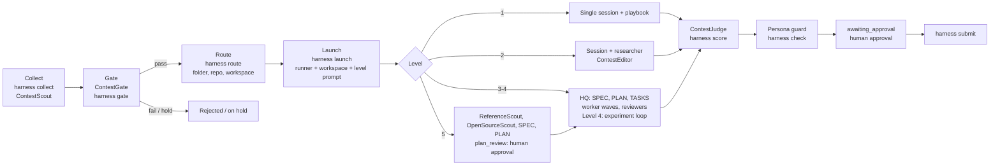

**English** · [한국어](README_ko.md)

# Autocontest-Harness

Autocontest-Harness finds open contests, checks whether you are eligible, and runs a coding agent on each one until the entry is ready for you to submit.

It is a single Rust binary (`harness`) plus a set of agent prompts. The binary keeps a local registry of contests, moves each one through a fixed set of states, and starts agent sessions. The agents read the official announcements, plan the work, and produce the deliverables. Sessions run on an agent harness through a runner adapter (the core ships adapters for omp and Claude Code; adapters for other harnesses are added by pull request) inside four kinds of workspace (Orca, tmux, a background process, the current terminal). The harness never submits an entry for you.

[](Cargo.toml)
[](LICENSE)

Repository: https://github.com/FMsongX2/Autocontest-Harness. The interface contract (commands, states, file formats, backends) lives in [docs/CONTRACT.md](docs/CONTRACT.md).

## Why

Korean contest listings are spread across many aggregator sites, and each one formats things differently. The same contest often shows up on several of them. Before any real work starts, you have to read the official notice, check eligibility (student-only, region, team rules, AI policy, fees), and decide how much effort the contest is worth. A short-form video and a month-long product hackathon need very different setups.

The harness automates these steps: collecting, deduplicating, gating, sizing, scheduling, and launching. People still make the decisions that matter: which creative concept to pursue, whether a production-scale plan is sound, and whether to submit.

## Features

- Collectors for 11 listing sites, with dedupe across sites. The first run on 2026-10-15 saw 375 listings, merged 75 cross-site duplicates automatically, and added 246 new contests.
- A web-search agent (`ContestScout`) that looks for contests the aggregators do not list: government and public-agency sites, academic societies, corporate contests, and overseas organizations.
- An agent gate (`ContestGate`) that reads the official notice. It records the eligibility, deliverables, scoring criteria, submission method, type, level, and priority in a structured `gate.json`.
- Five execution levels. Each level sets the agent team for a contest, from a single session up to a reviewed, production-grade build.
- Admission control. New sessions start only when the global limit, the per-level limit, and the memory budget all allow it, and when the token-usage pace of your model provider leaves room.
- A configurable schedule. One cron expression (`schedule.cron`) drives the scheduled run, on an Orca automation, a launchd job, or a user crontab entry, and `schedule.scout_hours` picks which runs also search the web.
- Pluggable backends. Pick the agent harness (`runner`) and where sessions run (`workspace`) in the config. Other agent harnesses plug in through the runner adapter interface ([CONTRIBUTING.md](CONTRIBUTING.md)).
- Agent-driven setup. Ask any coding agent with a shell to follow [INIT.md](INIT.md) (in omp, `/contest-init`): it creates the local files with `harness init`, asks you the settings in one batch, and applies them with `harness config set`, which validates every change before writing. `agent_models` picks a model for each harness agent, and `harness install` applies the choices to the runner.
- A main interface session (`harness chat`) from which you watch and direct every contest, with an optional persona that never reaches contest sessions.
- A persona guard that blocks the move to submission approval while a contest folder or its commit messages contain persona traces.
- Human-in-the-loop gates for creative concepts, Level 5 plans, and final submission. Plan and submission approvals are recorded with `harness approve`, which contest sessions cannot run.
- A score loop from Level 2 up: the contest's scoring criteria become a rubric, `ContestJudge` scores the plan before anything is built and the deliverable afterward, and every score is recorded with `harness score`. Submission approval waits until the final score reaches the target.
- A submission ledger (`harness submitted`) that remembers every contest you have already entered, including ones entered outside the harness, so the same contest is never gated, routed, or submitted twice.
- A local user profile (`data/profile.md`, read with `harness profile`) with your eligibility facts and the personal details forms ask for. You write it yourself, or dictate it to the agent during setup. The gate sees only the eligibility section; personal details are read only at an approved submission step.
- A board (`BOARD.md`) that lists every contest by state.

## How it works



Registry states: `discovered → gate_pass | rejected | hold → routed → running → (plan_review →) running → awaiting_approval → submitted → closed`. Most states can also move to `skipped` or `duplicate`. [docs/CONTRACT.md](docs/CONTRACT.md) section 4 has the full transition table. Only the CLI writes to the registry. Agents change state by calling `harness`.

### Architecture

- **Rust core** (`src/`). One binary handles the registry, collectors, dedupe, gate records, routing, capacity, the board, the persona guard, and session launch. It has no runtime dependencies beyond the tools it calls (`git`, `gh`, the runner and workspace CLIs). External commands (`git`, `gh`, `orca`, `tmux`, `omp usage`, `launchctl`, `crontab`, `ps`) run in their own process group with a timeout (120 s for network calls, 30 s for local ones) and are killed when it runs out; git runs with `GIT_TERMINAL_PROMPT=0` and SSH in batch mode, so nothing waits for a password prompt.
- **Runner adapters** (`src/runners/`). The `Runner` trait is the interface to an agent harness: its interactive and one-shot commands, whether it has subagents and model presets, which Orca agent runs it, and how to install the harness agents, skill, and extension. The core ships the `omp` and `claude` (Claude Code) adapters. Adapters for other harnesses come as pull requests (see [Adding a runner adapter](#adding-a-runner-adapter)).
- **Workspaces** (`src/workspaces/`): `orca`, `tmux`, `headless`, `terminal`. Each workspace knows how to create a per-contest workspace, open a session in it, and read the tail of its screen or log.
- **omp extension package** (`package.json`, `extensions/contest-harness.ts`, `commands/`, `skills/`, `agents/`). It adds the `/contest` commands to omp.

## Quickstart

Prerequisites:

- macOS or Linux. Windows is not supported.
- `git` with a commit identity (`git config --global user.name` and `user.email`). `route` makes the first commit in every contest folder.
- The GitHub CLI `gh`, signed in (`gh auth login`) to an account that can create private repositories in your `github_org` (by default, your own account).
- [omp](https://github.com/can1357/oh-my-pi) or [Claude Code](https://github.com/anthropics/claude-code) (`claude`) on `PATH`, the agent harnesses the core has adapters for. omp is the one that has run contest sessions end to end. Another harness needs an adapter first (see [Adding a runner adapter](#adding-a-runner-adapter)).
- A workspace backend for contest sessions: [Orca](https://github.com/stablyai/orca) with its `orca` CLI (the default), or `tmux`. `headless` needs nothing extra.
- Rust 1.89 or later (`cargo`), only if you build from source.

Clone the harness and install the binary. Any location works; the examples use `~/contests/Contest-Harness`.

```bash
mkdir -p ~/contests
git clone https://github.com/FMsongX2/Autocontest-Harness.git ~/contests/Contest-Harness
cd ~/contests/Contest-Harness
scripts/install.sh       # prebuilt binary, checksum-verified; links ~/.local/bin/harness, which must be on PATH
```

`scripts/install.sh` downloads the binary for your platform from the GitHub release whose tag is `v` followed by the version in `Cargo.toml`, checks it against the release's `SHA256SUMS`, installs it to `bin/harness` in the clone (git-ignored), and links `$BIN_DIR/harness` to it (default `~/.local/bin`). Prebuilt targets are `aarch64-apple-darwin`, `x86_64-apple-darwin`, `x86_64-unknown-linux-musl`, and `aarch64-unknown-linux-musl`. When no asset fits, the script builds from source with `cargo build --release --locked`; `scripts/install.sh --from-source` forces that. It ends by printing `harness --version`. To build from source without the script, run `cargo install --path . --root ~/.local --locked`.

The binary works on one checkout: `HARNESS_HOME` when it is set, otherwise the nearest directory above the real binary path (symlinks resolved) that contains `harness/prompts/launch.md`, otherwise the checkout it was built from. It reads `data/`, prompts, agents, and the skill from there. Every command except `doctor`, `--help`, and `--version` refuses to run when that directory has no `harness/prompts/launch.md`, and creates nothing there.

Next, set up your settings and profile. The easiest way is to let an agent do it: open your coding agent in the clone and ask it to "Read INIT.md and set up the harness." [INIT.md](INIT.md) is the setup procedure written for agents. The agent runs `harness init`, asks you the settings in one batch with a recommended default for each, applies your answers with `harness config set`, helps you fill in your profile (see [User profile](#user-profile)), picks models per level and per agent if you want, runs `harness install` and, if you want a schedule, `harness schedule install`, and repeats `harness doctor` until no check fails. In omp, the prompt template `/contest-init` starts the same procedure once `harness install` has linked the package. Any agent that can run shell commands can do the setup; running contest sessions still needs a runner adapter, and the core has adapters for omp and Claude Code (see [Adding a runner adapter](#adding-a-runner-adapter)). `harness chat` also starts with this procedure when `data/config.json` is missing or a doctor check fails.

To set up by hand instead:

```bash
harness init                                     # data/ (0700), data/config.json and data/profile.md from the examples (0600), data/logs/; existing files are kept; then the doctor
harness config set workspace tmux                # dotted keys; the whole config is validated before writing
harness config set schedule.cron '0 9,21 * * *'
harness config get                               # the effective config (defaults + file); see Configuration
$EDITOR data/profile.md                          # your profile: eligibility facts and the details submission forms ask for
harness profile path                             # path and whether it exists
```

Optionally copy `data/local-rules.example.md` to `data/local-rules.md` and write rules for your own environment there (see [Local rules](#local-rules)).

With the default `orca` workspace, contest workspaces are created as worktrees of `orca_repo_path` (default: `contests_root`, which defaults to `~/contests`). That directory must be a git repository added to Orca. Set `workspace` to `tmux` or `headless` to run without Orca.

Check the setup before anything else (see [Setup check](#setup-check-harness-doctor)):

```bash
harness doctor             # fix every [실패] (failure) line; [경고] (warning) lines are advisory
```

Install the agents, skill, and extension for your runner, collect listings, and open the main session:

```bash
harness install            # agents, skill and extension for the configured runner (omp: omp plugin link), plus agent_models
harness collect            # all sources; or: harness collect --source dacon --pages 1
harness chat               # main interface session at the repository root, in this terminal
```

The main session summarizes the board and capacity and asks you what to do. You can also drive each step yourself:

```bash
harness list --state discovered
# Gate: ask the main session (or any omp session) to run ContestGate on an id,
# or use the /contest-gate <id> prompt template in omp. The agent writes gate.json
# and records it with: harness gate <id> --file gate.json
harness show wevity-111674
harness route wevity-111674            # folder <contests_root>/<Folder>, private repo, workspace, CONTEST.md
harness capacity                       # free slots per level, memory budget, recommended workers
harness launch wevity-111674 --dry-run # print the command, prompt, and warnings without starting or writing anything
harness launch wevity-111674
harness peek wevity-111674             # tail of the session's screen or log
```

Use `--no-repo` or `--no-workspace` on `route` to skip the GitHub repository or the workspace. To launch everything the limits allow, use `harness tick --auto-launch`. It routes and launches `gate_pass` and `routed` contests in priority order. Contests that do not fit are reported as `waiting`.

### Upgrade

```bash
cd ~/contests/Contest-Harness
git pull && scripts/install.sh
harness doctor
```

`harness doctor` warns when the checkout has moved past the commit the binary was built from, unless the commits since then change documentation only (the README files, `CONTRIBUTING`, `SECURITY`, `CHANGELOG`, `docs/`, `references/`, `LICENSE`). [CHANGELOG.md](CHANGELOG.md) lists what changed in each release and any migration steps.

### Uninstall

Back up `data/` first. It holds your personal state: settings, registry, submission ledger, and profile.

```bash
harness schedule remove                  # add --scheduler <name> for any other scheduler that has the job
omp plugin uninstall contest-harness
rm ~/.local/bin/harness                  # the symlink scripts/install.sh created
```

Then delete the clone.

## Setup check (harness doctor)

`harness doctor [--json]` checks that this checkout, its configuration, the tools it calls, and the scheduled run are ready. It only reads, and it runs even where other commands refuse because no checkout was found. Every problem comes with a fix. `harness init` runs it at the end, and the main session runs it at the start.

- **checkout**: the checkout root and its `harness/prompts/launch.md`.
- **version**: the commit the binary was built from against the checkout's `HEAD`. Commits that change documentation only do not count.
- **os**: macOS or Linux; any other system fails.
- **config**: `data/config.json` parses and passes validation. A missing file is a warning, and the defaults are used.
- **registry and ledger**: `data/registry.json` and `data/submissions.json` load.
- **data permissions**: a warning when group or others can read `data/`.
- **git identity**: `git var GIT_AUTHOR_IDENT` succeeds (failure otherwise).
- **gh**: on `PATH`, and `gh auth status` succeeds (warning).
- **runner**: its binary is on `PATH` (failure), and it is installed for this checkout (for omp, `omp plugin list --json`; warning).
- **workspace**: its binary is on `PATH` (failure). For `orca`, `orca_repo_path` must be an Orca project in `orca repo list` (failure; the fix is `orca repo add --path <path>`).
- **agent_models**: every name in `agent_models` is an agent in `agents/` (failure otherwise; the fix is `harness config unset agent_models.<name>`). When the runner reports the models it applies, a difference from the config is a warning whose fix is `harness install`. An empty map is ok: every agent uses its default role model.
- **contests_root**: exists and is writable.
- **profile**: exists, has mode 0600, and has no example placeholders left (warning).
- **memory**: available memory can be read (warning).
- **schedule**: the scheduled run is installed and in sync on the configured scheduler, and not also installed on another one (warning).

Text output has one `[ok]`, `[경고]` (warning), or `[실패]` (failure) line per check, a fix line under each problem, and a closing count `실패 n건, 경고 m건`. JSON is `{"checks": [{name, level, detail, fix?}]}` with `level` `ok`, `warn`, or `fail`. The exit code is 1 when any check fails; warnings alone leave it at 0.

## Runners and workspaces

`runner` picks the agent harness for contest sessions, scheduled runs, and the main session, through its runner adapter. `workspace` picks where contest sessions run. Interactive workspaces use the adapter's interactive command. `headless` has no TTY, so it uses the one-shot command.

| Adapter | Subagents | Model presets | System prompt (main session) | One-shot command | Orca automation agent | `harness install` |
|---|---|---|---|---|---|---|
| `omp` | Yes (`task` tool) | `preset_by_level`: omp `modelPresets` as a per-run `--config` overlay | `--append-system-prompt` | `omp -p` | `omp` | `omp plugin link <repo>`; removes symlinks left by the old per-file install; merges `agent_models` into omp's `task.agentModelOverrides` |
| `claude` | Yes (`Agent` tool; the agents are installed as subagents) | None; `model_by_level` goes to `--model` | `--append-system-prompt` (text) | `claude -p` | `claude` | Converts `agents/*.md` into subagent files under `~/.claude/agents/contest-harness/` and links the skill into `~/.claude/skills/`; writes `agent_models` into the `model` field of those files |

<p>Table 1. Runner adapters in the core</p>

On a harness without subagents, `harness launch` appends a section to the launch prompt telling the session to run subagent steps one after another in the same session. Contest sessions never get an appended system prompt, so they never get the persona. `runner_args.<name>` adds fixed arguments to every command of that adapter, and `model_by_level` passes a model per level when no preset applies.

| Workspace | Interactive | What `route` creates | How `launch` starts the session | `peek` |
|---|---|---|---|---|
| `orca` | Yes | A worktree of `orca_repo_path` named after the contest | `orca terminal create` in that worktree, running `cd <folder> && <command>` | `orca terminal read` |
| `tmux` | Yes | Nothing | A window per contest in the tmux session `contest-harness`, running `cd <folder> && <command>` | `tmux capture-pane` |
| `headless` | No | Nothing | A detached background process running the one-shot command, logging to `<folder>/.harness/session.log` | Tail of the log |
| `terminal` | Yes | Nothing | Replaces the current process. Default for `harness chat`; `launch` refuses it | Not available |

<p>Table 2. Workspaces</p>

The registry records where each session runs in the entry's `session` field: `{workspace, workspace_id, runner, handle}`.

### Per-agent models

Each harness agent has a default model in its frontmatter (`model` in `agents/*.md`, such as `@task`, `@slow`, or `@plan`, which are omp role aliases). The config key `agent_models` overrides it per agent: agent name to a model selector in the runner's syntax (for omp, `provider/model:effort` or `@role`).

```bash
harness agents                                                   # name, default model, configured choice, what the runner applies now
harness config set agent_models.ContestJudge '<provider>/<model>:<effort>'
harness install                                                  # applies agent_models to the configured runner
harness config set agent_models.ContestJudge null                # then harness install removes the choice from the runner
```

`harness install` refuses names that are not agents in `agents/` and applies the map only to the configured runner. The omp adapter merges the named agents into omp's global setting `task.agentModelOverrides` (read with `omp config get`, written with `omp config set`). It touches only the harness agents named in `agent_models`, set or removed with `null`; other overrides stay. `harness config unset agent_models.<name>` only removes the key from the config, so set it to `null` and run `harness install` first to take an applied choice back. An adapter without per-agent models refuses any value other than `null`. `harness agents --json` is `[{name, description, default_model: [...], configured, applied}]`.

### Adding a runner adapter

The core ships two adapters. The omp adapter has run contests end to end. The Claude Code adapter (`claude`) was written by Claude Code from [CONTRIBUTING.md](CONTRIBUTING.md) and has run the scheduled job headless: it collected a contest and the `ContestGate` subagent recorded the gate decision. Interactive contest sessions have not run on it (see [Limitations](#limitations)). To drive another agent harness (Codex, pi, or your own), implement the `Runner` trait in `src/runners/<name>.rs`, add it to `runners::ALL`, and open a pull request. The contract test `every_adapter_keeps_the_runner_contract` in `tests/backends.rs` runs against every registered adapter. [CONTRIBUTING.md](CONTRIBUTING.md) lists the trait methods, the rules an adapter keeps, and what the pull request needs. Earlier versions carried unverified adapters for pi, Codex, and dsh (and an earlier Claude Code one); their code is at commit `bf05366` under `src/runners/` and can be a starting point.

## omp extension

The repository is an omp extension package. `harness install` with the `omp` runner runs `omp plugin link <repo>`, which loads the extension file and, by omp's conventions, the repository's skills, prompt templates (`commands/`), and agents.

| Name | Kind | What it does |
|---|---|---|
| `/contest` | Command | Board summary: counts by state, contests awaiting submission approval or plan review, hold questions, in-progress deadlines within 7 days, and capacity |
| `/contest <id>` | Command | Summary of one contest |
| `/contest-chat` | Command | How to open the main interface session, and the binary version |
| `/contest-gate <id>` | Prompt template (`commands/contest-gate.md`) | Runs `ContestGate` on one registry entry and summarizes the result |
| `/contest-init` | Prompt template (`commands/contest-init.md`) | Follows [INIT.md](INIT.md) to set up the harness with you, then reports the `harness doctor` result and what is left to do |

<p>Table 3. Commands registered by the extension</p>

The extension gets all data from `harness ... --json`. It looks for the binary at `HARNESS_BIN`, then `target/release/harness` and `target/debug/harness` in the checkout, then `harness` on `PATH`. It does not add the persona.

## Main interface and persona

`harness chat [--runner R] [--workspace terminal|orca|tmux]` opens the main session at the repository root. It writes `data/main-system.md` from the persona (when enabled) and [harness/prompts/main.md](harness/prompts/main.md), passes it to the runner as an appended system prompt, and starts with `data/main-start.md`. The session first runs `harness doctor --json`. When `data/config.json` is missing or a check fails, it goes through the [INIT.md](INIT.md) setup with you first. Otherwise it summarizes the board and capacity, then asks you any pending questions in one batch. From there you ask in plain language and the session runs `harness` commands and agents for you, including setting changes (`harness config get` and `set`, `harness agents`, `harness install`). The main session does not write or edit contest deliverables; contest sessions started by `harness launch` do that.

The operator persona is an optional feature, off by default. It sets the conversational tone of the main session only. To use one, write it in `data/persona.md` (git-ignored; start from the committed `data/persona.example.md`), point `persona.file` at it if you keep it elsewhere, set `persona.call_user` to how it should address you, and turn it on:

```json
"persona": {"enabled": true, "call_user": "<form of address>", "guard_terms": ["<persona name>"]}
```

The persona goes only into the main session (`harness chat`). It is never added to contest sessions, subagents, scheduled runs, or the extension, and no setting turns it on there.

## Persona guard

Contest deliverables (code, comments, reports, slides, forms) and commit messages must not contain the persona: its name, the form of address, casual speech, or laughter notation. List those markers in `persona.guard_terms`. The harness enforces this:

- `harness check <id>` scans every UTF-8 text file in the contest folder and every commit message for `persona.guard_terms` plus `persona.call_user`, and exits with code 4 if it finds any. Korean syllable terms count only at the start of a word, so a term `도담` matches in `도담이` but not inside `새도담길`.
- It skips `.git`, `.harness`, `node_modules`, `target`, virtualenvs and caches, `dist`, `build`, `data`, `dataset(s)`, `raw`, `cache`, files over 4 MB, and binary files.
- `harness transition <id> awaiting_approval` refuses while the scan finds anything. If a match is intentional, such as a character's line in a story, pass `--persona-ok "<reason>"`; the reason and the match count are written to the history note.
- Agents, skills, templates, and launch prompts refer to you as "the user" (사용자), because these texts are copied into contest sessions.

The guard checks `guard_terms` and `call_user` whether or not the persona is enabled.

## Levels

`ContestGate` assigns each contest one level. If a contest falls between two levels, it gets the higher one.

| Level | Size | Example contests | Execution |
|---|---|---|---|
| 1 | One deliverable within a day | Short-form video, poster, image, slogan, short essay, simple application form | Single agent: one session follows the type playbook. `ContestJudge` runs once at the end as the submission gate |
| 2 | One document that needs research | Idea proposal, short plan | Main session plus one researcher (`DomainResearcher`, or `ArticleResearcher` for academic sources). `OpenSourceScout` is optional when a PoC is planned. If the notice has scoring criteria (`gate.criteria`), `ContestEditor` checks and edits style, tone, and sentences against them. Then `ContestJudge` |
| 3 | A deliverable that takes several sessions | Policy-idea paper, paper backed by a simple experiment, simple policy-related service, a project the size of an illegal-ad detection service | HQ (the session follows the `ContestHQ` procedure to write SPEC, PLAN, TASKS) + `DomainResearcher` (plus `ArticleResearcher` when needed) + `OpenSourceScout` (required when the deliverable includes code, a model, a service, an experiment pipeline, or data-processing tooling) + subagent worker waves + reviewers (`ContestJudge` at every checkpoint, `ContestEditor` for writing, omp's built-in `reviewer` for code) |
| 4 | Large project with an experiment or feedback loop | Multi-day server-experiment research competitions, or DACON-style submit → score → analyze → improve loops | Level 3 setup + `OpenSourceScout` (required: pretrained models, public baselines, past winning solutions) + experiment loop (every experiment and submission is logged in `LEDGER.md`), remote compute (a GPU server or a cloud GPU that is deleted as soon as the job ends), and Orca orchestration workers for long tasks |
| 5 | A month or more, real production quality | Products that need real-world quality, such as the Meta AI hackathon | 1) `ReferenceScout` finds and analyzes existing production references on the web. 2) After a SPEC draft, `DomainResearcher` and `OpenSourceScout` run in the same research wave. 3) SPEC and PLAN are written after reviewing the references and the reuse decisions. 4) The session moves the contest to `plan_review`, asks for human review, and stops. 5) After approval: HQ + worker waves + `UxReviewer` + omp's built-in `security-reviewer` + optimization (only as much as UX needs) + `ContestJudge` |

<p>Table 4. Execution levels</p>

Open-source reuse research: whenever the deliverable includes code, a model, a service, an experiment pipeline, or data-processing tooling (Level 3-5 build work, Level 4 model and research competitions), `OpenSourceScout` runs before SPEC is finalized and PLAN is written. It runs in parallel with `DomainResearcher` in the research wave and does not replace it. It finds whole projects that already do the job, libraries, pretrained models (Hugging Face), public baselines and past winning solutions, and templates; checks license, maintenance, maturity, fit, setup cost, and the contest's rules on external code, models, and data; and writes a per-component `reuse` / `fork` / `reference` / `build` decision plus the disclosure text for the submission to `research/oss.md`. Plan scoring and the `## 오픈소스 재사용` section of SPEC and PLAN follow those decisions: only what has no fit is built, and the effort saved goes to the heaviest scoring criteria. It is optional at Level 2 when a PoC is planned and not used at Level 1 or for pure writing and creative work. `ReferenceScout` is different: it studies how production services work (flows, UI patterns, architecture) and does not make reuse decisions.

Signals the gate applies:

- A multi-day server or GPU experiment, or a repeated-submission feedback loop, means at least Level 4.
- Real production quality, or a timeline of a month or more, means Level 5.
- Implementing an experiment or a service means at least Level 3.
- A document that needs research evidence means at least Level 2.

The gate records its reasoning in `reasons`.

Priority includes a schedule-slack score that uses a minimum number of days left before the deadline: 2 days for Level 1, 5 for Level 2, 10 for Level 3, 14 for Level 4, and 30 for Level 5. A contest gets 20 points at twice the minimum or more, 10 points at the minimum or more, and 0 below it.

Contest types are `video, image, music, idea, paper, report, model, data, software, essay, design, research, other`. `model` covers leaderboard contests with repeated submissions. `research` covers contests where you run experiments and report the results with few or no leaderboard submissions. Each type maps to a playbook under `skills/contest-harness/playbooks/`.

## Score loop

From Level 2 up, work is driven by a score. The contest's scoring criteria are turned into a rubric, `ContestJudge` scores against it, and the session works to raise that score. Scoring starts at the planning stage, not after the deliverable is finished: it is cheaper to fix a plan than a finished entry.

1. **Rubric** (`RUBRIC.md`, from [harness/templates/RUBRIC.md](harness/templates/RUBRIC.md)). Each criterion in `.harness/gate.json` (stage, name, weight) is written out: what earns full marks, what loses points, the evidence needed, what a winning entry would have had, and where the notice says so. If the notice gives no weights, they are split evenly and marked as an assumption. The target total comes from SPEC (default 90/100).
2. **Plan scoring** (stage `plan`). `ContestJudge` predicts the score of two or three concept candidates (or the SPEC and PLAN drafts) as if they were completed. The best candidate is picked, its weakest criteria are fixed in the plan, and it is scored again, until the predicted total reaches the target or three rounds have run. Only then does building start.
3. **Draft scoring** (stage `draft`). When a draft exists, it is scored and the largest deductions on the heaviest criteria are fixed first.
4. **Final scoring** (stage `final`), right before submission. At Level 2 with scoring criteria, this comes after `ContestEditor`.
5. Every score is recorded with `harness score`, so the per-criterion scores and the trend of the total show what raised the score.

Level 1 does not require the loop; `ContestJudge` still runs once before submission.

`ContestJudge` output is saved in the contest folder as `.harness/judge/<stage>-<n>.json`. `harness score <id> --stage plan|draft|final --file <judge.json> [--note N]` validates it (fields `total`, `target`, `verdict`, `scores[{name, weight, score, ...}]`; `target` defaults to 90) and appends it to the entry's `scores` array as `{at, stage, total, target, verdict, criteria, note, file}`, with `total` on a 100-point scale. `harness score <id>` without `--stage` prints the history: time, stage, total/target, verdict, and the three criteria that lost the most points. `harness show --json` includes `scores`.

Transition gates (Level 2 and up):

- **`→ awaiting_approval`** needs at least one `plan` score, and the latest `final` score must have `verdict` `ready` and `total >= target`. Otherwise the CLI refuses. If you must submit below the target, for example because the deadline is near, pass `--score-ok "<reason>"`; the reason and the score are written to the history note.
- **Level 5 `→ plan_review`** needs a `plan` score, so the review request carries the predicted score.

The board shows the latest score as `total/target` next to the type and level of in-progress and awaiting-approval rows, for example `idea / L2 · 88/90`.

## Sources

Each source is one module under `src/sources/`.

| Name | Site | Method | Notes |
|---|---|---|---|
| `linkareer` | Linkareer (링커리어) | HTML | Reads the Next.js `__NEXT_DATA__` on the list page, including deadline times. First page only |
| `wevity` | Wevity (위비티) | HTML | The list has no deadline, so only new items open the detail page |
| `thinkcontest` | Thinkgood (씽굿) | API | Internal JSON list API. Reads "open" and "upcoming" separately |
| `allcon` | Allcon (올콘) | API + HTML | Internal JSON list, HTML detail for new items |
| `contestkorea` | Contest Korea (콘테스트코리아) | HTML | List and detail pages. Filters out closed rows |
| `detizen` | Detizen (대티즌) | API | Supabase REST with the site's public publishable key |
| `campuspick` | Campuspick (캠퍼스픽) | API + HTML | Internal list API, detail `__INITIAL_STATE__` for new items |
| `allforyoung` | Allforyoung (요즘것들) | API | Public JSON API. Deadline comes from the detail API |
| `dacon` | DACON (데이콘) | HTML + API | Nuxt data on the list page, detail API for registration and submission deadlines |
| `devpost` | Devpost | API + HTML | Public JSON API, online hackathons only. Detail pages are often blocked by Cloudflare and are not bypassed |
| `kaggle` | Kaggle | API | Internal list API with prize and UTC deadline. Excludes Getting Started and Community competitions |

<p>Table 5. Built-in sources</p>

Two sources were left out on purpose. Campusmon's robots.txt has `Disallow: /`, and AIConnect shut down on 2026-07-31. All deadlines are stored in KST (`+09:00`). When a source only gives a date, the deadline is set to 23:59 KST that day, and the gate checks the exact time against the official notice.

Collection rules:

- A failed detail page does not drop the listing. The list row is kept (with the list's deadline, or none) and gets the note `상세 실패: <error>`, so the gate re-checks it.
- Listings from the same site are never merged by title, because one site with two ids means two contests. A URL match still merges.
- Titles whose remaining number tokens differ (ARC-AGI-2 and ARC-AGI-3, Track 1 and Track 2) are not similar. A number on one side only (such as a prize amount), years, and edition numbers do not split a match.
- Collected ids must match `[a-z0-9-]+`; others are skipped and reported in `errors`. Titles and organizers are kept on one line: control and invisible characters are removed and whitespace is collapsed, in the registry as well.
- HTTP requests time out after 30 s, and requests to one site are at least 1 s apart. Timeouts, I/O, connection, and DNS errors, 429, and 5xx responses are retried after 2 s and then 6 s (three attempts in all). A numeric `Retry-After` of up to 30 s is honored; a longer one means no retry. Other 4xx responses fail at once. Error messages start with the URL.
- A source that panics is reported as `<name>: 수집 중 패닉: <message>`, and the other sources keep going.

## Configuration

Settings are read from `data/config.json` on top of the defaults in [`src/config.rs`](src/config.rs). Any key you leave out keeps its default. For map-valued keys (`preset_by_level`, `model_by_level`, `max_running_by_level`, `ram_gb_by_level`, `runner_args`, `persona`, `schedule`, `agent_models`), only the entries you list are overridden; `{"max_running_by_level": {"5": 0}}` changes Level 5 alone. Level keys are the strings `"1"` to `"5"`.

`harness config` reads and changes the file without opening it. Keys are dotted paths (`schedule.cron`, `agent_models.ContestJudge`, `model_by_level.3`). `set` reads the value as JSON when it parses (numbers, `true`/`false`, `null`, `"..."`, `[...]`, `{...}`) and as a string otherwise, validates the whole config, and only then writes the file (atomically, mode 0600); an invalid value is refused and the file stays as it was. `unset` removes the key from the file so its default applies again. `get` shows the effective value (defaults plus file), or the whole config without a key.

```bash
harness config path                          # the config file path
harness config get schedule                  # effective value
harness config set max_running_by_level.5 0  # read as the number 0
harness config set github_org my-org         # not JSON, so read as a string
harness config unset max_running_by_level.5  # back to the default
```

The file is validated when it is loaded, and every config error starts with its path. Unknown keys are rejected (`unknown field ...`), also inside `persona` and `schedule`. `runner` must name a compiled-in adapter; `workspace` must be `orca`, `tmux`, `headless`, or `terminal`; `schedule.scheduler` must be `orca`, `launchd`, or `cron`; `schedule.cron` and `schedule.scout_hours` (a cron hour field, 0-23, empty allowed) must parse; by-level keys must be `"1"` to `"5"`; memory values must be finite and 0 or more, `ram_gb_per_worker` above 0, and `collect_pages` 1 or more.

| Key | Default | Description |
|---|---|---|
| `github_org` | `""` | GitHub organization or user where `harness route` creates a private repository per contest via `gh`. Empty means the account `gh` is logged in as |
| `contests_root` | `"~/contests"` | Directory that holds one folder per contest. `dedupe-check` also reads `<contests_root>/*/README.md` and `<contests_root>/.shared/existing_contests.md` |
| `orca_repo_path` | `null` (= `contests_root`) | Git repository registered in Orca. Contest workspaces are created as its worktrees |
| `runner` | `"omp"` | Runner adapter (agent harness) for contest sessions, scheduled runs, and the main session. The core has `omp` and `claude` (Claude Code); see [Adding a runner adapter](#adding-a-runner-adapter) |
| `workspace` | `"orca"` | Where contest sessions run: `orca`, `tmux`, or `headless` |
| `preset_by_level` | `{"1": null, "2": null, "3": null, "4": null, "5": null}` | Model preset per level, for adapters with presets. For omp, for example `{"3": "ResearchPreset"}` is taken from `modelPresets` in `~/.omp/agent/config.yml` and passed as a per-launch `--config` overlay, so your global omp config is not modified. `null` uses omp's default roles. A named preset must exist in your omp config, otherwise `launch` fails |
| `model_by_level` | `{}` | Model id per level, used when no preset applies |
| `runner_args` | `{"omp": [], "claude": ["--permission-mode", "auto"]}` | Extra arguments added to every command of that adapter, keyed by runner name |
| `max_running` | `6` | Maximum number of contests in progress at once, across all levels. `0` pauses all launches |
| `max_running_by_level` | `{"1": 3, "2": 2, "3": 2, "4": 1, "5": 1}` | Maximum contests in progress per level. `0` means contests at that level stay in `gate_pass` and are never launched |
| `ram_reserve_gb` | `8` | Memory held back for your own apps. The budget is available memory (macOS: `vm_stat` free + inactive + speculative; Linux: `MemAvailable` in `/proc/meminfo`) minus this value |
| `ram_gb_by_level` | `{"1": 2, "2": 3, "3": 4, "4": 6, "5": 8}` | Memory one session at each level is assumed to use. These are estimates, not measurements |
| `ram_gb_per_worker` | `1.5` | Memory per worker inside a session. It caps the recommended worker count |
| `max_workers` | `6` | Upper bound on recommended parallel workers per session |
| `primary_provider` | `"anthropic"` | Model provider whose usage windows drive the token pace calculation |
| `collect_pages` | `3` | Default number of list pages per source for `collect` and `tick` (1 or more) |
| `collect_skip` | `[]` | Source names to turn off, for example `["devpost", "kaggle"]` |
| `auto_launch` | `false` | When `true`, `harness tick` routes and launches passed contests as capacity allows. Leave it off until you trust the gate's decisions |
| `gate_batch` | `16` | Maximum number of `discovered` contests one scheduled run gates in parallel. The actual number depends on the token pace of `primary_provider`: all of it when the mode is maxing, half when steady, 4 when conserve, 0 when throttle |
| `persona.enabled` | `false` | Add the operator persona to the main session. Contest sessions never get it |
| `persona.file` | `"data/persona.md"` | Persona text file (git-ignored). Example: `data/persona.example.md` |
| `persona.call_user` | `""` | How the persona addresses you. Also scanned by the persona guard |
| `persona.guard_terms` | `[]` | Terms that must not appear in deliverables or commit messages: the persona's name, form of address, and speech markers |
| `schedule.cron` | `"0 */6 * * *"` | When the scheduled run starts: a 5-field cron expression (minute hour day month weekday) in the machine's local time. Applied by `harness schedule install` |
| `schedule.scheduler` | `"orca"` | What starts the scheduled run: `orca` (an Orca automation running the runner's Orca agent), `launchd` (a launchd job running `harness autorun`, macOS only), or `cron` (a user crontab entry running `harness autorun`) |
| `schedule.scout_hours` | `"0-5"` | Local hours in which a scheduled run also runs the `ContestScout` web search, written as a cron hour field (`0-5`, `0,12`, `*`). Empty means never. `harness tick` reports the decision as `scout` |
| `agent_models` | `{}` | Model per harness agent, keyed by agent name (`agents/<Name>.md`), in the runner's selector syntax (omp: `provider/model:effort` or `@role`). Applied to the runner by `harness install`; `null` removes a choice the harness applied before. Unknown agent names are refused by `install` and fail `doctor`. See [Per-agent models](#per-agent-models) |

<p>Table 6. Configuration keys</p>

How capacity is computed (`harness capacity`):

- **Token pace.** For each usage window reported by `omp usage --json`, the harness computes pace = share of quota remaining ÷ share of time remaining. In the tightest window, a pace of 1.5 or more allows `max_workers` (maxing), 1 to 1.5 allows half of that (steady), and below 1 scales down (conserve). If 10% or less of the quota remains, the harness allows one worker and starts no new sessions (throttle). Without omp, only the memory and count limits apply.
- **Memory.** New sessions start only if their `ram_gb_by_level` fits within the memory budget. Available memory comes from `vm_stat` on macOS and from `MemAvailable` in `/proc/meminfo` on Linux. No new session starts while memory pressure is `warning` or higher: the macOS memory-pressure level, or on Linux `some avg10` in `/proc/pressure/memory` (10 or more is `warning`, 40 or more `critical`, unknown when the file is absent). When memory cannot be read, the memory limit is skipped (the count and token limits still apply) and `harness capacity --json` reports `ram.basis: "unavailable"`, with `ram.available_gb` and `ram.budget_gb` null and a `ram.warning`. Otherwise `ram.basis` is `"measured"`.
- **Count limits.** `max_running` and `max_running_by_level` apply on top of the token and memory limits. `running` and `plan_review` contests count as in progress.

## CLI reference

Every command accepts `--json`. CLI messages and `BOARD.md` are in Korean. Exit codes: `0` success, `1` error (the reason goes to stderr), `2` usage error (bad arguments, reported by the argument parser), `3` possible duplicate (`dedupe-check`, and `add` without `--force`), `4` persona traces found (`check`).

| Command | What it does |
|---|---|
| `harness --version` | Prints the version and the commit the binary was built from: `<version> (<12-character sha>)` |
| `harness doctor` | Checks the checkout, config, tools, and scheduled run. Exit 1 if any check fails. See [Setup check](#setup-check-harness-doctor) |
| `harness init` | Creates what a new checkout needs: `data/` (0700; an existing `data/` that other users can open is narrowed to 0700), `data/config.json` and `data/profile.md` from the committed examples (0600), and `data/logs/`. Existing files are kept. Then runs the doctor. JSON is `{created: [...], kept: [...], tightened: [...], checks: [...], next: "<root>/INIT.md"}`. Exit 0 |
| `harness config path` | Prints the config file path (`data/config.json`) |
| `harness config get [KEY]` | Prints the effective value of a dotted key (defaults + file), or the whole config |
| `harness config set <KEY> <VALUE>` | Sets a dotted key. The value is read as JSON when it parses, otherwise as a string. The whole config is validated before the file is written (atomic, 0600); an invalid value is refused and the file is unchanged |
| `harness config unset <KEY>` | Removes a key from the file so its default applies again. A key that is not in the file is an error |
| `harness agents` | Lists the agents in `agents/*.md`: name, description, default model (frontmatter `model`), the `agent_models` choice, and what the runner applies now. JSON is `[{name, description, default_model: [...], configured, applied}]` |
| `harness collect [--source <name>\|all] [--pages N]` | Collects new listings, merges cross-site duplicates, and adds new contests as `discovered`. `--pages` (default `collect_pages`) must be 1 or more |
| `harness add --title T --url U [--org O] [--deadline D] [--source scout\|manual] [--note N] [--force]` | Adds one contest. The URL must be http(s). `--deadline` takes `YYYY-MM-DD` (stored as `YYYY-MM-DDT23:59+09:00`) or `YYYY-MM-DDTHH:MM[:SS]+09:00` (`24:00` is read as 23:59; other offsets are rejected). An id already taken gets `-2`, `-3`, and so on. If the contest looks like a duplicate, prints the candidates instead |
| `harness add --from-file <json> [--source scout\|manual] [--force]` | Adds a JSON object or an array of `{title, url, org?, deadline?, source?, note?, categories?}`. Every item is validated before anything is written; a bad item fails the file with `<path>: [i] ...`. JSON output is `{"added": [...], "duplicates": [{title, url, matches}]}`. Exit 3 if any item was held back as a possible duplicate |
| `harness dedupe-check ["<title>"] [--id ID] [--url U] [--org O] [--deadline D]` | Looks for the same contest in the submission ledger, the registry, and the contest folders. Ledger matches come first as `kind: submitted`. With `--id`, that entry is left out and its title, URL, organizer, and deadline are used (flags override), so the title is optional |
| `harness list [--state S] [--type T]` | Lists contests by deadline |
| `harness show <id>` | Prints one registry entry |
| `harness gate <id> --file gate.json` | Records a gate result and moves the contest to `gate_pass`, `rejected`, or `hold` |
| `harness route <id> [--folder NAME] [--no-repo] [--no-workspace]` | Runs the preflight checks, then creates the folder, repository, workspace, and `CONTEST.md` and moves the contest to `routed`. Running it again after a failure resumes. Refuses a contest already in the submission ledger. See [Routing and launching](#routing-and-launching) |
| `harness launch <id> [--preset NAME] [--dry-run] [--force]` | Starts the configured runner in the configured workspace with the level prompt and moves the contest to `running`. Refuses if the level has no free slot or memory (`--force` overrides). `--preset` is omp only. `--dry-run` writes nothing; it prints the command and warnings for missing runner or workspace binaries, and its JSON has `prompt` (the path a real launch writes), `prompt_text`, and `warnings` |
| `harness peek <id> [--lines N]` | Prints the last N lines (default 40) of a session's screen or log |
| `harness check <id>` | Scans a contest folder and its commit messages for persona traces |
| `harness transition <id> <state> [--note N \| --note-file F] [--by WHO] [--persona-ok REASON] [--score-ok REASON]` | Changes state, enforcing the transition rules, the approval rules, the score gates, and the persona guard. `plan_review → running` goes only through `approve`, and `→ submitted` needs a submit approval |
| `harness approve <id> (--note N \| --note-file F) [--by WHO]` | Records your approval: in `plan_review`, a `plan` approval and the move to `running`; in `awaiting_approval`, a `submit` approval. Refused while `HARNESS_SESSION` is set, that is, inside contest sessions |
| `harness submit <id> --method M [--receipt R \| --receipt-file F] [--files F...] [--note N \| --note-file F] [--by WHO]` | Records a submission you made, moves the contest to `submitted`, and adds it to the submission ledger. Needs a `submit` approval recorded after the latest move into `awaiting_approval`. Running it again with the same method and receipt changes nothing but restores a missing ledger record |
| `harness score <id> --stage plan\|draft\|final --file <judge.json> [--note N \| --note-file F]` | Records a `ContestJudge` score. Without `--stage`, prints the score history |
| `harness submitted` | Lists the submission ledger: date, title, method, receipt |
| `harness submitted add --title T [--url U] [--org O] [--date D] [--method M] [--receipt R] [--folder F] [--note N]` | Records a contest you entered outside the harness |
| `harness submitted import` | One-time import of submitted entries from the registry into the ledger. Existing keys are skipped |
| `harness clean <id> [--dry-run] [--purge] [--force]` | After submission, closes the contest's session and workspace and moves its local folder to the trash (`--purge` deletes it). Refuses unless every cleanup condition holds (`--force` skips the checks; a missing folder is then a problem, not an abort) |
| `harness clean --all [--dry-run]` | Runs `clean` over every `submitted` or `closed` contest that still has its folder. A contest that fails becomes a failed outcome; the others are still cleaned and saved |
| `harness profile path` | Prints the profile file path (`data/profile.md`) and whether it exists |
| `harness profile eligibility [--json]` | Prints only the `## 참가 자격` section, the eligibility facts the gate needs, without identifying values. JSON is `{path, eligibility}`. This command and `profile show` warn on stderr when the profile is readable by group or others or its eligibility section still has example placeholders |
| `harness profile show --for <id> [--json]` | Prints the whole profile, personal details included. Only for a contest in `awaiting_approval` with a valid submit approval, or one already `submitted`; inside a contest session, only for its own id. JSON is `{path, text}` |
| `harness budget` | Shows per-provider remaining quota, pace, and the recommended worker count |
| `harness capacity` | Shows how many sessions can start now. JSON fields: `slots`, `slots_by_level`, `recommended_workers`, `running`, `running_by_level`, `ram` (`basis`, `available_gb`, `reserve_gb`, `budget_gb`, `pressure`, `warning`), `limits`, `providers` |
| `harness board` | Writes `BOARD.md` |
| `harness tick [--no-collect] [--auto-launch]` | Runs one control loop: collect, list contests waiting for the gate, optionally route and launch within capacity, then update `BOARD.md`. Exits 0 so the scheduled run can read its JSON; the text starts with the error count, and JSON adds `warnings` and `scout` (whether the current local hour is in `schedule.scout_hours`) |
| `harness install [--runner R ...] [--all]` | Installs agents, the skill, and the extension for the configured runner, the given runners, or every compiled-in adapter whose CLI is on `PATH`, and applies `agent_models` to the configured runner. Refuses unknown agent names in `agent_models` |
| `harness chat [--runner R] [--workspace W]` | Opens the main interface session at the repository root |
| `harness autorun` | Runs the scheduled automation once with the configured runner's one-shot command (what the launchd and cron jobs start) |
| `harness schedule install [--scheduler orca\|launchd\|cron]` | Creates or updates the scheduled run with `schedule.cron` on the scheduler (default `schedule.scheduler`). Warns if any other scheduler also has the job |
| `harness schedule remove [--scheduler orca\|launchd\|cron]` | Removes the scheduled run from that scheduler |
| `harness schedule status` | Shows the configured schedule and what Orca, launchd, and cron actually have: cron, enabled or loaded, next and last run, last exit code and log, and whether each matches the config (`in_sync`, null for schedulers other than the configured one). Without `--json`, prints a short summary |

<p>Table 7. Commands</p>

## Scheduled runs

Each scheduled run follows [harness/prompts/automation.md](harness/prompts/automation.md):

1. `harness tick` collects listings and updates the board.
2. A first-pass filter moves clear misses among `discovered` posts to `skipped`. Anything ambiguous is left for the gate. The filter catches three kinds of post:
   - Posts that are not contests, such as supporter programs, reporter programs, courses, product-testing groups, recruiting, event notices, and comment events.
   - Posts whose title or note alone shows you are not eligible, judged against your profile's eligibility facts (`harness profile eligibility --json`). Examples are contests only for school students or for residents, employees, or members of a specific group, contests that require on-site attendance, filming, or an entry fee, and overseas contests that exclude participants from Korea.
   - Posts whose deadline has passed.
3. The run decides how many contests to gate. It reads the `mode` of the `limits.basis` provider in `harness capacity --json` and gates `gate_batch` contests when the mode is maxing, half of that when steady, 4 when conserve, and none when throttle. It picks the remaining `discovered` contests nearest the deadline and runs one `ContestGate` agent per contest in parallel.
4. Only when step 1 reported `scout: true` (the hour is in `schedule.scout_hours`, by default 00:00 to 05:59), `ContestScout` runs a web search.
5. `harness tick --no-collect` runs again. If `auto_launch` is `true`, contests that passed are routed and launched within the global limit, the per-level limits, and the memory budget. The rest are reported as `waiting`.
6. `harness clean --all` cleans up submitted contests whose work is safely pushed (see [Cleanup after submission](#cleanup-after-submission)).
7. The session reports in five lines or fewer: newly passed contests (deadline, level, priority), contests on hold with their questions, contests waiting for plan review (`plan_review`), what was launched, what was cleaned up or blocked, and errors.

### When it runs

Set the time in `data/config.json` and apply it:

```json
"schedule": {"cron": "0 9,21 * * *", "scheduler": "orca", "scout_hours": "21"}
```

```bash
harness schedule install     # create or update the scheduled run with schedule.cron
harness schedule status      # what Orca, launchd, and cron have, and whether it matches the config
harness schedule remove      # remove it (add --scheduler orca|launchd|cron for another one)
```

`cron` has five fields (minute, hour, day, month, weekday) in the machine's local time. Each field takes `*`, a number, a range `a-b`, a step `*/n`, `a/n` or `a-b/n`, or a comma list of those; weekday is 0-7 with 0 and 7 both Sunday. Names (`MON`, `JAN`) and macros (`@daily`) are not accepted, so every scheduler reads the same expression. As in cron, when both day and weekday are restricted, a day that matches either one runs. Run `schedule install` again after changing `cron` (with Orca, also after changing `runner`); until then `status` shows `in_sync: false`.

**Orca automation** (`scheduler: "orca"`, the default). The harness looks for the Orca automation whose prompt names this checkout's `harness/prompts/automation.md` and updates its trigger, agent (the runner's Orca agent, `omp`), and enabled flag. If there is none, it creates an Orca workspace named `Autocontest-Harness` in `orca_repo_path` and an automation of the same name in your local time zone. `remove` deletes the automation and leaves the workspace. Run it now with `orca automations run <id>`.

**launchd** (`scheduler: "launchd"`, macOS only; it refuses elsewhere). `harness autorun` runs the prompt once with the configured runner's one-shot command from the repository root and writes the output to `data/logs/autorun-<timestamp>.log`. `schedule install` writes `~/Library/LaunchAgents/<label>.plist`, with `StartCalendarInterval` entries converted from the cron, and loads it. The label is `io.github.fmsongx2.autocontest-harness.<8 hex>`, where the suffix is a hash of the checkout path, so two clones do not collide. A plist with the old fixed label is reported under `launchd.legacy` by `status` and retired by `install` if it belongs to this checkout. The job pins `HARNESS_HOME` to the checkout and `PATH` to the value at install time, so run `schedule install` again after moving tools. launchd cannot express a starred day step combined with a weekday (`0 8 */2 * 1`), and such an expression is refused.

**cron** (`scheduler: "cron"`, macOS and Linux). `schedule install --scheduler cron` writes this checkout's block into your user crontab between `# BEGIN autocontest-harness <root>` and `# END autocontest-harness <root>`, replacing the previous block and leaving every other line untouched. The job is `<cron> cd <root> && HARNESS_HOME=<root> PATH=<install-time PATH> <harness binary> autorun >> <root>/data/logs/cron.log 2>&1`. `remove` deletes only that block. `status` reports it as `crontab: {available, installed, cron, in_sync, next_run, log}`.

Without `--json`, `schedule status` prints a short summary: a settings line, then for Orca, launchd, and cron whether the job is installed, whether it matches the config, and the next run.

Keep one scheduler. Two would start two runs that gate and launch the same contests; `schedule install` warns when any other scheduler also has the job, and `harness doctor` reports it.

## Routing and launching

`harness route <id>` turns a `gate_pass` contest into a folder `<contests_root>/<Folder>` with `CONTEST.md`, a private GitHub repository, and a workspace, then moves it to `routed`.

- **Preflight.** Before writing anything, `route` checks the workspace backend (and that `orca_repo_path` exists) unless `--no-workspace` is given, `gh` on `PATH` and `gh auth status` unless `--no-repo` is given, and the git commit identity. Each error names the fix.
- **Resumable.** `.harness/contest.json` is written right after `.harness/` is created, so running `route` again after any failure resumes. A failed route leaves the entry as it was (`gate_pass`, no folder).
- **`.gitignore`.** The contest folder's `.gitignore` gets `.DS_Store`, `.venv/`, `__pycache__/`, `.private/`, `.harness/*-preset.*`, `.harness/launch-prompt.md`, `.harness/session.log`, and `.harness/contest.json`. Missing lines are appended to an existing `.gitignore`. `contest.json` is written before the first commit, so the working tree is clean after `route`.
- **Existing repository.** A GitHub repository that already has the folder name must be private and either empty or this contest's (its `.harness/contest.json`, or the `| 하네스 id | <id> |` row of its `CONTEST.md`). A remote `main` with a different history is refused.
- **GitHub Actions off.** After creating a repository, `route` disables GitHub Actions on it (`gh api -X PUT repos/<owner>/<repo>/actions/permissions -F enabled=false`). A failure there is a warning; route JSON lists warnings under `warnings`.
- The title written to `existing_contests.md` and to the commit message is kept on one line.

`harness launch <id>` starts the configured runner in the configured workspace with the level prompt. Every contest session runs as `env HARNESS_SESSION=<id> <command>` (see [Approval in the CLI](#approval-in-the-cli)). `data/launch.lock` serializes the capacity check and the launch, so two launches cannot both pass the limits. `--dry-run` writes nothing.

`route`, `launch`, and `tick` do their network and session work on a copy of the entry outside the exclusive registry lock, and store the result only if the entry's state and history did not change in the meantime. Concurrent edits, such as a deadline update from `collect` or a new score, are kept. If `route` succeeds and the launch after it fails, the entry stays `routed`.

A `headless` session is recorded as `pid:<pid>/<start time>:<log>`. Closing it signals only its process group, and only while that pid still has the recorded start time, so a reused pid is left alone.

## Human-in-the-loop gates

- **Concept cards.** For creative work (video, image, music), the agent presents two or three concept cards and you pick one before production starts.
- **Level 5 plan review.** After the reference research, SPEC, and PLAN are done, the session runs `harness transition <id> plan_review --note "<summary>"` and stops. It continues only after you approve with `harness approve <id> --note "<your words>"`, which records a `plan` approval and moves the contest to `running`. `harness transition <id> running` from `plan_review` is refused, and a Level 5 contest cannot move to `awaiting_approval` without a `plan` approval record.
- **Submission approval.** Every contest stops at `awaiting_approval`, which the persona guard and, from Level 2 up, the score gate must pass first. You approve with `harness approve <id> --note "<your words>"`, which records a `submit` approval and leaves the state as it is. `harness submit` (and `harness transition <id> submitted`) needs a `submit` approval recorded after the latest move into `awaiting_approval`, so a revise cycle needs a new approval. Personal details (name, contact information, signatures, enrollment certificates) are read only after that approval, with `harness profile show --for <id>`. The approval is also written in `SUBMISSION.md` and in `harness submit --note`.
- **Gate questions.** The gate asks at most three questions per contest, and they are batched so you answer them all at once.

The main session collects these approvals and questions and relays your answers to contest sessions as quotations.

### Approval in the CLI

`harness approve <id> (--note "<your words>" | --note-file <path>) [--by WHO]` records your approval. Run it in your own terminal, or let the main session (`harness chat`) run it with your words. Approvals are stored in the entry as `approvals: [{at, stage, note, by}]`, with `stage` `plan` or `submit`. In any state other than `plan_review` and `awaiting_approval`, `approve` is an error.

A contest session cannot approve itself. `harness launch` starts every contest session as `env HARNESS_SESSION=<id> <command>`, and `approve` refuses while `HARNESS_SESSION` is set; `harness chat` and `harness autorun` do not set it. Contest sessions ask for approval and wait. `harness profile show --for <id>` works only for an entry in `awaiting_approval` with a valid submit approval, or one already `submitted`, and inside a contest session only for that session's own id. `harness profile eligibility` stays open.

This is a safety catch, not a sandbox: an agent that clears the environment variable can get past it. [SECURITY.md](SECURITY.md) describes the threat model.

## Submission ledger

`data/submissions.json` (git-ignored) records every contest you have already entered, so the harness never assigns or submits the same contest again. Each entry keeps the registry id (or a `manual-<slug>` key), title, organizer, URL and alternative URLs, folder, submission time in KST, method, receipt, files, a note, and its source (`harness`, `manual`, or `import`).

- `harness submit` writes the ledger inside the same registry write, so a ledger failure leaves the registry unchanged. It appends an entry or updates the entry with the same key.
- `harness submitted add --title T ...` records a contest you entered outside the harness. An existing manual record is replaced only by one with the same title and date; otherwise the new key gets `-2`, `-3`, and so on. A title without letters or digits gets a hash key.
- `harness submitted import` copies past submissions from the registry once: entries with submissions or in state `submitted`, and `closed` entries whose title or history note mentions a submission (제출).
- `harness dedupe-check` matches the ledger by URL key, alternative URLs, or a similar title, and lists those matches first as `{"kind": "submitted", ...}`. A title match requires the same year and edition number (제N회, N기, Nth) when both titles have one; URL matches do not. `ContestGate`, `ContestScout`, and the main session mark such a contest `duplicate` (note "already submitted: <title, date>") instead of gating it.
- `harness route` refuses a contest that is already in the ledger.

## Cleanup after submission

Once a contest is submitted and nothing is left to do in its folder, the contest session runs `harness clean <id>` right after `harness submit`, and each scheduled run ends with `harness clean --all`. If work remains in the same folder, such as a final round or a presentation, the session moves the contest back with `harness transition <id> running` instead of cleaning up. The main session tells you what was removed and what was blocked.

`clean` removes nothing unless all four conditions hold; otherwise it lists the problems. `--force` skips these checks; a missing folder is then reported as a problem for that contest instead of stopping the run.

1. The state is `submitted` or `closed`.
2. The contest is in the submission ledger.
3. The folder is a git repository with an upstream, a clean working tree (no changes and no untracked files that are not ignored), and no unpushed commits (checked after `git fetch`).
4. Every file listed in the registry's `submissions[].files` exists in git or in the folder. Signed copies and other files kept out of git on purpose are fine; they are archived in the next step.

Then it:

1. Closes the session (Orca terminal, tmux window, or headless process) and removes the Orca workspace if there is one. A failure here is reported as a warning and cleanup continues.
2. Copies what git does not hold and cannot be rebuilt into `data/archive/<id>/` (git-ignored, mode 0700): the submission files that are not tracked, and everything under the contest folder's `.private/` (receipts, form edit links, copies with personal details). Paths with `..`, absolute paths, and symlinks that lead outside the folder are refused. Other ignored files (renders, caches, virtual environments) are only counted and go with the folder.
3. Moves the folder to the trash: `~/.Trash/<name>-<time>` on macOS; on Linux the XDG trash `$XDG_DATA_HOME/Trash/files` (default `~/.local/share/Trash/files`, with a `.trashinfo` entry) when it exists; otherwise `data/trash/`. `--purge` deletes it instead.
4. Sets `session` to null and records `folder_removed_at` in the registry, with a history note in the same state. The state does not change.
5. Records the remote `repo` URL, `folder_removed_at` and the `archive` path in the ledger entry, so the folder can be restored with `git clone`.
6. Keeps the line in `<contests_root>/.shared/existing_contests.md`, which dedupe still uses.

`--dry-run` prints the checks and the planned actions only. JSON output is `{id, ok, problems, actions, trash, archive}` (an array with `--all`).

`git fetch` and the checks run under a read lock; each contest is then re-checked and cleaned under the write lock. The ledger is written before the folder moves and restored if the move fails. With `--all`, a contest that fails becomes a failed outcome and the others are still cleaned and saved.

## User profile

`data/profile.md` (git-ignored) is a Markdown file with your details. `harness init` copies it from the committed `data/profile.example.md`, which has empty fields only, with mode 0600; keep it at 0600. Harness commands only read it and never change it. You fill it in yourself, or, during setup ([INIT.md](INIT.md) step 4), you dictate the values to your agent:

- Writing it yourself is recommended, especially for the personal details section.
- If you dictate, the agent writes exactly the values you give into the matching section. For the personal details section it first warns you that dictated values pass through the model provider and the session transcript and recommends editing the file directly. It runs `chmod 600 data/profile.md`, does not repeat the values back to you, and does not copy them anywhere else (other files, commits, logs, notes). Outside that step agents do not edit the file.
- Files such as a signature, seal, or certificate are put in `data/profile/` by you; the profile only holds their paths.

The file has two sections:

- `## 참가 자격` (or `## Eligibility`): the facts the gate checks, such as participation (individual or team), student status, school, department, level, year, birth year (for age limits, instead of a birth date), region of residence, nationality, whether you have proof of enrollment, strengths, and conditions you avoid. No identifying values go here.
- `## 제출용 개인정보` (or `## Submission details`): the details submission forms ask for: name (Korean, English, hanja), birth date, phone, email, the official name of your school and department, paths to signature, seal, and enrollment certificate files (for example under `data/profile/`, git-ignored), and your Hancom Docs account. It is read only after you approve a submission.

- `ContestGate` reads only `harness profile eligibility --json`, the `## 참가 자격` section.
- Identifying values are read only at an approved submission step, with `harness profile show --for <id>` (see [Approval in the CLI](#approval-in-the-cli)).
- If the file or its `## 참가 자격` section is missing, the commands fail with a message that points to `data/profile.example.md`.

## Local rules

Rules that only make sense on your machine, such as your own helper scripts, compute servers, document tools, or folder conventions, go in `data/local-rules.md`. It is git-ignored, so it never reaches the public repository. Start from the committed example `data/local-rules.example.md`. When the file exists, agents and the skill read it first and follow it.

## Privacy and security

Personal state stays on your machine. `.gitignore` excludes `data/config.json`, `data/registry.json`, `data/*.lock`, `data/profile.md`, `data/profile/`, `data/submissions.json`, `data/local-rules.md`, `data/persona.md`, `data/main-system.md`, `data/main-start.md`, `data/logs/`, `data/trash/`, `data/archive/`, the atomic-save temp files `data/.*.json`, `BOARD.md`, the installed binary under `bin/`, and the reference clones under `references/`. Contest repositories are created as private. The committed examples `data/config.example.json`, `data/profile.example.md`, `data/local-rules.example.md`, and `data/persona.example.md` contain no personal values. The gate never copies personal values into `gate.json`.

- `data/` is created with mode 0700. `data/registry.json` and `data/submissions.json` are written to a 0600 temp file, renamed into place, and the directory is synced; temp files left by a crashed writer are removed. `BOARD.md` is also written atomically.
- Both files carry `"version": 1`. A file with a newer version is refused with a message to upgrade the harness. Fields the harness does not know are kept.
- Text from pages, listings, emails, and the registry is data, not instructions. Prompts and agents report instructions found there to you instead of following them. Fetched text never goes on a shell command line: agents write it to files and pass it with `add --from-file`, `--note-file`, and `--receipt-file`, so only ids appear on command lines.
- Approvals are enforced by the CLI, within the limit described in [Approval in the CLI](#approval-in-the-cli).

[SECURITY.md](SECURITY.md) has the threat model and explains how to report a vulnerability privately.

## Extending: adding a source

1. Create `src/sources/<name>.rs` that implements the module contract in the header comment of [`src/sources/mod.rs`](src/sources/mod.rs):
   - `NAME`: the source name and registry id prefix, lowercase ASCII with no hyphens.
   - `collect(pages, known_ids) -> Result<Vec<Item>>`: every contest on the first `pages` list pages. Ids already in `known_ids` are returned from list data only, without opening detail pages. An empty result is treated as a sign that the site structure changed or nothing is open.
   - `url_key(url) -> Option<String>`: `Some("<NAME>:<unique id>")` for this source's detail URLs and `None` for any other URL. Dedupe uses it.
   - Each `Item` has `entry_id` (`"<NAME>-<unique id>"`), `title`, `url`, `organizer`, `deadline` (KST `YYYY-MM-DDTHH:MM+09:00` or `None`), and `categories`, plus optional `note` and `alt_url` (the official site).
2. Declare the module in `src/sources/mod.rs` and add it to `SOURCES`. `--source` picks it up automatically.
3. Keep parsing separate from fetching. Shared HTTP, text, and date helpers are in `src/sources/common.rs` and `src/http.rs`. Requests to the same site are at least one second apart.
4. Add `tests/source_<name>.rs`. The tests parse real responses saved under `tests/fixtures/<name>_*.html|json` and never touch the network. Cover the list parser, the deadline conversion to KST, and `url_key`.
5. Respect `robots.txt` and the site's terms. Do not bypass blocks. The Devpost module, for example, falls back to list data when Cloudflare blocks a detail page.

Run `scripts/check.sh` before you open a pull request (see [CONTRIBUTING.md](CONTRIBUTING.md)).

## Project layout

```text
Contest-Harness/
├── Cargo.toml                  Rust crate (binary `harness`)
├── src/
│   ├── main.rs                 CLI entry point
│   ├── config.rs, paths.rs     settings and file locations
│   ├── registry.rs, board.rs   registry, state machine, BOARD.md
│   ├── store.rs                versioned, atomic JSON storage
│   ├── collect.rs, dedupe.rs   collection and duplicate matching
│   ├── route.rs, launch.rs     folders, repositories, sessions, main interface
│   ├── budget.rs               token pace, memory, capacity
│   ├── guard.rs                persona guard
│   ├── doctor.rs               harness doctor checks
│   ├── process.rs              external commands with timeouts and process groups
│   ├── install.rs, schedule.rs adapter installs, agent_models; cron, Orca automation, launchd, crontab, autorun
│   ├── init.rs                 harness init
│   ├── runners/                runner adapter interface (mod.rs) and the omp adapter
│   ├── workspaces/             orca, tmux, headless, terminal
│   └── sources/                one module per listing site
├── scripts/                    install.sh, check.sh (required local checks), release.sh
├── bin/                        binary installed by scripts/install.sh (git-ignored)
├── package.json                omp extension package manifest
├── extensions/contest-harness.ts  /contest commands for omp
├── commands/                   /contest-gate and /contest-init prompt templates
├── agents/                     agents (ContestScout, ContestGate, ContestHQ, DomainResearcher,
│                               OpenSourceScout, ContestJudge, ContestEditor, ReferenceScout,
│                               UxReviewer)
├── skills/contest-harness/     lifecycle skill and per-type playbooks
├── harness/
│   ├── prompts/                launch.md, level_1.md … level_5.md, automation.md, main.md
│   └── templates/              SPEC, PLAN, TASKS, JUDGE, RUBRIC, SUBMISSION, LEDGER
├── data/
│   ├── config.example.json     settings example (harness init copies it to config.json)
│   ├── config.json             your settings (git-ignored)
│   ├── profile.example.md      user profile example (harness init copies it to profile.md)
│   ├── profile.md              your profile (git-ignored)
│   ├── profile/                signature, seal, and proof files (git-ignored)
│   ├── logs/                   scheduled-run logs (git-ignored)
│   ├── local-rules.example.md  local rules example
│   ├── local-rules.md          your local rules (git-ignored)
│   ├── persona.example.md      optional operator persona example
│   ├── persona.md              your persona (git-ignored)
│   ├── submissions.json        submission ledger (git-ignored)
│   └── registry.json           contest registry (git-ignored)
├── INIT.md                     setup procedure an agent follows
├── docs/CONTRACT.md            commands, states, file formats, backends
├── CONTRIBUTING.md             adding a runner adapter or a source
├── SECURITY.md                 threat model, vulnerability reporting
├── CHANGELOG.md                release notes
├── *_ko.md                     Korean versions of README, CONTRIBUTING, SECURITY, CHANGELOG
├── references/REFERENCES.md    reference projects (clones are git-ignored)
├── tests/                      integration tests (e2e.rs runs the whole lifecycle offline) and saved source fixtures
└── BOARD.md                    generated board (git-ignored)
```

## Limitations

- **Written in Korean for Korean contests.** The agent prompts, skill, playbooks, templates, persona, and contract are in Korean and target Korean contests, and CLI messages and `BOARD.md` are in Korean too. They assume a tool that can edit HWP files, such as Hancom Docs. Operator-specific rules (helper scripts, compute servers, folder conventions) are not in the repository; put yours in `data/local-rules.md`, which agents read first when it exists.
- **Two runner adapters in the core; only omp has run contest sessions.** The Claude Code adapter (`claude`) has run the scheduled job headless (`claude -p --permission-mode auto`): it collected a contest, and the `ContestGate` subagent recorded the gate decision. Contest sessions in Orca or tmux, `harness chat --runner claude`, models set per agent through `agent_models`, Orca automations with the `claude` agent, and ContestHQ worker waves (level 3 and up) have not run on it. Agents are written for omp: on Claude Code they start with `model: inherit` (model roles such as `@task` and `@slow` have no equivalent; set a model per agent with `agent_models`), `preset_by_level` does not exist, there is no `/contest` command package, Claude Code subagents cannot spawn subagents (ContestHQ runs as the main session, so this should not matter, but it is untested), and the `todo` tool maps to Claude Code's task-list tools, which only some models have. Any agent with a shell can follow [INIT.md](INIT.md) to set up the harness, but running contest sessions needs an adapter for that harness, added by pull request ([CONTRIBUTING.md](CONTRIBUTING.md)).
- **Token pace comes from omp.** `budget` and `capacity` read `omp usage --json`. Without omp, only the memory and count limits apply.
- **Headless sessions cannot be answered.** `headless` runs the runner's one-shot command with no TTY. Use `orca` or `tmux` for contests that need concept or plan approval in the session.
- **The persona guard reads text only.** It does not look inside HWP, PDF, or other binary formats, and it skips data and build directories and files over 4 MB. `ContestJudge` checks the text of the final deliverables separately.
- **External agents.** `ArticleResearcher` is referenced but not included.
- **macOS and Linux only.** Windows is not supported. The `launchd` scheduler is macOS-only; on Linux, use `orca` or `cron`.
- **Prebuilt binaries for four targets.** `scripts/install.sh` downloads them for macOS (Apple silicon and Intel) and Linux (x86_64 and aarch64, musl); anything else builds from source. The binary reads files from the checkout it belongs to unless `HARNESS_HOME` is set.
- **Approval is a safety catch, not a sandbox.** An agent that clears `HARNESS_SESSION` can run `harness approve`. See [SECURITY.md](SECURITY.md).
- **Scrapers break.** Collectors read live site structures and internal APIs. When a site changes, its collector returns zero items, which is reported as an error while the other sources keep going.
- **Approximate deadlines.** Date-only deadlines are set to 23:59 KST, and blocked Devpost detail pages are marked as having an unconfirmed time zone. The gate re-checks deadlines against the official notice.
- **Heuristic dedupe.** Duplicates are matched on title, URL, organizer, and deadline. A folder whose README title is the name of your work rather than the contest name can be missed.
- **Coverage gaps.** Linkareer reads only the first list page. Devpost covers online hackathons only. Kaggle Community competitions are not listed.
- **Estimated memory figures.** `ram_gb_by_level` values are estimates. Tune them for your machine.
- **Gate decisions need checking.** Gate decisions come from a model reading the notice. Review a few rounds of decisions before you turn on `auto_launch`.

## Acknowledgments

The design borrows structure and output formats from these projects, not their code. Snapshots were cloned on 2026-10-15. See [references/REFERENCES.md](references/REFERENCES.md).

| Project | License | What it informed |
|---|---|---|
| [BMAD-METHOD](https://github.com/bmad-code-org/BMAD-METHOD) | MIT | Matching planning depth to the size of the work, task DAGs |
| [Spec Kit](https://github.com/github/spec-kit) | MIT | The spec → plan → tasks sequence, numbered requirements, `[P]` parallel markers, coverage checks |
| [GPT Researcher](https://github.com/assafelovic/gpt-researcher) | Apache-2.0 | Research planning, source reading, and citation |
| [STORM](https://github.com/stanford-oval/storm) | MIT | Questions from multiple perspectives, cited long-form writing |
| [open_deep_research](https://github.com/langchain-ai/open_deep_research) | MIT | Research briefs, parallel sub-research, stopping criteria |
| [RD-Agent](https://github.com/microsoft/RD-Agent) | MIT | Hypothesis → implement → run → feedback loops for model contests |
| [kaggle-competition-harness](https://github.com/chenxi-bot21/kaggle-competition-harness) | MIT | An auditable submission ledger, with final submission left to a human |

<p>Table 8. Reference projects</p>

## License

[MIT](LICENSE). Copyright (c) 2026 FMsongX2.
