[English](README.md) · **한국어**

# Autocontest-Harness

Autocontest-Harness는 접수 중인 공모전을 찾고 참가 자격을 확인한 뒤, 공모전마다 코딩 에이전트를 띄워 사용자가 제출만 하면 되는 단계까지 작업을 진행한다.

사용자는 에이전트 세션 하나, 곧 메인 세션과 대화하고, 나머지는 메인 세션이 돌린다. 그 밑에는 에이전트 지시문 묶음과 하네스 코어 `ach`가 있다. `ach`는 에이전트가 부르는 Rust 바이너리 하나로, 공모전 레지스트리를 로컬에 두고, 공모전 하나하나를 정해진 상태 순서대로 옮기고, 승인·점수·페르소나 관문을 지키고, 에이전트 세션을 띄운다. 에이전트는 공식 공고를 읽고 작업을 계획해 결과물을 만든다. 세션은 러너 어댑터를 거쳐 에이전트 하네스에서 돌고(코어에는 omp와 Claude Code 어댑터가 들어 있고, 다른 하네스의 어댑터는 pull request로 더한다), 작업 환경 네 가지(Orca, tmux, 백그라운드 프로세스, 현재 터미널) 가운데 하나에서 돌린다. 제출은 하네스가 대신 하지 않는다.

저장소: https://github.com/FMsongX2/Autocontest-Harness. 명령·상태·파일 형식·백엔드 같은 인터페이스 계약은 [docs/CONTRACT.md](docs/CONTRACT.md)에 있다.

## 왜 만들었나

국내 공모전 공고는 여러 모음 사이트에 흩어져 있고, 사이트마다 형식이 다르다. 같은 공모전이 여러 사이트에 함께 올라오는 일도 많다. 실제 작업에 들어가기 전에 공식 공고를 읽고, 참가 자격(학생 한정, 지역, 팀 규정, AI 사용 정책, 참가비)을 확인하고, 그 공모전에 얼마나 공을 들일지 정해야 한다. 숏폼 영상과 한 달짜리 제품 해커톤은 필요한 작업 구성이 전혀 다르다.

하네스는 이 과정, 곧 수집·중복 제거·게이트·크기 판정·일정 관리·실행을 자동으로 처리한다. 중요한 결정은 여전히 사람이 한다. 어떤 창작 콘셉트로 갈지, 프로덕션 규모의 계획이 타당한지, 제출할지는 사용자가 정한다.

## 기능

- 모음 사이트 11곳의 수집기와 사이트 간 중복 제거. 2026-10-15 첫 수집에서 공고 375건을 읽어 사이트 간 중복 75건을 자동 병합하고 새 공모전 246건을 넣었다.
- 모음 사이트에 없는 공모전을 웹 검색으로 찾는 에이전트(`ContestScout`). 정부·공공기관 누리집, 학회, 기업 자체 공모, 해외 기관의 공고가 대상이다.
- 공식 공고를 읽는 게이트 에이전트(`ContestGate`). 참가 자격, 제출물, 심사기준, 제출 방법, 유형, 레벨, 우선순위를 구조화한 `gate.json`으로 기록한다.
- 실행 레벨 5단계. 레벨마다 공모전을 맡을 에이전트 구성이 정해져 있고, 세션 하나부터 검수를 거치는 프로덕션 수준 구현까지 있다.
- 실행 수 조절. 전체 상한, 레벨별 상한, 메모리 예산이 모두 허용하고 모델 공급자의 토큰 사용 속도에 여유가 있을 때만 새 세션을 띄운다.
- 조절할 수 있는 정기 실행 시각. cron 식 하나(`schedule.cron`)가 Orca automation, launchd 작업, 사용자 crontab 항목 가운데 하나로 도는 정기 실행의 시각을 정하고, `schedule.scout_hours`가 웹 검색까지 하는 회차를 고른다.
- 바꿔 끼우는 백엔드. 에이전트 하네스(`runner`)와 세션을 돌릴 곳(`workspace`)을 설정에서 고른다. 다른 에이전트 하네스는 러너 어댑터 인터페이스로 붙인다([CONTRIBUTING_ko.md](CONTRIBUTING_ko.md)).
- 에이전트가 해 주는 설정. 셸을 쓰는 코딩 에이전트에게 [INIT.md](INIT.md)를 따르게 하면(omp에서는 `/contest-init`) `ach init`으로 로컬 파일을 만들고, 설정을 한 번에 묶어 묻고, 바꾸는 값을 모두 검사한 뒤에 쓰는 `ach config set`으로 적용한다. `agent_models`로 하네스 에이전트마다 모델을 고르고, `ach install`이 그 선택을 러너에 적용한다.
- 모든 공모전을 보고 지휘하는 메인 인터페이스 세션(`ach chat`). 선택 사항인 페르소나를 붙일 수 있고, 페르소나는 공모전 세션에 들어가지 않는다.
- 페르소나 차단 검사. 공모전 폴더나 커밋 메시지에 페르소나 흔적이 있으면 제출 승인 단계로 넘어가지 않는다.
- 사람이 판단하는 관문: 창작 콘셉트, 레벨 5 계획, 최종 제출. 세션은 제출 승인을 요청하기 전에 낼 파일과 그 SHA-256을 적은 구조화된 제출 준비 기록(`ach readiness`)을 남긴다. 계획 승인과 제출 승인은 `ach approve`로 기록하며, 공모전 세션은 이 명령을 실행할 수 없다. 제출 승인은 승인받은 그 파일·점수·제출 준비 기록에만 유효하다.
- 선택 사항인 제출 승인 상시 위임(설정 `delegation`). 기본은 꺼져 있다. 사용자가 명시해 켜고 범위를 정하며 언제든 철회할 수 있다. 그 범위 안에서 메인 세션은 구조화된 검사를 모두 통과한 제출을 승인할 수 있다. 참가비, 새 계정, 새 동의, 새 서명, 레벨 5 계획 승인은 위임되지 않는다.
- 레벨 2 이상의 점수 루프. 공모전 평가기준을 점수표로 바꾸고, 만들기 전에 기획을, 만든 뒤에 결과물을 `ContestJudge`가 채점해 `ach score`로 남긴다. 최종 점수에는 Judge가 검토한 파일과 해시가 함께 남고, 지금 작업 판의 최종 점수가 목표에 닿아야 제출 승인 단계로 넘어간다.
- 제출 기록부(`ach submitted`). 하네스 밖에서 낸 것까지 이미 제출한 공모전을 모두 기억해, 같은 공모전을 다시 게이트·라우팅·제출하지 않는다.
- 로컬 사용자 정보(`data/profile.md`, `ach profile`로 읽는다). 참가 자격과 제출 양식에 들어갈 개인 정보를 둔다. 사용자가 직접 쓰거나, 설정할 때 에이전트에게 대화로 알려 준다. 게이트는 참가 자격 절만 보고, 개인정보는 승인된 제출 단계에서만 읽는다.
- 할 일 중심 보드(`BOARD.md`). 맨 위에 사용자가 확인할 공모전을 안정된 코드로 모으고, 진행 중 행마다 관측된 런타임 상태, 다음 조치, 막힘, 근거 시각을 보인다. 관측하지 못한 세션은 `unobserved`로 보이며 정상으로 치지 않는다.
- 런타임 체크포인트·재조정·복구. 세션은 단계마다 `ach checkpoint`로 끝낸 파일 해시와 다음 할 일을 남긴다. `ach reconcile`은 세션이 실제로 살아 있는지 읽기 전용으로 관측하고, `ach recover`는 관측 토큰과 모든 안전 조건(유효한 체크포인트, 풀리지 않은 제출 없음, 저장된 대화가 하나)이 맞을 때만 같은 대화를 다시 연다.
- 공식 규칙 증거. `ach rules capture`가 공식 공고·첨부의 실제 바이트를 불변 파일로 보관하고, 원문이 바뀌면 검토 대기가 된다. `ach rules review`로 구조화한 규칙의 값이 실제로 바뀐 범주만 게이트·기획·최종·제출 승인 근거를 무효로 만든다.
- 독립 최종 평가와 결과 기록. 위임 승인에 쓰는 최종 점수는 이전 점수·이력·작성자 정보가 빠진 블라인드 패킷(`ach evaluation prepare`)을 본 독립 평가와 일치해야 한다. 공식 결과는 `ach evaluation outcome`으로 남기고, 내부 점수와 결과는 관측 표본 수와 함께 비교할 뿐 수상 확률을 만들지 않는다.
- 제출 트랜잭션. 의도(`ach submission intent`) → 외부 행동 전에 저장하는 시작(`submission start`) → 실제 제출 → 접수 증빙 확인(`ach submit --attempt`). 결과를 모르는 제출은 실패가 아니며 자동으로 다시 내지 않는다.
- 관리 컨트롤러(`controllers/`, `ach controller approve|queue|briefs|preset`). 계약 버전 확인, 수명 동안의 잠금, 새 작업 동결(`new_work_frozen`), 재시작 뒤에도 되풀이하지 않는 알림.

## 동작 방식



<p>그림 1. 공고에서 제출까지, 단계마다 누가 하는지</p>

레지스트리 상태 순서: `discovered → gate_pass | rejected | hold → routed → running → (plan_review →) running → awaiting_approval → submitted → (followup_pending →) closed`. 제출한 뒤 본선·발표 같은 미래 일정만 남은 공모전은 `followup_pending`에서 기다리고, 실제 후속 작업을 시작할 때 `ach resume`으로 `running`에 돌아간다. 대부분의 상태에서 `skipped`나 `duplicate`로도 옮길 수 있다. 전체 전이표는 [docs/CONTRACT.md](docs/CONTRACT.md) 4절에 있다. 레지스트리는 CLI만 쓴다. 에이전트는 `ach`를 불러 상태를 바꾼다.

### 구조



<p>그림 2. 구성 요소와 서로 부르는 관계</p>

- **Rust 코어 `ach`**(`src/`). 바이너리 하나가 레지스트리, 수집기, 중복 판정, 게이트 기록, 라우팅, 용량 계산, 보드, 페르소나 검사, 세션 실행을 맡는다. 에이전트가 부르고, 사용자 `PATH`에는 설치하지 않는다. 부르는 도구(`git`, `gh`, 러너·작업 환경 CLI) 말고는 실행 시 의존성이 없다. 외부 명령(`git`, `gh`, `orca`, `tmux`, `omp usage`, `launchctl`, `crontab`, `ps`)은 따로 만든 프로세스 그룹에서 제한 시간(네트워크 120초, 로컬 30초)을 두고 돌리며, 시간을 넘기면 끝낸다. git은 `GIT_TERMINAL_PROMPT=0`과 batch 모드 SSH로 돌려 암호 입력을 기다리지 않는다.
- **러너 어댑터**(`src/runners/`). `Runner` trait이 에이전트 하네스와 맞닿는 인터페이스다. 대화형 명령, 한 번 실행 명령, 서브에이전트·모델 프리셋 지원 여부, Orca에서 띄울 에이전트, 하네스 에이전트·스킬·확장 설치법을 정한다. 코어에는 `omp`와 `claude`(Claude Code) 어댑터가 들어 있고, 다른 하네스의 어댑터는 pull request로 받는다([러너 어댑터 추가](#러너-어댑터-추가) 참고).
- **작업 환경**(`src/workspaces/`): `orca`, `tmux`, `headless`, `terminal`. 작업 환경마다 공모전별 작업 공간 만들기, 그 안에서 세션 열기, 화면이나 로그 끝 읽기를 안다.
- **omp 확장 패키지**(`package.json`, `extensions/contest-harness.ts`, `commands/`, `skills/`, `agents/`). omp에 `/contest` 명령을 더한다.

## 빠른 시작

전제 조건:

- macOS 또는 Linux. Windows는 지원하지 않는다.
- 커밋 작성자 정보(`git config --global user.name`과 `user.email`)를 설정한 `git`. `route`가 공모전 폴더마다 첫 커밋을 만든다.
- GitHub CLI `gh`: `github_org`(기본값은 자기 계정)에 private 저장소를 만들 수 있는 계정으로 로그인해 둔다(`gh auth login`).
- `PATH`에 [omp](https://github.com/can1357/oh-my-pi) 또는 [Claude Code](https://github.com/anthropics/claude-code)(`claude`). 코어에 어댑터가 있는 에이전트 하네스다. 공모전 세션을 처음부터 끝까지 돌려 본 것은 omp다. 다른 하네스는 어댑터부터 있어야 한다([러너 어댑터 추가](#러너-어댑터-추가) 참고).
- 공모전 세션의 작업 환경: [Orca](https://github.com/stablyai/orca)와 `orca` CLI(기본값) 또는 `tmux`. `headless`는 따로 필요한 것이 없다.
- Rust 1.89 이상(`cargo`). 소스에서 빌드할 때만 필요하다.

### 1. 설치

```bash
git clone https://github.com/FMsongX2/Autocontest-Harness.git ~/contests/Contest-Harness
cd ~/contests/Contest-Harness
scripts/install.sh
```

스크립트는 하네스 코어를 클론의 `bin/ach`에 둔다. 이 플랫폼용 릴리스 바이너리를 릴리스의 `SHA256SUMS`로 확인해 받고, 맞는 것이 없으면 소스에서 빌드한다. `PATH`는 건드리지 않는다. `ach`는 사용자가 아니라 에이전트가 부르기 때문이다([`ach` 바이너리](docs/reference_ko.md#ach-바이너리) 참고).

### 2. 설정

클론 폴더에서 코딩 에이전트(omp나 Claude Code)를 열고 이렇게 말한다.

> INIT.md를 읽고 설정해 줘.

에이전트는 [INIT.md](INIT.md)를 따른다. 설정을 항목마다 추천 기본값을 붙여 한 번에 묻고, 사용자 정보(참가 자격과 제출 양식에 들어갈 정보, [사용자 정보](docs/reference_ko.md#사용자-정보) 참고) 채우기를 돕고, 원하면 모델을 고르고, 쓰는 에이전트 하네스에 에이전트와 스킬을 설치하고, 원하면 정기 실행을 등록한 뒤, 실패가 없어질 때까지 설치 점검을 되풀이한다. omp에서는 `/contest-init`이 같은 절차를 시작한다.

기본 작업 환경 `orca`는 공모전 작업 공간을 `orca_repo_path`(기본값은 `contests_root`, 그 기본값은 `~/contests`)의 worktree로 만든다. 그래서 이 폴더는 Orca에 추가된 git 저장소여야 한다. Orca 없이 돌리려면 설정할 때 `tmux`나 `headless`를 고른다.

### 3. 쓰기

클론에서 메인 세션을 연다. 사용자가 직접 실행하는 명령은 이것 하나다.

```bash
bin/ach chat
```

메인 세션은 설치 상태를 점검하고, 보드와 남은 용량, 사용자를 기다리는 일을 요약한 뒤, 사용자가 말하는 대로 일한다. 예를 들면 다음과 같다.

- "새 공고 모으고 마감 가까운 것부터 게이트 돌려 줘."
- "wevity-111674 실행해 줘." "wevity-111674 어디까지 했어?"
- "linkareer-357108 제출 승인할게." 메인 세션이 사용자의 말을 `ach approve`로 기록한다. 공모전 세션은 스스로 승인할 수 없다.

공모전 세션은 Orca나 tmux에 열리고, 거기서 세션에 바로 답할 수도 있다. 수집과 게이트는 정기 실행이 알아서 한다. 단계를 하나씩 직접 돌리려면 [손으로 단계 돌리기](docs/reference_ko.md#손으로-단계-돌리기)를 본다.

### 업그레이드

```bash
git pull && scripts/install.sh
bin/ach doctor
```

클론이 바이너리를 빌드한 커밋보다 앞으로 나갔으면 `ach doctor`가 경고한다. 그 뒤 커밋이 문서(README 파일, `CONTRIBUTING`, `SECURITY`, `CHANGELOG`, `docs/`, `references/`, `LICENSE`)만 바꿨으면 경고하지 않는다. 릴리스마다 바뀐 점과 옮길 절차는 [CHANGELOG_ko.md](CHANGELOG_ko.md)에 있다.

### 제거

먼저 `data/`를 백업한다. 설정, 레지스트리, 제출 기록부, 사용자 정보 같은 개인 상태가 들어 있다.

```bash
bin/ach schedule remove      # 다른 스케줄러에도 작업이 있으면 --scheduler <이름>을 붙여 한 번 더
omp plugin uninstall contest-harness                                     # omp
rm -r ~/.claude/agents/contest-harness ~/.claude/skills/contest-harness  # Claude Code
```

그다음 클론을 지운다.

## 러너와 작업 환경

`runner`는 공모전 세션, 정기 실행, 메인 세션에 쓸 에이전트 하네스를 러너 어댑터로 고른다. `workspace`는 공모전 세션을 돌릴 곳을 고른다. 대화형 작업 환경은 어댑터의 대화형 명령을 쓰고, TTY가 없는 `headless`는 한 번 실행 명령을 쓴다.

| 어댑터 | 서브에이전트 | 모델 프리셋 | 시스템 프롬프트(메인 세션) | 한 번 실행 명령 | Orca automation 에이전트 | `ach install` |
|---|---|---|---|---|---|---|
| `omp` | 있음(`task` 도구) | `preset_by_level`: omp `modelPresets`를 실행마다 만드는 `--config` 덮개로 | `--append-system-prompt` | `omp -p` | `omp` | `omp plugin link <저장소>`. 예전 파일별 설치가 남긴 심볼릭 링크는 지운다. `agent_models`를 omp의 `task.agentModelOverrides`에 합친다 |
| `claude` | 있음(`Agent` 도구, 에이전트를 서브에이전트 파일로 설치) | 없음. `model_by_level`을 `--model`로 | `--append-system-prompt`(본문) | `claude -p` | `claude` | `agents/*.md`를 `~/.claude/agents/contest-harness/`의 서브에이전트 파일로 변환하고 스킬을 `~/.claude/skills/`에 링크한다. `agent_models`는 그 파일의 `model` 필드에 쓴다 |

<p>표 1. 코어에 든 러너 어댑터</p>

서브에이전트가 없는 하네스에서는 `ach launch`가 실행 지시문 끝에, 서브에이전트로 하라는 단계를 같은 세션에서 차례로 수행하라는 절을 덧붙인다. 공모전 세션에는 시스템 프롬프트를 덧붙이지 않으므로 페르소나가 들어가지 않는다. `runner_args.<이름>`은 그 어댑터의 모든 명령에 붙일 고정 인자이고, `model_by_level`은 프리셋이 없을 때 레벨별 모델을 넘긴다.

| 작업 환경 | 대화형 | `route`가 만드는 것 | `launch`가 세션을 띄우는 방식 | `peek` |
|---|---|---|---|---|
| `orca` | 예 | `orca_repo_path`의 worktree(이름은 공모전 제목) | 그 worktree에서 `orca terminal create`로 `cd <폴더> && <명령>` 실행 | `orca terminal read` |
| `tmux` | 예 | 없음 | tmux 세션 `contest-harness`에 공모전마다 창 하나, `cd <폴더> && <명령>` 실행 | `tmux capture-pane` |
| `headless` | 아니오 | 없음 | 한 번 실행 명령을 백그라운드 프로세스로 띄우고 `<폴더>/.harness/session.log`에 기록 | 로그 끝 |
| `terminal` | 예 | 없음 | 지금 프로세스를 그 명령으로 바꾼다. `ach chat`의 기본값이고 `launch`는 거절한다 | 불가 |

<p>표 2. 작업 환경</p>

레지스트리 항목의 `session` 필드가 세션 위치를 `{workspace, workspace_id, runner, handle}`로 기록한다.

### 에이전트별 모델

하네스 에이전트마다 frontmatter에 기본 모델이 있다(`agents/*.md`의 `model`, 예를 들어 omp 역할 별칭 `@task`, `@slow`, `@plan`). 설정 키 `agent_models`가 에이전트마다 이를 바꾼다. 에이전트 이름에 러너 문법의 모델 지정을 짝짓는다(omp는 `provider/model:effort` 또는 `@역할`).

```bash
ach agents                                                   # 이름, 기본 모델, 설정한 모델, 러너가 지금 적용한 모델
ach config set agent_models.ContestJudge '<provider>/<model>:<effort>'
ach install                                                  # agent_models를 설정한 러너에 적용
ach config set agent_models.ContestJudge null                # 다음 ach install이 러너에서 그 선택을 지운다
```

`ach install`은 `agents/`에 없는 이름을 거절하고, 설정한 러너에만 적용한다. omp 어댑터는 이름을 적은 에이전트를 omp 전역 설정 `task.agentModelOverrides`에 합친다(`omp config get`으로 읽고 `omp config set`으로 쓴다). `agent_models`에 적힌 하네스 에이전트(값을 정했거나 `null`로 지운 것)만 건드리고 다른 설정은 그대로 둔다. `ach config unset agent_models.<이름>`은 설정 파일에서 키만 지우므로, 이미 적용한 선택을 되돌리려면 먼저 `null`로 두고 `ach install`을 실행한다. 에이전트별 모델을 지원하지 않는 어댑터는 `null`이 아닌 값을 거절한다. `ach agents --json`은 `[{name, description, default_model: [...], configured, applied}]`이다.

### 러너 어댑터 추가

코어에는 어댑터가 둘 들어 있다. omp 어댑터로는 공모전을 처음부터 끝까지 실제로 돌렸다. Claude Code 어댑터(`claude`)는 Claude Code가 [CONTRIBUTING_ko.md](CONTRIBUTING_ko.md)를 따라 직접 썼고, 정기 실행을 headless로 돌려 봤다. 공모전 하나를 수집했고 `ContestGate` 서브에이전트가 게이트 판정을 기록했다. 대화형 공모전 세션은 아직 돌려 보지 않았다([한계](#한계) 참고). 다른 에이전트 하네스(Codex, pi, 직접 만든 하네스)로 돌리려면 `src/runners/<이름>.rs`에 `Runner` trait을 구현하고 `runners::ALL`에 한 줄 더한 뒤 pull request를 보낸다. `tests/backends.rs`의 계약 테스트 `every_adapter_keeps_the_runner_contract`가 등록된 어댑터마다 돈다. trait 메서드, 어댑터가 지킬 규칙, pull request에 담을 것은 [CONTRIBUTING_ko.md](CONTRIBUTING_ko.md)에 있다. 예전 버전에는 검증하지 않은 pi·Codex·dsh 어댑터(와 예전 Claude Code 어댑터)가 있었고, 그 코드는 커밋 `bf05366`의 `src/runners/`에 남아 있어 출발점으로 쓸 수 있다.

## 메인 인터페이스와 페르소나

클론에서 실행한 `bin/ach chat [--runner R] [--workspace terminal|orca|tmux]`는 저장소 루트에서 메인 세션을 연다. 페르소나(켜져 있을 때)와 [harness/prompts/main.md](harness/prompts/main.md)로 `data/main-system.md`를 만들어 러너에 시스템 프롬프트 덧붙이기로 넘기고, `data/main-start.md`로 시작한다. 세션은 먼저 `ach doctor --json`을 실행한다. `data/config.json`이 없거나 실패한 점검이 있으면 [INIT.md](INIT.md) 설정 절차를 사용자와 먼저 마친다. 그렇지 않으면 보드와 용량을 요약하고 사용자에게 물을 것을 한 번에 묶어 묻는다. 그다음부터 사용자가 말로 요청하면 세션이 `ach` 명령과 에이전트를 대신 돌린다. 설정 바꾸기(`ach config get`·`set`, `ach agents`, `ach install`)도 여기에 든다. 메인 세션은 공모전 결과물을 직접 쓰거나 고치지 않는다. 그 일은 `ach launch`로 띄운 공모전 세션이 한다.

운영자 페르소나는 선택 기능이며 기본으로 꺼져 있다. 메인 세션의 대화 말투만 정한다. 쓰려면 `data/persona.md`(git 제외, 커밋된 `data/persona.example.md`에서 시작)에 페르소나를 적고, 다른 곳에 두면 `persona.file`로 가리키고, `persona.call_user`에 사용자를 부를 호칭을 적은 뒤 켠다:

```json
"persona": {"enabled": true, "call_user": "<호칭>", "guard_terms": ["<페르소나 이름>"]}
```

페르소나는 메인 세션(`ach chat`)에만 들어간다. 공모전 세션, 서브에이전트, 정기 실행, 확장에는 들어가지 않으며, 그곳에서 켜는 설정도 없다.

## 페르소나 차단 검사

공모전 결과물(코드·주석·보고서·발표자료·서식)과 커밋 메시지에는 페르소나(이름, 호칭, 반말·애교 말투, 웃음 표기)가 들어가면 안 된다. 그 표지는 `persona.guard_terms`에 적는다. 하네스는 이렇게 막는다:

- `ach check <id>`는 공모전 폴더의 UTF-8 텍스트 파일 전부와 커밋 메시지 전부에서 `persona.guard_terms`와 `persona.call_user`를 찾고, 하나라도 있으면 종료 코드 4로 끝난다. 한글 음절 낱말은 낱말 첫머리에서만 센다. 낱말 `도담`은 `도담이`에서는 세고 `새도담길` 안에서는 세지 않는다.
- `.git`, `.harness`, `node_modules`, `target`, 가상환경과 캐시, `dist`, `build`, `data`, `dataset(s)`, `raw`, `cache` 폴더, 4MB 넘는 파일, 바이너리 파일은 건너뛴다.
- `ach transition <id> awaiting_approval`은 흔적이 있는 동안 거절한다. 작품 속 대사처럼 의도한 표현이면 `--persona-ok "<사유>"`를 붙인다. 사유와 건수가 이력 메모에 남는다.
- 에이전트·스킬·템플릿·실행 지시문은 사용자를 "사용자"로 부른다. 이 글들이 공모전 세션에 그대로 옮겨지기 때문이다.

검사는 페르소나를 켰는지와 관계없이 `guard_terms`와 `call_user`로 한다.

## 레벨

`ContestGate`가 공모전마다 레벨 하나를 매긴다. 두 레벨 사이에 걸치면 높은 쪽을 고른다.

| 레벨 | 크기 | 공모전 예 | 실행 구성 |
|---|---|---|---|
| 1 | 하루 안에 끝나는 산출물 하나 | 숏폼, 포스터, 이미지, 슬로건, 짧은 수기, 간단한 신청서 | 단일 에이전트: 세션 하나가 유형 플레이북대로 만든다. 제출 관문으로 마지막에 `ContestJudge`를 한 번 돌린다 |
| 2 | 조사 근거가 필요한 문서 하나 | 아이디어 제안서, 짧은 기획서 | 메인 세션 + 조사 에이전트 1(`DomainResearcher`, 논문 근거는 `ArticleResearcher`). PoC를 계획하면 `OpenSourceScout`를 골라 쓴다. 공고에 평가표(`gate.criteria`)가 있으면 `ContestEditor`가 평가표 기준으로 문체·어투·문장을 점검하고 다듬는다. 그 뒤 `ContestJudge` |
| 3 | 여러 세션이 드는 결과물 | 정책 아이디어 논문, 간단한 실험으로 증명하는 논문, 간단한 정책 관련 서비스, 불법광고 탐지 서비스 정도의 프로젝트 | HQ(세션이 `ContestHQ` 절차로 SPEC·PLAN·TASKS를 쓴다) + `DomainResearcher`(필요하면 `ArticleResearcher`) + `OpenSourceScout`(결과물에 코드·모델·서비스·실험 파이프라인·데이터 처리 도구가 들어가면 필수) + 서브에이전트 워커 웨이브 + 리뷰어(체크포인트마다 `ContestJudge`, 글이면 `ContestEditor`, 코드면 omp 기본 `reviewer`) |
| 4 | 실험·피드백 루프가 있는 큰 프로젝트 | 며칠 동안 서버로 실험하는 연구 대회, 데이콘처럼 제출 → 결과 → 분석 → 개선을 반복하는 대회 | 레벨 3 구성 + `OpenSourceScout`(필수: 사전학습 모델, 공개 베이스라인, 이전 우승 해법) + 실험 루프(모든 실험과 제출을 `LEDGER.md`에 기록) + 원격 계산(GPU 서버나 클라우드 GPU, 작업이 끝나면 바로 삭제) + 긴 작업은 Orca orchestration 워커 |
| 5 | 1달 이상, 실제 프로덕션 수준 | Meta AI 해커톤처럼 실사용 품질이 필요한 제품 | 1) `ReferenceScout`가 웹에서 이미 나와 있는 프로덕션 레퍼런스를 찾아 분석한다. 2) SPEC 초안 뒤 같은 조사 웨이브에서 `DomainResearcher`와 `OpenSourceScout`를 나란히 돌린다. 3) 레퍼런스와 재사용 결정을 본 뒤 SPEC·PLAN을 쓴다. 4) 세션이 공모전을 `plan_review`로 옮기고 사람에게 검수를 요청한 뒤 멈춘다. 5) 승인 뒤 구현: HQ + 워커 웨이브 + `UxReviewer` + omp 기본 `security-reviewer` + 최적화(UX에 필요한 만큼만) + `ContestJudge` |

<p>표 3. 실행 레벨</p>

오픈소스 재사용 조사: 결과물에 코드·모델·서비스·실험 파이프라인·데이터 처리 도구가 들어가면(레벨 3~5 만들기형, 레벨 4 모델·연구 대회) SPEC 확정과 PLAN 전에 `OpenSourceScout`를 반드시 돌린다. 조사 웨이브에서 `DomainResearcher`와 나란히 돌고, 그것을 대신하지 않는다. 통째로 같은 일을 하는 프로젝트, 라이브러리, 사전학습 모델(Hugging Face), 공개 베이스라인·이전 우승 해법, 템플릿을 찾아 라이선스·유지보수·성숙도·적합도·설치 비용과 공고의 외부 코드·모델·데이터 규칙을 대조하고, 구성 요소별 `reuse`/`fork`/`reference`/`build` 결정과 제출물 고지 문안을 `research/oss.md`에 남긴다. 기획 채점과 SPEC·PLAN의 `## 오픈소스 재사용` 절은 이 결정을 따른다. 맞는 것이 없는 부분만 만들고, 아낀 품은 배점이 큰 심사기준에 돌린다. 레벨 2는 PoC를 계획할 때만 골라 쓰고, 레벨 1과 글·창작만 하는 작업에는 쓰지 않는다. `ReferenceScout`는 다르다: 프로덕션 서비스가 어떻게 하는지(흐름·UI 패턴·아키텍처)를 배우는 교본이고, 재사용 결정은 하지 않는다.

게이트가 보는 신호:

- 며칠 이상 걸리는 서버·GPU 실험이나 반복 제출 피드백 루프가 있으면 최소 레벨 4.
- 실사용 프로덕션 품질이 필요하거나 기간이 1달 이상이면 레벨 5.
- 실험이나 서비스 구현이 필요하면 최소 레벨 3.
- 조사 근거가 필요한 문서면 최소 레벨 2.

게이트는 판단 근거를 `reasons`에 적는다.

우선순위에는 일정 여유 점수가 들어간다. 기준은 마감까지 남아 있어야 할 최소 일수로, 레벨 1은 2일, 2는 5일, 3은 10일, 4는 14일, 5는 30일이다. 남은 날이 최소치의 2배 이상이면 20점, 최소치 이상이면 10점, 그보다 적으면 0점이다.

유형은 `video, image, music, idea, paper, report, model, data, software, essay, design, research, other` 가운데 하나다. `model`은 리더보드에 반복 제출하는 대회다. `research`는 실험을 돌려 결과를 보고하는 대회로, 리더보드 제출이 없거나 적다. 유형마다 `skills/contest-harness/playbooks/` 아래의 플레이북 하나가 대응한다.

## 점수 루프

레벨 2 이상은 점수를 기준으로 일한다. 공모전 평가기준을 점수표로 바꾸고, `ContestJudge`가 그 점수표로 채점하고, 세션은 그 점수를 올리는 방향으로 작업한다. 채점은 결과물을 다 만든 뒤가 아니라 기획 단계부터 한다. 완성품보다 기획을 고치는 편이 싸다.

1. **점수표**(`RUBRIC.md`, 템플릿 [harness/templates/RUBRIC.md](harness/templates/RUBRIC.md)). `.harness/gate.json`의 criteria(단계·이름·배점)를 기준별로 풀어 쓴다: 만점 조건, 감점 요인, 필요한 근거, 입상작이라면 있었을 것, 공고 원문 위치. 배점이 공개되지 않았으면 균등 배분하고 가정으로 표시한다. 목표 총점은 SPEC의 값(기본 90/100)이다.
2. **기획 채점**(stage `plan`). 콘셉트 후보 2~3개(또는 SPEC·PLAN 초안)를 `ContestJudge`가 "이대로 완성하면 몇 점"으로 예측 채점한다. 가장 높은 후보를 고르고, 기준별 부족분을 기획에 반영해 다시 채점한다. 예측 총점이 목표 이상이 되거나 3회를 돌 때까지 반복한 뒤에 만든다.
3. **중간 채점**(stage `draft`). 결과물 초안이 나오면 채점하고, 배점이 큰 기준의 감점부터 고친다.
4. **최종 채점**(stage `final`). 제출 직전에 한다. 레벨 2는 평가표가 있으면 `ContestEditor` 다듬기 뒤에 채점한다. 한글 본문(보고서·제안서·논문·에세이 등)은 그 전에 외부 공용 스킬 `humanize-korean`으로 윤문한다. 호출 세션이 `.private/humanize/`에서 실행하고, 검사를 모두 통과한 윤문본만 채택하며, 실행마다 `JUDGE.md`의 "한글 윤문 기록" 표에 남긴다. `ContestEditor`와 `ContestJudge`는 이 기록을 확인만 한다. 기록이 없거나 해시가 파일과 맞지 않으면 HIGH 발견 사항이고 판정은 최소 `revise`다.
5. 점수는 매번 `ach score`로 남긴다. 기준별 점수와 총점 추이가 남아야 무엇이 점수를 올렸는지 안다.

레벨 1은 점수 루프를 강제하지 않는다. 제출 전 `ContestJudge` 1회는 그대로다.

`ContestJudge` 출력은 공모전 폴더의 `.harness/judge/<stage>-<n>.json`에 저장한다. `ach score <id> --stage plan|draft|final --file <judge.json> [--note N]`이 이것을 검증해(필드 `total`, `target`, `verdict`, `scores[{name, weight, score, ...}]`, `target`이 없으면 90) 레지스트리 항목의 `scores` 배열에 `{at, stage, total, target, verdict, criteria, note, file, revision}`로 더한다. `total`은 100점 환산이다. 기준은 `gate.json`의 기준과 정확히 같아야 하고(심사 단계, 이름, 공개 배점), 배점은 0보다 커야 하며, 같은 심사 단계와 이름이 두 번 나올 수 없다. `total`은 기준 점수를 환산한 합과 0.5 넘게 달라서는 안 된다. `final` 점수에는 `artifacts: [{path, sha256}]`도 있어야 한다. Judge가 실제로 검토하고 직접 해시를 계산한 제출 파일이며 경로는 공모전 폴더 기준이다. 해시가 지금 파일과 하나라도 다르면 `ach score`가 거절한다. `--stage` 없이 `ach score <id>`를 실행하면 점수 이력(시각, 단계, 총점/목표, 판정, 가장 많이 깎인 기준 셋)을 보여 준다. `ach show --json`에도 `scores`가 그대로 나온다.

전이 관문(레벨 2 이상):

- **`→ awaiting_approval`**: `plan` 점수가 하나 이상 있어야 하고, 지금 작업 판의 가장 최근 `final` 점수가 `verdict` `ready`이면서 `total >= target`이어야 한다. 아니면 CLI가 거절한다. 마감 등으로 목표에 못 미친 채 내야 하면 `--score-ok "<사유>"`를 붙인다. 사유와 점수가 history note에 남고, 그 이력 항목에 타입이 있는 점수 미달 표시가 붙는다. 이 표시만, 그리고 사용자 승인에서만 인정된다. 위임 승인은 받아들이지 않고, 노트 문구로는 이 표시를 대신할 수 없다.
- **레벨 5 `→ plan_review`**: `plan` 점수가 있어야 한다. 검수 요청에 예측 점수가 함께 간다.

보드는 진행 중·승인 대기 행의 유형·레벨 칸에 최근 점수를 `총점/목표`로 보인다. 예: `idea / L2 · 88/90`.

## 사람이 판단하는 관문

- **콘셉트 카드.** 창작물(영상·이미지·음악)은 에이전트가 콘셉트 카드 2~3장을 보이고, 제작 전에 사용자가 하나를 고른다. 사용자가 콘셉트 선택을 위임했으면(`delegation.concept_selection`) 세션이 추천 1순위로 진행하고 선택 근거를 남긴다.
- **레벨 5 계획 검수.** 레퍼런스 조사와 SPEC·PLAN이 끝나면 세션이 `ach transition <id> plan_review --note "<검수 요청 요약>"`을 실행하고 멈춘다. 사용자가 `ach approve <id> --note "<사용자의 말>"`로 승인해야 다음 단계로 간다. 이 명령은 `plan` 승인을 기록하고 `running`으로 옮긴다. `plan_review`에서 `ach transition <id> running`은 거절하며, `plan` 승인 기록이 없으면 레벨 5 공모전을 `awaiting_approval`로 옮기지 않는다. 계획 승인은 위임할 수 없다.
- **제출 승인.** 모든 공모전은 페르소나 검사와 (레벨 2 이상이면) 점수 관문을 통과한 뒤 `awaiting_approval`에서 멈춘다. 세션은 승인을 요청하기 전에 `ach readiness`로 제출할 파일과 제출처(`destination`)가 든 제출 준비 기록을 남긴다([CLI가 강제하는 승인](#cli가-강제하는-승인) 참고). 사용자가 `ach approve <id> --note-file <파일>`로 승인하거나, 사용자가 준 상시 위임의 범위 안에서 메인 세션이 승인한다. 어느 쪽이든 지금 작업 판·제출 준비 기록·점수·규칙 기준에 묶인 `submit` 승인이 기록되고 상태는 그대로다. 제출은 트랜잭션으로 한다: `ach submission intent`(승인이 아직 유효하고 파일이 해시와 같을 때만) → `ach submission start`(보내기 전에 저장) → 승인된 제출처에 실제 제출 → 접수 증빙으로 `ach submit <id> --attempt <A> --file <증빙>`. `submitted`로 가는 길은 이것뿐이다. 그래서 고쳐서 다시 올리면 새로 승인받아야 한다. 개인정보(이름·연락처·서명·재학증명서)는 그 승인 뒤에만 `ach profile show --for <id>`로 꺼내 별도 최종 사본에 넣는다. 승인 근거는 `SUBMISSION.md`에도 남긴다.
- **게이트 질문.** 게이트는 공모전마다 질문을 최대 3개까지 남기고, 사용자가 한 번에 답할 수 있게 모아서 묻는다.

메인 세션이 이 승인과 질문을 모아 묻고, 사용자의 답을 공모전 세션에 인용으로 전한다.

### CLI가 강제하는 승인

`ach approve <id> (--note "<사용자의 말>" | --note-file <경로>) [--by 누가]`가 사용자의 승인을 기록한다. 메인 세션에 승인한다고 말하면 메인 세션이 사용자의 말로 이 명령을 실행한다. 클론의 터미널에서 `bin/ach approve`를 직접 실행해도 된다. 승인은 항목에 `approvals: [{at, stage, note, by, ...}]`로 남고, `stage`는 `plan` 또는 `submit`이다. `submit` 승인에는 무엇에 묶였는지도 함께 남는다. `plan_review`와 `awaiting_approval`이 아닌 상태에서 `approve`는 오류다.

**작업 판.** 항목이 `running`에 들어갈 때마다(처음 실행, `awaiting_approval`에서 수정 요청으로 돌아갈 때, `ach resume`) 새 작업 판이 시작된다. `final` 점수, 제출 준비 기록, 제출 승인은 기록된 작업 판에 속하고 새 작업 판으로 이어지지 않는다. 세션만 다시 여는 `ach restart`는 작업 판을 바꾸지 않는다.

**제출 준비 기록.** 세션은 최종 채점(레벨 2 이상)과 `ach check` 뒤, `→ awaiting_approval` 전에 `ach readiness <id> --file <json>`을 실행한다. 파일에는 다음 다섯 필드와 `destination`이 타입에 맞게 모두 있어야 한다.

```json
{"submission_ready": true, "needs_user_input": false, "blockers": [], "artifacts": [{"path": "submission/proposal.pdf", "sha256": "<64자리 소문자 16진수>"}], "followup_required": false, "destination": "https://contest.example.org/apply"}
```

`needs_user_input`은 제출에 사용자의 답이나 조치(확인 질문, 실물 서명, 본인 인증, 새 계정, 결제)가 더 필요하면 `true`다. `artifacts`는 실제로 낼 파일로, 공모전 폴더 안의 일반 파일과 지금 내용의 SHA-256이다. 레벨 2 이상은 최근 `final` 점수의 파일 안에 있어야 한다. `followup_required`는 접수 뒤 같은 폴더로 할 본선·발표·추가 제출이 남는지를 뜻하고, 제출 뒤 정리 방식을 정한다. `destination`은 승인받을 공식 제출 URL이나 메일 주소이고 0.8.0부터 새 제출에 필요하다. CLI는 경로와 해시만 지금 작업 판에 묶어 남긴다. `running`·`awaiting_approval`에서만 기록되고, 새로 기록하면 이전 기록에 대한 승인은 효력을 잃는다. 승인 판단은 노트 문구를 해석하지 않고 이 기록만 쓴다. `--file` 없이 `ach readiness <id>`를 실행하면 지금 기록을 보여 준다.

**승인 판단 상태.** `ach approval-status <id>`는 `{id, revision, request_token, submit_approval_valid, eligible, reasons, readiness, latest_final}`와 페르소나·위임 정책 검사를 낸다. `eligible`은 `awaiting_approval`이고, 제출 준비 기록이 제출 가능·사용자 조치 없음·막는 것 없음이며, 기록된 해시가 지금 파일과 같고, 점수 조건이 맞고, 규칙 검토 대기·무효와 풀리지 않은 제출 시도가 없을 때만 `true`다. 아니면 `reasons`에 안정된 코드로 이유가 있다. `request_token`은 작업 판, 제출 준비 기록, 점수 이력, 공식 규칙의 제출 단계 기준 중 하나라도 바뀌면 달라진다.

**제출 승인 규칙.** `submit` 승인은 승인할 때의 작업 판·제출 준비 기록·점수·공식 규칙의 제출 단계 기준에 묶인다. 승인 뒤 이 가운데 하나라도 바뀌었거나(아래 승인된 개인 항목 채우기는 예외) 기록된 파일이 해시와 다르면 `ach submission intent`·`start`가 거절한다. 의도는 승인된 제출 준비 기록의 `artifacts`(개인 항목을 채웠으면 그 사본)를 그대로 묶고, 의도의 `destination`은 승인된 기록의 `destination`과 정확히 같아야 한다. `destination`이 없는 예전 기록으로 받은 승인은 새 제출을 허가하지 않는다. 승인 뒤 새 `final` 점수를 기록하거나 규칙 변경으로 무효가 생기면 그 승인은 효력을 잃는다. `ach transition <id> submitted`는 거절하고, `ach submit --attempt`만 `submitted`로 옮긴다. 결과를 모르는 제출(시간 초과, 응답 끊김, 세션 중단)은 `ach submission unknown`으로 남기고 다시 내지 않는다. 접수 목록·주최 측 답장·메일함 검색으로 접수를 찾으면 그 증빙으로 확인하고, 접수되지 않았다는 긍정 증거가 있을 때만 `ach submission resolve`로 새 시도를 연다([참고 문서](docs/reference_ko.md#제출-트랜잭션)).

**위임 승인.** 설정 `delegation`의 기본값은 `{"enabled": false, "granted_at": "", "note": "", "contest_ids": [], "allow_personalization": false, "video_score_exempt": false, "concept_selection": false}`이다. 켜려면 `granted_at`과 `note`(언제 무엇을 위임했는지)가 있어야 하고, `contest_ids`가 비면 모든 공모전이다. `ach config set delegation.enabled false`로 바로 철회한다. 철회하면 아직 쓰지 않은 위임 승인으로는 제출 의도·시작과 `ach profile show`를 할 수 없고, 이미 시작했거나 제출한 공모전의 기록은 그대로 남는다. 공모전 세션은 이 설정을 바꿀 수 없다. 그 범위 안에서 메인 세션은 `approval-status`의 토큰으로 `ach approve <id> --delegated --expected-request <request_token> --note-file <파일>`을 실행한다. CLI는 레지스트리 잠금 안에서 자격, 페르소나 검사, 위임 범위, 토큰을 다시 확인하고 하나라도 어긋나면 기록하지 않는다. 위임 승인은 사용자 승인보다 두 가지가 더 필요하다: 공식 규칙이 추적 중이어야 하고(`rules_untracked`가 아님), 레벨 2 이상에서 영상 점수 면제가 아니면 지금 `final` 점수가 검증된 독립 평가에 묶여 있어야 한다(`independent_final_missing`·`independent_final_stale`가 아님). 위임 승인은 `awaiting_approval`의 `submit` 승인만 된다. `--score-ok` 점수 미달은 받아들이지 않고(영상 공모전은 `video_score_exempt`를 켰을 때만 면제), 참가비·결제, 새 계정, 새 동의, 새 서명, 레벨 5 계획 승인은 어떤 경우에도 위임되지 않는다.

**승인 뒤 개인 항목 채우기.** 유효한 제출 승인이 있고 막는 것과 남은 사용자 조치가 없으면, 세션은 프로필에 이미 있는 개인 항목과 이미 있는 서명을 별도 최종 사본(예: `.private/approved/`)에 넣는다. 원본은 덮어쓰지 않는다. 사본의 전 페이지를 다시 렌더링해 검수한 뒤 `ach readiness <id> --file <json> --personalized`를 실행한다. 파일에는 `personalization_of`(승인된 `request_token`)를 더한다. `artifacts`의 개인 항목 사본마다 `source`(그 사본이 채운 승인된 원본의 상대 경로)를 적고, 바뀌지 않은 원본은 `source` 없이 자기 경로와 해시로 적어도 된다. 이렇게 해서 승인된 원본 하나하나가 정확히 한 번씩 대응해야 한다. `followup_required`는 승인된 기록과 같아야 하고, 바꾸려면 일반 `ach readiness`를 다시 기록하고 새로 승인받는다. 이 기록은 승인을 이어받는다. 사용자 승인에는 이 명시 기록으로 되고, 위임 승인에는 `delegation.allow_personalization`도 켜져 있어야 한다. 내용 수정은 이 경로로 할 수 없고 수정 요청으로 `running`에 돌아가야 한다.

공모전 세션은 스스로 승인할 수 없다. `ach launch`, `ach restart`, `ach resume`은 모든 공모전 세션을 `env ACH_SESSION=<id> PATH=<클론>/bin:… <명령>`으로 띄우고, `ACH_SESSION`이 있으면 `approve`(사용자·위임 모두), `delegation` 설정 변경, `ach session-close`를 거절한다. `ach chat`과 `ach autorun`은 이 변수를 두지 않는다. 공모전 세션은 승인을 요청하고 기다린다. `ach profile show --for <id>`는 유효한 제출 승인이 있는 `awaiting_approval` 항목이나 이미 `submitted`인 항목에만 쓰고, 공모전 세션 안에서는 그 세션의 id에만 쓴다. `ach profile eligibility`는 제한 없이 쓴다.

**0.7.0으로 올릴 때.** 이 버전은 승인 방식을 바꾼다. 0.7.0 이전에 기록한 승인·점수·제출 준비 노트는 읽을 수 있게 남지만 파일과 작업 판에 묶여 있지 않으므로 새 제출을 허가하지 않는다. 진행 중인 공모전은 지금 파일로 `final` 채점과 제출 준비 기록을 다시 남기고 새로 승인받는다. 일괄 승격은 하지 않는다.

**0.8.0으로 올릴 때.** 기존 승인·점수·제출 기록은 그대로 읽힌다. 0.8.0은 예전 노트에서 공식 규칙 증거, 독립 평가, 접수 확인, 체크포인트를 만들어 넣지 않는다. 그래서 진행 중인 공모전은 (1) 새 제출 전에 `destination`이 든 제출 준비 기록을 다시 남기고 새로 승인받아야 하고, (2) 위임 승인으로 내려면 공식 원문을 `ach rules capture`·`review`로 보관하고 독립 최종 평가를 받아야 한다. 증거가 없으면 자동화가 멈출 뿐 일괄 이전은 하지 않는다. `data/` 아래의 예전 실행 스크립트는 `controllers/` 패키지로 옮겼으므로 상시 서비스는 `ach controller approve`·`ach controller queue`로 다시 띄운다(실행 중인 서비스의 재시작은 사용자가 정한다).

이것은 안전장치이지 샌드박스가 아니다. 환경 변수를 지운 에이전트는 이 검사를 넘을 수 있다. 위협 모델은 [SECURITY_ko.md](SECURITY_ko.md)에 있다.

## 개인정보와 보안

개인 상태는 사용자의 컴퓨터에만 둔다. `.gitignore`가 `data/config.json`, `data/registry.json`, `data/*.lock`, `data/profile.md`, `data/profile/`, `data/submissions.json`, `data/local-rules.md`, `data/persona.md`, `data/main-system.md`, `data/main-start.md`, `data/logs/`, `data/trash/`, `data/archive/`, 원자적 저장의 임시 파일 `data/.*.json`, `BOARD.md`, `bin/` 아래 설치한 바이너리, `references/` 아래의 참고 저장소 사본을 제외한다. 공모전 저장소는 private으로 만든다. 커밋된 예시 `data/config.example.json`, `data/profile.example.md`, `data/local-rules.example.md`, `data/persona.example.md`에는 개인 값이 없다. 게이트는 개인정보 값을 `gate.json`에 옮기지 않는다.

- `data/`는 권한 0700으로 만든다. `data/registry.json`과 `data/submissions.json`은 0600 임시 파일에 쓰고 이름을 바꾼 뒤 폴더를 동기화한다. 쓰다가 멈춘 프로세스가 남긴 임시 파일은 지운다. `BOARD.md`도 원자적으로 쓴다.
- 두 파일에는 `"version": 1`이 있다. 더 새 버전의 파일은 하네스를 업그레이드하라는 메시지와 함께 거절한다. 하네스가 모르는 필드는 그대로 둔다.
- 웹 페이지, 공고 목록, 이메일, 레지스트리의 글은 지시가 아니라 데이터다. 지시문과 에이전트는 그 안에서 찾은 지시를 따르지 않고 사용자에게 알린다. 가져온 글은 셸 명령줄에 넣지 않는다. 에이전트는 그 글을 파일로 써서 `add --from-file`, `--note-file`, `rules capture --file`, `submission ... --file`, `submit --file`로 넘기므로 명령줄에는 id와 CLI가 낸 토큰만 나온다. 공식 원문 스냅숏과 접수 증빙 원본은 공모전 폴더 `.private/`에만 두고, 레지스트리·보드·컨트롤러 기록에는 해시와 안정된 코드만 남긴다.
- 승인은 CLI가 강제하며, 그 한계는 [CLI가 강제하는 승인](#cli가-강제하는-승인)에 적었다.

위협 모델과 비공개 취약점 신고 방법은 [SECURITY_ko.md](SECURITY_ko.md)에 있다.

## 한계

- **한국어로, 국내 공모전용으로 쓰였다.** 에이전트 지시문, 스킬, 플레이북, 템플릿, 페르소나, 계약은 한국어로 쓰여 있고 국내 공모전을 대상으로 한다. CLI 메시지와 `BOARD.md`도 한국어다. HWP 파일을 다룰 도구(한컴독스 등)를 전제한다. 운영자 환경에 따른 규칙(도우미 스크립트, 계산 서버, 폴더 관례)은 저장소에 없다. 자기 규칙은 `data/local-rules.md`에 적으면 에이전트가 먼저 읽는다.
- **코어의 러너 어댑터는 둘이고, 공모전 세션을 돌려 본 것은 omp뿐이다.** Claude Code 어댑터(`claude`)로는 정기 실행을 headless(`claude -p --permission-mode auto`)로 돌려 봤다. 공모전 하나를 수집했고 `ContestGate` 서브에이전트가 게이트 판정을 기록했다. Orca나 tmux의 공모전 세션, `ach chat --runner claude`, `agent_models`로 에이전트마다 정한 모델, `claude` 에이전트를 쓰는 Orca automation, ContestHQ의 작업자 묶음 실행(레벨 3 이상)은 돌려 보지 않았다. 에이전트는 omp 기준으로 쓰였다. Claude Code에서는 `model: inherit`로 시작하고(`@task`·`@slow` 같은 모델 역할은 대응이 없으니 `agent_models`로 에이전트마다 정한다), `preset_by_level`은 없고, `/contest` 명령 패키지도 없다. Claude Code의 서브에이전트는 서브에이전트를 띄우지 못한다(ContestHQ는 메인 세션으로 돌아 문제가 없을 것이나 시험하지 않았다). `todo` 도구는 일부 모델에만 있는 Claude Code의 작업 목록 도구로 옮긴다. 셸을 쓰는 에이전트라면 [INIT.md](INIT.md)로 하네스를 설정할 수 있지만, 공모전 세션을 띄우려면 그 하네스의 어댑터를 pull request로 더해야 한다([CONTRIBUTING_ko.md](CONTRIBUTING_ko.md)).
- **토큰 속도는 omp에서 읽는다.** `budget`과 `capacity`는 `omp usage --json`을 읽는다. omp가 없으면 메모리와 개수 상한만 적용한다.
- **headless 세션에는 답할 수 없다.** `headless`는 TTY 없이 러너의 한 번 실행 명령을 돌린다. 세션 안에서 콘셉트나 계획 승인이 필요한 공모전은 `orca`나 `tmux`를 쓴다.
- **페르소나 검사는 텍스트만 읽는다.** HWP·PDF 같은 이진 형식의 안쪽은 보지 못하고, 데이터·빌드 폴더와 4MB 넘는 파일은 건너뛴다. 최종 결과물의 텍스트는 `ContestJudge`가 따로 확인한다.
- **외부 에이전트.** `ArticleResearcher`를 언급하지만 이 저장소에는 들어 있지 않다.
- **macOS와 Linux만 지원한다.** Windows는 지원하지 않는다. `launchd` 스케줄러는 macOS 전용이고, Linux에서는 `orca`나 `cron`을 쓴다.
- **미리 빌드한 바이너리는 네 대상뿐이다.** `scripts/install.sh`가 macOS(Apple silicon, Intel)와 Linux(x86_64, aarch64, musl)용을 내려받고, 그 밖에서는 소스에서 빌드한다. `ACH_HOME`을 지정하지 않으면 바이너리는 자기가 속한 클론의 파일을 읽는다.
- **승인은 안전장치이지 샌드박스가 아니다.** `ACH_SESSION`을 지운 에이전트는 `ach approve`를 실행하거나 `delegation`을 바꿀 수 있다. [SECURITY_ko.md](SECURITY_ko.md) 참고.
- **위임 승인은 품질이 아니라 기록을 본다.** 제출 준비 기록, 점수, 독립 평가 묶음, 규칙 상태, 파일 해시, 페르소나 검사로 판단하고 결과물 자체를 읽지 않는다. 이 검사만으로 내도 되는 공모전에만 위임한다.
- **블라인드 패킷은 메타데이터만 가린다.** CLI는 파일 이름·이력·점수를 패킷에서 빼지만 문서 안의 이름·학교 같은 신원 정보는 지우지 않는다. 지운 사본은 호출 세션이 만들고 확인서로 남긴다.
- **제출 결과는 기계가 판정하지 않는다.** CLI는 접수 증빙 파일이 있고 해시가 맞는지만 확인하고, PDF·이미지 접수증의 뜻을 읽지 않는다. 결과를 모르는 제출은 사람이 공식 경로로 확인할 때까지 불명으로 남는다.
- **보정은 기술 통계다.** `ach evaluation calibration`은 관측 표본 수와 비교만 보이고, 표본이 적으면 `inadequate_data`로 표시한다. 수상 확률이나 예측 모형은 없다.
- **0.7.0 이전 승인은 이어지지 않는다.** 진행 중인 공모전은 지금 파일로 최종 점수, 제출 준비 기록, 승인을 다시 받아야 한다.
- **수집기는 깨질 수 있다.** 수집기는 실제 사이트 구조와 내부 API를 읽는다. 사이트가 바뀌면 그 수집기가 0건을 돌려주고, 이것은 오류로 보고되며 다른 출처는 계속 수집된다.
- **마감은 근사값일 수 있다.** 날짜만 있는 마감은 23:59 KST로 두고, 상세 페이지가 막힌 Devpost 항목에는 시간대 미확인 표시가 붙는다. 게이트가 공식 공고에서 마감을 다시 확인한다.
- **중복 판정은 휴리스틱이다.** 제목·URL·주최·마감으로 판정한다. 폴더 README의 제목이 공모전 이름이 아니라 작품 제목이면 놓칠 수 있다.
- **수집 범위에 빈틈이 있다.** 링커리어는 첫 쪽만 읽는다. Devpost는 온라인 해커톤만 다룬다. Kaggle Community 대회는 목록에 나오지 않는다.
- **메모리 수치는 추정치다.** `ram_gb_by_level`은 추정값이므로 자기 컴퓨터에 맞게 조정한다.
- **게이트 판정은 확인이 필요하다.** 게이트 판정은 모델이 공고를 읽고 내린 결과다. `auto_launch`를 켜기 전에 판정 몇 회분을 직접 검토한다.

## 감사의 말

설계는 아래 프로젝트에서 코드가 아니라 구조와 산출물 형식을 빌려 왔다. 사본은 2026-10-15에 받았다. 자세한 내용은 [references/REFERENCES.md](references/REFERENCES.md)에 있다.

| 프로젝트 | 라이선스 | 반영한 부분 |
|---|---|---|
| [BMAD-METHOD](https://github.com/bmad-code-org/BMAD-METHOD) | MIT | 일의 크기에 맞춘 계획 깊이, 작업 DAG |
| [Spec Kit](https://github.com/github/spec-kit) | MIT | spec → plan → tasks 순서, 요구사항 번호, `[P]` 병렬 표시, 커버리지 검사 |
| [GPT Researcher](https://github.com/assafelovic/gpt-researcher) | Apache-2.0 | 조사 계획, 출처 읽기, 인용 |
| [STORM](https://github.com/stanford-oval/storm) | MIT | 여러 관점의 질문, 인용이 달린 긴 글 |
| [open_deep_research](https://github.com/langchain-ai/open_deep_research) | MIT | 연구 브리프, 병렬 하위 조사, 중단 기준 |
| [RD-Agent](https://github.com/microsoft/RD-Agent) | MIT | 모델 대회의 가설 → 구현 → 실행 → 피드백 루프 |
| [kaggle-competition-harness](https://github.com/chenxi-bot21/kaggle-competition-harness) | MIT | 감사 가능한 제출 기록, 최종 제출은 사람이 하는 원칙 |

<p>표 4. 참고 프로젝트</p>

그림 1과 2는 [diagram-design](https://github.com/cathrynlavery/diagram-design)(MIT, Copyright (c) 2025 Cathryn Lavery)으로 그렸다. `docs/diagrams/`의 HTML 원본은 그 템플릿에서 시작했고, SVG는 그 `scripts/export_svg.py --system-fonts`로 내보냈다.

## 라이선스

[MIT](LICENSE). Copyright (c) 2026 FMsongX2.
